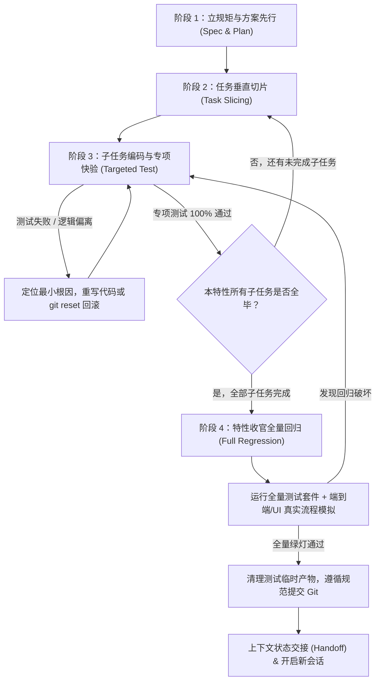

# 通用规范驱动 AI Agent 协同开发工作流 (Universal Spec-Driven Agent Workflow)

本 Skill 旨在解决人机协同编程中的典型困境：**“模型随意幻觉编造、约束边界不清、上下文越长越健忘、拆东墙补西墙（修 A 坏 B）以及人类沦为盲目点击确认的旁观者”**。

通过建立**“以人类为架构质检员、以规范为物理沙箱、以两级测试为质量门禁、以反向考核为认知抓手”**的标准工程流线，适用于任何编程语言（Node.js / Python / Go / Rust / Java / 前端框架等）与技术栈的项目开发。

---

## 一、 协作心智与角色定位 (Mental Model)

* **人类开发者（User）**：**技术主管 (Tech Lead) + 主架构师 + 终审质检员**。
  - 核心职责：把控业务边界、确立架构约束、审查敏感操作、基于自动化测试证据进行交付验收。
* **AI 智能体（Agent）**：**极速高效但需紧拉缰绳的资深实现者**。
  - 核心职责：在既定规范沙箱内进行极速设计、编码、定向自测与最小侵入修复，严禁脱缰野马式的盲目自主。

---

## 二、 通用工程红线与约束挂载 (Universal Red Lines)

Agent 在进入任何项目时，首先必须读取当前项目的规范文档（如根目录的 `GEMINI.md`、`CONSTRAINTS.md`、`CLAUDE.md` 或 `SPEC.md`），并无条件恪守以下**四项通用底线**：

1. **凭据零入库与环境隔离 (Zero-Secrets Leakage)**：
   - 严禁将 API Key、Token、私钥或密码硬编码在源码中，严禁写入会被持久化或导出的业务数据库；
   - 凭据仅存于本地环境变量、受操作系统权限保护的独立隔离文件或内存；
   - 启动子进程或外部工具时，必须剥离包含敏感关键词的环境变量。
2. **依赖与技术栈白名单 (No Hallucinated Dependencies)**：
   - 严禁私自引入未经用户批准的新第三方库或包依赖；
   - 严禁基于概率幻觉臆造不存在的 API 或库函数，所有引用的第三方能力必须有已安装依赖清单或官方文档佐证。
3. **代码完整性与最小差异 (Minimal Diff & No Truncation)**：
   - 编辑现有文件必须输出完整的可替换代码块，**严禁输出 `// ... rest of code remains the same` 等省略占位符**破坏既有逻辑；
   - 遵循最小修改原则，只改动与当前子任务强相关的核心逻辑，严禁未经授权顺手重构周围无关的稳定模块。
4. **高危破坏操作强审批 (Human-in-the-Loop)**：
   - 凡涉及运行外部系统命令、覆写/删除重要文件、删表删库、外部网络写操作的指令，必须挂起并向用户出示意图与入参，等待用户明确批准后方可执行。
5. **确定性优先：严谨计算与精确数据交由代码/工具 (Deterministic First)**：
   - 凡涉及非平凡数值计算、财务/浮点统计聚合、精确日期推算、实时系统状态或结构化事实检索，**必须通过确定性代码或专用工具执行获取**，严禁依赖大模型概率心算或凭记忆猜测；
   - 在架构设计（System Prompt）与质量把关（Critic / Verifier）双层同时约束：若存在可用确定性工具但模型跳过调用直接心算，应视为核验不通过并要求调用工具重算。

---

## 三、 四阶段敏捷交付流线 (Universal 4-Phase SOP)



### 阶段 1：立规矩与方案先行 (Spec & Plan Mode)
- **核心原则**：**不准直接写代码**。
- **执行规则**：
  1. Agent 接收到复杂需求时，先分析项目规范与既有架构，输出《技术实现设计》：
     - 拟修改的文件列表与职责划分；
     - 数据结构/表模型/接口契约的变更；
     - 潜在的兼容性、并发或安全风险；
  2. Agent 主动向用户提出 2~3 个关于业务边界或边界用例的确认问题（可配合 `/grill-me` 互动）；
  3. 用户确认设计后，才启动编码。

### 阶段 2：任务垂直切片 (Task Slicing)
- **核心原则**：**化整为零，单点突破**。
- **执行规则**：
  1. 将复杂功能横向分层、纵向拆解为若干独立可验证的微型任务（Sub-tasks）；
  2. 每个子任务的颗粒度严格控制在：**改动 1~3 个文件、10~20 分钟内可闭环验证**；
  3. 典型的分层切分顺序：
     `数据存储/Schema 模型` $\rightarrow$ `底层核心算法/业务服务` $\rightarrow$ `API 路由/通信协议` $\rightarrow$ `前端 UI/用户交互`。

### 阶段 3：子任务编码与专项快验 (Targeted Testing)
- **核心原则**：**秒级反馈，证据说话**。
- **执行规则**：
  1. **免跑全量套件**：子任务开发迭代期，**严禁频繁运行耗时数十秒至数分钟的全量测试或 E2E 仿真**；
  2. **专项快验 (Targeted Test)**：只针对当前子任务涉及的具体模块运行定向测试（控制在百毫秒~1秒内）：
     ```bash
     # 示例：Node.js
     node --test tests/my-module.test.mjs
     # 示例：Python pytest
     pytest tests/test_my_module.py -k "test_specific_feature"
     # 示例：Go
     go test -run TestSpecificFeature ./internal/service/...
     ```
  3. **终端证据链**：Agent 汇报“已实现/已修复”时，必须附带终端实际测试运行输出，严禁空口保证；
  4. **快速止损与回滚**：若 Agent 连续两次修改未能通过专项测试，立即执行 `git checkout / reset` 回滚至上次干净状态，重新调整思路。

### 阶段 4：特性收官全量回归与接力 (Full Regression & Clean Handoff)
- **核心原则**：**系统级防退化，清爽上下文**。
- **执行规则**：
  1. **双轨全量回归**：所有子任务全部开发完毕、准备合流时，统一执行：
     - ① 全量单元与集成测试套件；
     - ② 端到端真实用户旅程模拟（E2E / CLI / UI）；
  2. **测试产物清理**：测试通过后，立即清理测试运行产生的临时截图、日志与覆盖率报告；
  3. **原子提交**：确认 `git status` 无冗余暂存后，遵循 Conventional Commits（`feat(...)`, `fix(...)`, `docs(...)` 等）提交；
  4. **上下文交接 (Context Handoff)**：
     - 长会话会引起大模型注意力稀释与“上下文中毒”。一个完整特性收官后，让 Agent 输出简短的《进度与状态交接》（说明已完成项与后续代办）；
     - **果断开启清爽的新会话**，让新会话通过读取该文档继续推进下一个特性。

---

## 四、 认知强化：反向考核与情景测试 (Socratic Reverse-Quiz)

为防止用户在高速交付中丧失对架构细节的掌控，建立双向互动的反向测试机制：

### 1. 触发时机
* **架构方案评审前**：通过反问考察需求背后的隐性约束与边界场景；
* **关键模块收官后**：AI 针对刚刚修改的代码核心逻辑与安全边界，主动抛出 1~2 道实战情景题；
* **用户主动要求**：用户可随时输入“*考考我对当前系统架构/安全机制的理解*”。

### 2. 出题维度与原则
* **题型要求**：拒绝背诵概念，侧重真实线上故障与架构抉择情景；
* **覆盖领域**：
  - **安全与合规**：如敏感信息防护、权限边界、注入防御；
  - **并发与资源**：如死循环熔断、连接泄漏、事务隔离；
  - **工程流线**：如重试风暴应对、测试分级权衡。
* **闭环解析**：用户回答后，AI 必须给出深层架构意图解析，并标明源码位置供对照印证。

---

## 五、 通用实战 Prompt 模板库 (User Prompts Cheatsheet)

以下模板可跨项目、跨技术栈直接复用：

### 1. 需求规划与反向对齐（防越权、防过度设计）
> “我想在项目中实现 [功能名称/业务目标]。**请先不要改动任何代码**。请先输出你的实现方案，包括：涉及修改哪些文件、数据结构变化、潜在的兼容性与破坏性风险。并向我提出 2~3 个关于业务边界或边缘用例的确认问题。等我确认后，我们再开始第一步。”

### 2. 子任务代码生成红线（防偷工减料、防乱引依赖）
> “请按照我们刚才确认的方案执行子任务 [1/N: 模块名]。**硬性约束**：  
> 1. 严格使用项目已有依赖，严禁私自引入新第三方库；  
> 2. 修改时输出完整的 drop-in replacement，严禁使用任何 `// ...` 省略占位符；  
> 3. 必须保持原有代码的注释与错误处理风格；  
> 4. 实现完成后，只运行本模块的定向专项测试并汇报输出，先不要跑全量测试。”

### 3. 强制自我批判与审视（破除模型盲目自信）
> “请暂时脱离开发者的身份，**扮演一名极其挑剔的资深系统安全架构师与测试主管**，对刚才这组代码进行严厉的代码审查。找出其中可能存在的：① 并发或未释放隐患；② 边界输入与类型异常；③ 对已有模块的潜在破坏。并给出优化建议。”

### 4. 最小侵入修复（防拆东墙补西墙）
> “测试发现 [具体报错现象 / 复现步骤]。**请遵循最小修改原则（Minimal Diff）**，只修正引发该问题的核心逻辑，不要重构周围无关的代码。修改后请在当前测试文件中增加针对该 Bug 的断言用例，并运行单测证明修复成功。”
