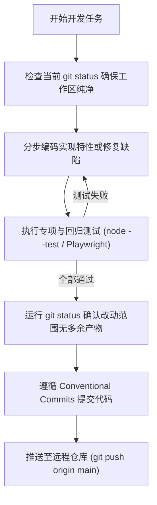

# 栖忆 (QiYi AI Companion) · 项目约束与架构治理规范
# Project Architecture, Governance & Technical Constraints

> **文档版本**：v2.0  
> **生效日期**：2026-11-02  
> **适用范围**：全项目代码实现、文档沉淀、依赖引入、测试用例编写与 Git 提交全生命周期。  
> **核心原则**：本地优先、隐私至上、过程透明、安全可控、无外部构建负担。

---

## 一、 项目定位与核心哲学

栖忆 (QiYi) 是一款专为桌面与移动端设计的**本地优先 (Local-First) AI 伴侣与智能个人工作台**。系统融合了**大语言模型多轮推理 (ReAct Loop)**、**长短期记忆衰减网络与图谱**、**两段式本地知识库检索**、**多媒体与背景音频流伴随** 以及 **中国古典园林视觉系统**。

### 核心设计哲学
1. **本地优先与数据主权 (Local-First & Data Sovereignty)**：
   - 用户的聊天记录、知识文档、人设配置、长期记忆完全保存在本地 SQLite 数据库中。
   - 任何第三方大模型调用只作为纯计算节点，不将本地数据库直接向外部暴露。
2. **零编译构建负担 (Zero-Build Vanilla Architecture)**：
   - 前端采用原生 Modern JavaScript (ESM) + 原生 CSS，不引入 Webpack/Vite/Babel/React/Vue 等重量级编译打包流水线，代码所见即所得，浏览器刷新即生效。
   - 后端使用纯原生 Node.js 内置模块（`node:http`, `node:sqlite`, `node:crypto`, `node:fs` 等），极大降低依赖供应链风险与部署维护成本。
3. **透明可解释与安全受控 (Transparent, Explainable & Guarded)**：
   - 多轮 Agent 推理中的每一步思考与工具调用均对用户透明下发解释。
   - 敏感高危指令（如文件覆写、删除、命令执行）实行强拦截与用户单次凭据审批制度。

---

## 二、 技术选型与架构决策 (ADR)

### 1. 运行时与后端 (Runtime & Backend)
- **选型**：`Node.js >= 22.0.0` (ESM 模块规范 `"type": "module"`)。
- **依据**：
  - Node.js 22 内置了稳定的原生 SQLite 支持（`node:sqlite`），省去对 `better-sqlite3` 等需 C++ 本地编译依赖的繁琐安装。
  - 原生提供 `ReadableStream`、`TextEncoder/Decoder`、`fetch` 和 `crypto.randomBytes`，实现纯标准 Web API 兼容器件。
- **约束**：
  - 严禁引入 CommonJS 语法（如 `require()` 或 `module.exports`），全仓保持 `.mjs` 或标准 ESM。
  - HTTP 服务基于 `node:http` 原生实现，严禁无故引入 Express/Koa/Nest 等框架膨胀体积。

### 2. 存储与状态引擎 (Persistence & State Engine)
- **选型**：`node:sqlite` (SQLite 3 嵌入式事务引擎)。
- **核心模式**：
  - 生产与单机采用本地文件模式（默认路径 `data/agent.sqlite`），测试采用内存模式 (`:memory:`)。
  - 启用 WAL 模式与外键约束，读写事务采用 `store.transaction(() => { ... })` 保证原子性。
- **严格安全红线**：
  - **严禁将 API Key 等机密凭据明文持久化存储在 SQLite 数据库中**。API Key 仅能保存在受操作系统权限控制的独立本地文件（如 `data/model-key.local`）或作为内存临时凭据。

### 3. 检索与知识库架构 (Retrieval & Knowledge Base)
- **选型**：轻量级内嵌 BM25 分词索引 + 启发式语义分块 + 向量嵌入 (Vector Embeddings) 扩展接口。
- **检索设计**：
  - **两段式精细检索**：第一阶段进行标题与结构化分块过滤；第二阶段进行重叠滑动窗口全文检索。
  - **向量库演进约束**：向量化支持必须设计为可插拔式混合召回（RRF - Reciprocal Rank Fusion），当未配置外部向量服务或本地模型时，系统必须平滑降级为高效的本地内嵌分词索引，确保离线全功能可用。

### 4. ReAct 多轮推理循环引擎 (Agent Loop Engine)
- **选型**：自研轻量级可解释 ReAct (Reasoning + Action) 循环引擎 ([`lib/agent-loop.mjs`](file:///e:/tools/wangshen/ai-companion/lib/agent-loop.mjs))。
- **关键参数与约束**：
  - **动态可调轮数 (0～100 轮)**：默认 20 轮。当用户配置为 `0` 时，系统自动旁路跳过工具调用逻辑，直接单轮回复。
  - **5 次连续调用熔断 (5-Time Duplicate Breaker)**：通过规范化 JSON 序列化工具入参哈希指纹，连续 5 次发起相同调用的死循环将被立即熔断，强制模型根据已有观测结果收敛输出。
  - **5 次连续失败阻断 (5-Time Failure Breaker)**：当外部工具发生网络故障或执行错误连续达 5 次时，立即阻断工具链继续调用，保护系统资源。
  - **步骤可解释性**：每一轮推理必须产出步骤意图 (`explanation`)，并通过 SSE 以 `thought_step` 实时同步给前端。

### 5. 指令安全检测与审批凭据 (Instruction Safety Inspector)
- **选型**：密码学凭据驱动的指令安全拦截系统 ([`lib/instruction-inspector.mjs`](file:///e:/tools/wangshen/ai-companion/lib/instruction-inspector.mjs))。
- **安全等级**：支持 `'strict'`、`'standard'`（默认）、`'loose'` 三档。
- **审批 Ticket 机制**：
  - 安全工具（如 `calculator`、`knowledge_deep_search`、`get_system_time`）评级为 `safe` 直接放行。
  - 高危破坏性工具（如执行命令、写文件、删库删表、发信）评级为 `sensitive` 或 `critical`，自动拦截并签发凭据。
  - Ticket 具备 **64 位密码级随机 Token**、**10 分钟 TTL 过期时效**，且必须通过 `consume()` 实现**防重放（Anti-Replay）一次性原子消费**。

### 6. Skill 注册中心与 MCP (Model Context Protocol) 体系
- **选型**：统一工具注册中心 ([`lib/tool-registry.mjs`](file:///e:/tools/wangshen/ai-companion/lib/tool-registry.mjs)) + Stdio JSON-RPC 2.0 MCP 客户端 ([`lib/mcp-manager.mjs`](file:///e:/tools/wangshen/ai-companion/lib/mcp-manager.mjs))。
- **内置 Skill 安全原则**：
  - `calculator`：必须使用词法白名单 + 严格沙箱解析器 [`safeEvaluateMath`](file:///e:/tools/wangshen/ai-companion/lib/tool-registry.mjs#L1-L20)，严禁直接使用裸 `eval()` 或未受限的 `Function()`，阻断沙箱逃逸与原型链污染。
- **MCP 服务接入原则**：
  - 支持通过 stdio 管道接入标准 MCP 外部进程，严格遵循 JSON-RPC 2.0 协议规范，并受全局调用超时（默认 15s）与 AbortController 信号控制。

### 7. 前端视觉与设计系统 (Frontend & Classical Garden UI)
- **选型**：原生 HTML5 + CSS Variables + 经典中国古典园林视觉设计系统 ([`public/garden.css`](file:///e:/tools/wangshen/ai-companion/public/garden.css))。
- **主题规范**：
  - 支持 `spring`（春园·青绿温玉）、`autumn`（秋庭·金粟古朴）、`night`（夜雨·玄青水墨）三套沉浸主题。
  - 所有表单控件、弹窗、下拉选择器必须严格使用主题色彩变量（`var(--paper-card)`, `var(--ink)`, `var(--frame-accent)`, `var(--bamboo)` 等），严禁硬编码纯白（`#ffffff`）导致暗色模式下出现白底刺眼与文字冲突。
- **双轨组件规范**：
  - 自定义卡片组件（如 `.persona-picker-dropdown`）在视觉上承载典雅国风排版；
  - 隐式可访问的原生控件（如 `<select id="chat-persona" class="persona-native-select">`）作为 DOM 底座并存，确保 Playwright 端到端测试与屏幕阅读器无障碍化。

---

## 三、 文档与代码目录结构规范

```
ai-companion/
├── CONSTRAINTS.md             # 本规范约束文件（项目架构治理基准）
├── README.md                  # 项目主说明文档
├── package.json               # 项目元数据与依赖定义（零多余运行时依赖）
├── playwright.config.mjs      # Playwright 端到端浏览器测试配置
├── server.mjs                 # 主 HTTP/SSE 服务入口与路由网关
├── lib/                       # 核心领域逻辑与服务层（ESM）
│   ├── agent-loop.mjs         # ReAct 多轮推理循环引擎（熔断/阻断/可解释流）
│   ├── chat-state.mjs         # 会话短期情感与意图状态机
│   ├── chat-stream.mjs        # 流式传输协议与可见正文解析
│   ├── instruction-inspector.mjs # 指令安全检测与凭据生命周期
│   ├── knowledge.mjs          # 本地知识库切片、索引与检索
│   ├── mail.mjs               # 本地/SMTP 邮件收发与草稿引擎
│   ├── mcp-manager.mjs        # MCP JSON-RPC 2.0 客户端与外部进程管理
│   ├── media.mjs              # 音乐搜索播放与表情包资源管理
│   ├── memory.mjs             # 长期记忆衰减、图谱与召回
│   ├── model.mjs              # OpenAI 兼容大模型客户端协议适配
│   ├── pets.mjs               # 桌面宠物伴侣交互与动作调度
│   ├── response-policy.mjs    # 伴侣回应策略与意图裁决
│   ├── scheduler.mjs          # 本地定时任务调度器
│   ├── semantic-answer.mjs    # 语义对话编排与知识图谱融合
│   ├── service.mjs            # 核心业务聚合 API 服务层
│   ├── store.mjs              # SQLite 数据库模型与事务底座
│   └── tool-registry.mjs      # 统一 Skill/MCP 工具注册中心与沙箱安全计算
├── public/                    # 前端原生静态资源（零构建）
│   ├── index.html             # 单页应用入口与 SVG 园林窗格图案定义
│   ├── app.js                 # 前端核心交互控制器与组件渲染
│   ├── styles.css             # 基础工作台布局与样式
│   ├── garden.css             # 中国古典园林色彩与视觉系统（核心）
│   ├── media.css / mail.css / pets.css / chat-state.css ... # 模块化样式
│   └── streaming.js           # 前端 SSE 流解析器
├── docs/                      # 架构评审、演进方案与工程复盘文档
│   ├── system-architecture-and-remediation-analysis-2026-11-02.md # 系统缺陷与深度修复架构分析
│   ├── vector-knowledge-base-analysis-2026-11-02.md               # 向量知识库选型与混合检索原理分析
│   ├── music-player-and-media-ui-guide.md                         # 媒体播放与浮层穿透工程避坑指南
│   └── ...                    # 领域特性与历史评审报告
├── tests/                     # 自动化测试套件
│   ├── *.test.mjs             # 单元与集成测试（node:test 执行，>800 用例）
│   ├── *.spec.mjs             # Playwright 浏览器端到端测试（桌面与移动端视口）
│   └── helpers.mjs            # 测试辅助函数与 Mock 桩
└── data/                      # 运行时本地数据目录（Git 忽略，仅本地持久化）
    ├── agent.sqlite           # SQLite 运行时数据库
    ├── model-key.local        # 本地加密隔离存储的 API Key（绝不入库）
    └── music-cache/           # 音乐媒体本地分片缓存
```

---

## 四、 开发规范与严格工程红线

### 1. 安全红线 (Security Redlines)
- **禁止密钥入库**：任何新增功能中，涉及 API Key、密码、Token 的字段，严禁写入 `agent.sqlite` 的任何数据表。
- **禁止裸代码执行**：严禁在代码中直接使用 `eval(...)`、`new Function(rawUserInput)` 执行不可信字符串。数学表达式计算必须经过词法分析白名单过滤。
- **外部输入隔离**：由用户导入的文档、外部检索的网页、记忆片段在组装进 Prompt 时，一律视为**不可信参考资料**，必须通过系统级前置提示词进行指令边界隔离，防止 Prompt 注入攻击。

### 2. 状态与并发控制 (Concurrency & Lifecycle)
- **会话单并发互斥锁**：针对同一 `conversationId`，在模型生成中必须上锁（`chatLocks.add(id)`），阻断并发重叠提问，生成完成或异常终止时必须在 `finally` 块释放。
- **信号全链路传递**：所有的异步请求、流式传输、工具执行均必须向下透传 `AbortSignal`。客户端连接关闭时，服务端需立即触发 `abort()` 中断上游推理与模型计费。

### 3. API 与通信规范 (API Protocol Standards)
- **REST 规范**：遵循语义化 HTTP 动词（`GET`, `POST`, `PUT`, `DELETE`）。
- **统一错误码**：
  - `400`：入参校验失败或格式错误。
  - `404`：资源不存在。
  - `409`：状态冲突（如会话正在生成回复、已有同名任务等）。
  - `410`：审批凭证已过期失效。
  - `413`：请求体超限。
  - `415`：不支持的媒体格式。
  - `416`：媒体范围请求不可用。
  - `499`：客户端主动取消回复生成。
  - `500`：本地系统异常。
  - `502`：大模型或第三方服务返回协议异常。
- **SSE 事件命名标准化**：
  - `status`：流程状态切换（如 `thinking`, `finalizing`）。
  - `reasoning`：模型思考内容流式输出。
  - `content`：最终正文内容增量分片。
  - `thought_step`：Agent 循环推理意图步骤与工具决策解释。
  - `approval_requested`：高危指令等待用户审批事件（含凭据 ID 与参数明细）。
  - `tool_result`：工具执行结果与观测反馈。
  - `done`：任务全量完成并返回持久化数据结构。
  - `error`：异常事件中止。

### 4. 前端交互与响应式准则 (Frontend & Mobile First)
- **小屏自适应原则**：
  - 核心界面必须严格通过 320px、390px（移动端）与 1024px、1280px、1366px（桌面端）视口测试。
  - 移动端输入框（Composer）必须稳定固定在触手可及的视口底部，禁止因侧边栏高度撑开导致页面整体出现双滚动条或外溢。
- **幽灵浮层防护**：
  - 原生 `<dialog>` 元素在关闭状态下禁止与 CSS `display: flex` 发生伪类冲突，避免形成不可见的点击拦截穿透。
- **动效减弱适配**：
  - 必须完整支持 `@media (prefers-reduced-motion: reduce)`，在该模式下静默跳过开场序列动画并停止无休止的鱼池或游园动画，保持即刻可交互。

---

## 五、 Git 提交与质量保障流线 (Quality Assurance Workflow)

为保证项目代码健康度与回溯追踪，所有开发者与 AI 协同助手必须严格遵守以下协作流程：



### 提交格式标准 (Conventional Commits)
- `feat(...)`: 新功能或扩展特性（如 `feat(agent): 实现多轮可解释推理循环引擎`）
- `fix(...)`: 缺陷修复（如 `fix(ui): 修复角色选择器暗色模式下白底黑字问题`）
- `perf(...)`: 性能优化（如 `perf(semantic): 优化会话记忆快照复用`）
- `docs(...)`: 文档沉淀与更新（如 `docs(governance): 新增项目约束与架构治理规范`）
- `test(...)`: 测试用例增补或调整（如 `test(security): 新增指令审批凭据过期防重放测试`）
- `chore(...)`: 依赖或工程清理（如 `chore(cleanup): 清理过期测试日志并更新 gitignore`）
