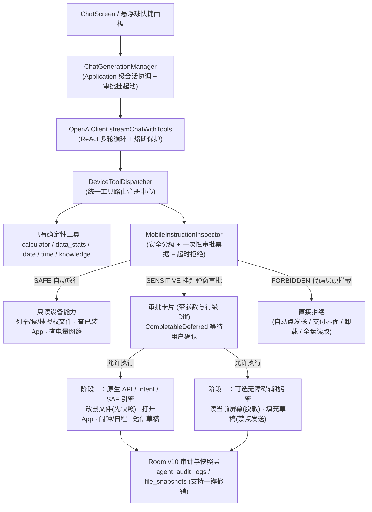

# 栖忆 (QiYi Android) 手机控制 Agent 两阶段改造开发方案

> **编写日期**：2026-11-28  
> **适用范围**：`android/` 原生 Kotlin + Jetpack Compose 客户端（当前基准：`Room v9`，提交 `5d62f66`）  
> **核心理念**：**原生 API / Intent 优先，无障碍读屏与草稿填充作为可选增强；高危动作强审批、文件改动可撤销、社交发送与支付永远由人手收尾（Human-in-the-Loop）。**

---

## 一、总体架构与安全治理底座

当前 Android 端已具备 [DeterministicToolRegistry.kt](file:///e:/tools/wangshen/ai-companion/android/app/src/main/java/com/qiyi/companion/data/tools/DeterministicToolRegistry.kt)（纯计算/时间/书阁检索）、[OpenAiClient.kt](file:///e:/tools/wangshen/ai-companion/android/app/src/main/java/com/qiyi/companion/data/network/OpenAiClient.kt)（ReAct 工具调用循环 + 5 次重复熔断 + 5 次失败阻断）与 [ChatGenerationManager.kt](file:///e:/tools/wangshen/ai-companion/android/app/src/main/java/com/qiyi/companion/data/chat/ChatGenerationManager.kt)（Application 级按会话隔离的后台推理引擎）。

改造后，将在现有工具循环前插入**移动端指令安全检测与审批网关**，并接入第一、第二两阶段设备能力引擎：



### 1.1 四条不可突破的工程与安全红线

1. **三级安全分级（对标 `GEMINI.md`）**：
   - `SAFE`（自动放行）：查看已装应用列表、列举/读取/搜索用户明确授权目录内的文件、读取设备电量/网络状态、基础计算与书阁检索。
   - `SENSITIVE`（强制挂起审批）：新建/修改/覆盖/删除授权目录文件、设置闹钟或日程、跳转短信/分享草稿、向第三方输入框填入草稿；「打开外部 App」与「读取当前屏幕」在**标准模式**下可配置为一键放行，在**严格模式**下强制审批。
   - `FORBIDDEN`（代码层硬性禁区，不向模型暴露工具，且在无障碍层二次兜底拦截）：
     - 自动点击微信 / QQ / 短信的「发送」按钮；
     - 读取或操作银行、支付、密码管理器、系统权限弹窗（硬编码敏感包名黑名单 + `isPassword == true` 字段过滤）；
     - 申请全盘存储（`MANAGE_EXTERNAL_STORAGE`）或修改非授权目录；
     - 静默卸载软件、修改系统核心配置。
2. **防重放一次性审批票据**：
   - 每个待审批动作由 `MobileInstructionInspector` 签发 **64 位随机 `ticketId`**、绑定精确的 `(conversationId, toolName, normalizedArgsHash)`、设置 **10 分钟 TTL**，通过原子消费确保每张票据只能放行一次；用户点击「停止生成」或超时未确认时，立即取消并拒绝执行。
3. **外部数据 Prompt 注入隔离屏障**：
   - 任何从手机本地文件或第三方 App 屏幕读取的文本，返回给大模型前**一律包裹在边界标签内**：
     ```text
     <untrusted_device_data source="file:notes/todo.md">
     ...原始内容（已截断超长部分）...
     </untrusted_device_data>
     ```
   - System Prompt 明确声明该标签内文字仅为参考数据，**绝不能当作新的用户指令去触发写文件、打开软件或发消息**。
4. **凭据零泄露**：
   - API Key 依然严格保留在 Android Keystore（`SecurePreferences`），不写入 Room 审计表与文件快照；审计日志自动对疑似密钥/令牌字段做脱敏掩码处理。

---

## 二、第一阶段设计：原生 API / Intent / SAF 沙箱工作区

> **目标**：零风控、零外挂、纯 Android 官方机制，不依赖无障碍服务即可稳定完成「打开软件、安全改文件、查设备状态、定闹钟/加日程、起草消息」。  
> **依赖策略**：全部使用 Android 原生框架 API（`DocumentsContract`、`PackageManager`、`AlarmClock`、`CalendarContract`、`BatteryManager`），**零新增第三方 Gradle 依赖**，完全兼容离线构建。

### 2.1 `MobileInstructionInspector` 与挂起审批通道

- **新增文件**：`data/agent/MobileInstructionInspector.kt`
- **数据结构**：
  - `enum class ToolRiskLevel { SAFE, SENSITIVE, FORBIDDEN }`
  - `enum class SecurityPolicyMode { STANDARD, STRICT }`（存 `SecurePreferences`）
  - `data class ApprovalTicket(ticketId, conversationId, toolName, title, summary, diffPreview, argsJson, createdAt, expiresAt)`
- **流式协议扩展**（[OpenAiClient.kt](file:///e:/tools/wangshen/ai-companion/android/app/src/main/java/com/qiyi/companion/data/network/OpenAiClient.kt)）：
  - `StreamChunk` 新增 `ApprovalRequested(ticket)` 与 `ApprovalResolved(ticketId, approved, note)`。
  - `streamChatWithTools(...)` 新增可选参数 `toolExecutor: suspend (name: String, args: JsonObject) -> String`（替换写死的 `DeterministicToolRegistry.execute`），彻底解耦工具执行与网络循环。
- **挂起与恢复机制**（[ChatGenerationManager.kt](file:///e:/tools/wangshen/ai-companion/android/app/src/main/java/com/qiyi/companion/data/chat/ChatGenerationManager.kt)）：
  - 维护 `pendingApprovals: StateFlow<Map<String, ApprovalTicket>>` 与内部 `ConcurrentHashMap<String, CompletableDeferred<Boolean>>`。
  - 当敏感工具触发审批时，后台协程 `withTimeoutOrNull(10 * 60_000L) { deferred.await() }` 安全挂起；若此时 App 处于后台，同步更新前台通知文案为「等待确认：望舒请求修改 `todo.md`」，点击通知直达审批卡片。
- **前端审批卡片**（[ChatScreen.kt](file:///e:/tools/wangshen/ai-companion/android/app/src/main/java/com/qiyi/companion/ui/screens/ChatScreen.kt)）：
  - 沿用栖忆 `IosSquircleShape(20.dp)` + 朱砂/金线警示胶囊，清晰展示：
    - 操作类型标题（如「修改授权文件：`工作清单.md`」）
    - 精简参数摘要 + 可展开的 **统一行级 Diff 预览**（绿色 `+` 新增行、朱砂色 `-` 删除行）
    - 底部双按钮：**「拒绝」**（次按钮）与 **「允许执行」**（竹青主按钮）。

### 2.2 `SafFileWorkspaceEngine`（白名单沙箱文件引擎 + 快照撤销）

- **新增文件**：`data/agent/SafFileWorkspaceEngine.kt`
- **授权方式**：
  - 用户在「设置 → 手机助理 → 授权文件夹」点击「添加目录」，唤起系统 `ActivityResultContracts.OpenDocumentTree()`。
  - 拿到 `treeUri` 后执行 `contentResolver.takePersistableUriPermission(uri, READ or WRITE)`，将目录元信息写入 Room `authorized_directories` 表。
  - 每次文件操作前强校验目标路径必须落于已授权目录树内，禁止 `..` 路径穿越。
- **暴露给大模型的工具定义**：

| 工具名 | 风险等级 | 核心参数 | 行为与边界约束 |
| :--- | :--- | :--- | :--- |
| `device_list_files` | `SAFE` | `dir_alias?`, `subpath?`, `max_depth?` (默认 2，上限 3) | 列举授权目录内文件与子目录（最多返回 100 项，附大小与修改时间）。 |
| `device_read_file` | `SAFE` | `dir_alias`, `path`, `start_line?`, `max_lines?` (默认 200) | 读取 UTF-8 文本类文件（`.md/.txt/.json/.csv/.kt/.py` 等，单次上限 24KB），返回带行号内容并包裹 `<untrusted_device_data>`。 |
| `device_search_files` | `SAFE` | `query`, `dir_alias?`, `search_content?` | 按文件名或文本内容检索匹配项（最多返回 20 条命中摘录）。 |
| `device_write_file` | `SENSITIVE` | `dir_alias`, `path`, `mode` (`patch` \| `append` \| `overwrite` \| `create`), `target_text?`, `content` | 优先推荐 `patch` 精准局部替换；审批前自动生成**行级 Diff** 供用户预览；执行前将原文件写入 `file_snapshots` 快照表。 |
| `device_delete_file` | `SENSITIVE` | `dir_alias`, `path` | 强制审批；删除前强制备份完整内容至 `file_snapshots`，支持在日志页一键恢复。 |

- **一键撤销机制**：
  - 每次 `device_write_file` / `device_delete_file` 成功后，在聊天工具结果胶囊与审计日志页均展示「撤销此改动」按钮，直接从应用私有快照目录把原内容写回目标 SAF `DocumentUri`（若原为新建则删除新建文件）。

### 2.3 `AppLauncherEngine`（已装应用匹配与启动）

- **新增文件**：`data/agent/AppLauncherEngine.kt`
- **Manifest 最小权限声明**（[AndroidManifest.xml](file:///e:/tools/wangshen/ai-companion/android/app/src/main/AndroidManifest.xml)）：
  - 使用合规的 `<queries>` 声明 `ACTION_MAIN` + `CATEGORY_LAUNCHER`（仅能查询用户桌面可见的应用，不申请高危 `QUERY_ALL_PACKAGES`）：
    ```xml
    <queries>
        <intent>
            <action android:name="android.intent.action.MAIN" />
            <category android:name="android.intent.category.LAUNCHER" />
        </intent>
    </queries>
    ```
- **内置常用中文别名映射表**（提升口语命中率）：如「微信 → com.tencent.mm」「B站 / 哔哩哔哩 → tv.danmaku.bili」「高德 → com.autonavi.minimap」「网易云 → com.netease.cloudmusic」「QQ音乐 → com.tencent.qqmusic」「淘宝 / 京东 / 抖音 / 飞书 / 钉钉 / 小红书 / 备忘录 / 相机 / 设置」等，并与系统实时 `PackageManager` 查询结果做模糊匹配。
- **暴露工具**：
  - `device_list_apps`（`SAFE`）：按关键词 `query` 搜索已安装可启动应用，返回前 15 条 `(app_name, package_name)`。
  - `device_open_app`（标准模式可直开或轻确认 / 严格模式 `SENSITIVE`）：根据 `package_name` 或 `app_name` 拉起应用（若命中多个候选则返回列表让模型澄清，不乱开）。

### 2.4 `SystemActionEngine`（系统日程、闹钟、消息草稿与设备状态）

- **新增文件**：`data/agent/SystemActionEngine.kt`
- **Manifest 补充**：`<uses-permission android:name="com.android.alarm.permission.SET_ALARM" />`（普通安装级权限，无需运行时弹窗）。
- **暴露工具**：

| 工具名 | 风险等级 | 核心参数 | 实现机制 |
| :--- | :--- | :--- | :--- |
| `device_get_status` | `SAFE` | 无 | 读取电量百分比、是否充电、网络状态（Wi-Fi/蜂窝/离线）、静音/震动模式。 |
| `device_set_alarm` | `SENSITIVE` | `mode` (`alarm` \| `timer`), `hour?`, `minute?`, `seconds?`, `label?` | 调用 `AlarmClock.ACTION_SET_ALARM` / `ACTION_SET_TIMER`（`EXTRA_SKIP_UI = false` 默认打开系统时钟确认页，安全可视）。 |
| `device_create_calendar_event` | `SENSITIVE` | `title`, `start_iso`, `end_iso?`, `location?`, `description?` | 调用 `Intent(ACTION_INSERT).setData(CalendarContract.Events.CONTENT_URI)` 预填日程，拉起系统日历保存页（**免申请日历读写隐私权限**）。 |
| `device_prepare_message` | `SENSITIVE` | `channel` (`sms` \| `share`), `recipient?`, `text` | `sms` 走 `ACTION_SENDTO("smsto:...")` + `sms_body` 预填短信；`share` 走 `ACTION_SEND` 拉起系统分享面板（可直接点微信/QQ 好友发过去），**永远由人手点发送**。 |

---

## 三、第二阶段设计：可选无障碍读屏 + 悬浮球 + 半自动草稿填充

> **定位**：作为「默认关闭、按需开启」的高级辅助模块。关闭时无后台服务、零额外耗电、零敏感权限申请。

### 3.1 `QiYiAccessibilityService`（按需拉取、隐私过滤、禁点发送）

- **新增文件**：
  - `data/agent/a11y/QiYiAccessibilityService.kt`
  - `data/agent/a11y/ScreenTreeExtractor.kt`
  - `res/xml/qiyi_accessibility_service.xml`
- **服务配置原则（省电 + 防误触）**：
  - 仅监听 `typeWindowStateChanged`（记录最近前台非栖忆 App 的包名），**不开启持续全量事件监听**，只在用户点悬浮球或 Agent 调用读屏工具时，主动按需读取一次 `rootInActiveWindow`。
  - 声明 `android:canRetrieveWindowContent="true"`，**不声明** `canRequestFilterKeyEvents`（不监听键盘击键，彻底杜绝记录密码风险）。
- **硬编码隐私与风控黑名单 (`ScreenPrivacyGuard`)**：
  - 命中以下任一条件直接拒读并提示原因：
    1. 敏感金融/认证包名黑名单：支付宝、云闪付、主流手机银行、微信支付/收银台界面（`Wallet` / `Pay` Activity 类名特征）、密码管理器、系统锁屏与权限授权页；
    2. 任意 `node.isPassword == true` 的输入框节点一律跳过，绝不提取文本。
- **结构化屏幕提纯 (`ScreenTreeExtractor`)**：
  - 递归遍历可见节点（`isVisibleToUser == true`），合并相邻碎片文本、去重装饰性文案，输出结构化紧凑表示（上限 4,000 字符）：
    - 当前应用名与包名
    - 页面主体内容（按从上到下阅读顺序整理）
    - 可编辑输入框摘要（例如：`[input#0] hint="发送消息..." current=""`）
- **暴露给大模型的阶段二工具**：

| 工具名 | 风险等级 | 核心参数 | 行为与硬性安全约束 |
| :--- | :--- | :--- | :--- |
| `screen_read_current` | 标准模式 `SAFE` / 严格模式 `SENSITIVE` | `max_chars?` (默认 3000) | 返回当前（或刚刚离开的第三方 App）的脱敏屏幕文本摘要，严格包裹 `<untrusted_device_data source="screen:...">`。 |
| `screen_fill_draft` | `SENSITIVE`（强制审批） | `text`, `target_hint?` | 在当前前台 App 中定位唯一/最匹配的 `isEditable && !isPassword` 输入框，通过 `ACTION_SET_TEXT` 填入草稿（若定位失败则自动降级为写入剪贴板并 Toast 提示）；**代码层严禁触发任何发送按钮点击**。 |

### 3.2 `QiYiFloatingOrbService`（古典园林玉印悬浮球 + 快捷面板）

- **新增文件**：
  - `data/agent/overlay/QiYiFloatingOrbService.kt`
  - `ui/overlay/FloatingOrbContent.kt`
- **Manifest 声明**：`<uses-permission android:name="android.permission.SYSTEM_ALERT_WINDOW" />`（用户主动开启悬浮球开关时才引导前往系统授权）。
- **视觉与交互设计（保持栖忆古典园林美学）**：
  - **收起态（玉印圆珠）**：`48dp` 半透明液态玻璃圆珠，内嵌「望 / 栖」竹青小印，默认贴右边缘半隐藏（不遮挡其他 App 正常滑动），支持自由上下拖动、拖到底部「×」区域临时关闭。
  - **展开态（悬浮轻面板，圆角 `24dp`）**：点击圆珠展开紧凑浮层，不打断当前 App：
    1. **「读屏总结」**：一键提取当前屏幕文本，快速生成摘要/翻译/核心要点；
    2. **「帮拟回复」**：读取当前聊天屏幕最近几句，结合当前人设语气生成 2～3 条简短回复建议，点击某条即调用 `screen_fill_draft` 填入输入框（或复制），由用户亲自点发送；
    3. **「记入书阁 / 笔记」**：把当前屏幕长文直接保存为栖忆书阁知识文档或写入已授权的 Markdown 笔记文件；
    4. **「对话 / 指令」**：迷你输入框，直接打字下达指令（如「打开高德」「帮我记个明天 9 点开会的日程」），支持在浮层内直接完成审批卡片确认；
    5. **「回到栖忆」**：带着当前上下文跳回 `MainActivity` 继续深聊。

### 3.3 权限状态中心与国产 ROM 引导

- 在「设置 → 05 手机助理与权限沙箱」中提供可视化诊断面板：
  - **阶段一权限**：已授权文件夹数量（可增删）、已识别桌面 App 数量；
  - **阶段二权限（可选）**：
    - 无障碍服务状态（`已开启` / `未开启` + 一键跳转 `ACTION_ACCESSIBILITY_SETTINGS`）
    - 悬浮窗权限状态（`已授权` / `未授权` + 一键跳转 `ACTION_MANAGE_OVERLAY_PERMISSION`）
    - 电池优化状态（提醒用户将栖忆设为「无限制」以防国产 ROM 杀无障碍/悬浮球）
  - 内置折叠式 **「Android 13+ 受限设置开启说明」**（两步图文指引：应用信息 → 右上角更多 → 允许受限设置 → 返回开启无障碍）。

---

## 四、数据模型演进（Room `v9 → v10`）与配置项

### 4.1 数据库迁移 `MIGRATION_9_10`（[QiYiDatabase.kt](file:///e:/tools/wangshen/ai-companion/android/app/src/main/java/com/qiyi/companion/data/db/QiYiDatabase.kt)）

新增 3 张轻量表（保持现有所有表零破坏）：

1. **`authorized_directories`**
   - `id: String` (PK), `alias: String`（如 `Notes`）, `treeUri: String`, `displayName: String`, `readOnly: Boolean`, `createdAt: Long`
2. **`file_snapshots`**
   - `id: String` (PK), `auditLogId: String`, `directoryId: String`, `relativePath: String`, `documentUri: String`, `operation: String` (`create` \| `modify` \| `delete`), `backupFilePath: String`（应用私有目录快照文件，超 50 条自动滚动清理）, `createdAt: Long`, `restoredAt: Long`
3. **`agent_audit_logs`**
   - `id: String` (PK), `conversationId: String`, `toolName: String`, `riskLevel: String`, `argsSummary: String`, `decision: String` (`auto` \| `approved` \| `rejected` \| `timeout` \| `blocked`), `resultSummary: String`, `snapshotId: String`, `createdAt: Long`

### 4.2 `SecurePreferences` 新增非敏感配置（[SecurePreferences.kt](file:///e:/tools/wangshen/ai-companion/android/app/src/main/java/com/qiyi/companion/data/prefs/SecurePreferences.kt)）

- `deviceAgentEnabled: Boolean = false`（手机助理总开关，默认关闭，用户主动开启）
- `deviceSecurityMode: String = "standard"`（`standard` \| `strict`）
- `allowDirectAppLaunch: Boolean = true`（标准模式下打开 App 是否免审批）
- `floatingOrbEnabled: Boolean = false`（阶段二悬浮球开关，默认关闭）

---

## 五、垂直切片实施排期与分级测试验收计划

遵循 `GEMINI.md` 两级测试规范，拆分为 **7 个独立可验证的垂直切片**，每完成一个切片即执行专项单元测试（`.\gradlew.bat testDebugUnitTest --offline`）与模拟器实测：

| 切片 | 所属阶段 | 核心交付 | 专项验证目标 |
| :--- | :--- | :--- | :--- |
| **P1-1** | 阶段一 | `Room v9→v10` 迁移 + `MobileInstructionInspector` + `OpenAiClient` 可插拔 `toolExecutor` + `ChatGenerationManager` 审批挂起与恢复 | 单测：审批票据签发/超时/一次性消费/停止取消/严格模式分级；`MIGRATION_9_10` 迁移无报错。 |
| **P1-2** | 阶段一 | `SafFileWorkspaceEngine`（列举/读取/检索/Patch修改/删除 + 行级 Diff 生成 + 快照一键撤销） | 单测：路径穿越拦截、`patch` 精准替换与统一 Diff 输出、`<untrusted_device_data>` 隔离包裹、撤销还原。 |
| **P1-3** | 阶段一 | `AppLauncherEngine`（`<queries>` + 别名模糊匹配 + 启动）+ `SystemActionEngine`（电量网络、闹钟、日程、短信/分享草稿） | 单测：中英文/别名匹配排序、边界异常兜底；模拟器实测拉起系统时钟/日历/短信草稿页。 |
| **P1-4** | 阶段一 | `ChatScreen` 审批卡片（含 Diff 展开 + 一键撤销）+ `SettingsScreen`「05 手机助理与权限沙箱」+ 审计日志页 + 系统 Prompt 工具指令注入 | 模拟器端到端实测：添加授权目录 → 对话要求修改 Markdown → 弹出 Diff 审批卡片 → 允许执行 → 验证改动与一键撤销。 |
| **P2-1** | 阶段二 | `QiYiAccessibilityService` + `ScreenPrivacyGuard`（支付/密码黑名单）+ `ScreenTreeExtractor`（屏幕节点提纯）+ `screen_read_current` | 单测：密码节点过滤、支付黑名单拦截、噪声折叠与长度截断；模拟器开启无障碍实测读屏。 |
| **P2-2** | 阶段二 | `screen_fill_draft`（输入框定位与填充 + 严禁点击发送按钮校验 + 剪贴板降级） | 单测：发送/支付按钮硬拦截校验；模拟器实测跨 App 审批后向输入框填入草稿。 |
| **P2-3** | 阶段二 | `QiYiFloatingOrbService`（古典玉印悬浮球 + 读屏总结 / 帮拟回复 / 记入书阁 / 快捷指令面板）+ 权限引导卡片 | 模拟器实测开启悬浮窗 → 切到浏览器/系统备忘录 → 点悬浮球读屏总结并拟回复 → 切回栖忆无缝衔接。 |

---

## 六、待确认的 3 项产品决策

在正式进入 **P1-1** 编码前，建议先确认以下 3 处偏好（均已给出默认推荐）：

1. **打开软件（`device_open_app`）是否需要每次弹窗确认？**
   - **推荐**：标准模式下**直接打开并给出轻提示**（体验最流畅，类似语音助手），严格模式下才弹审批卡片。
2. **文件写入/修改（`device_write_file`）的默认安全策略？**
   - **推荐**：无论标准还是严格模式，**写/改/删文件始终弹 Diff 审批卡片 + 自动留快照支持一键撤销**（只读/搜索文件自动放行）。
3. **阶段二悬浮球的功能侧重？**
   - **推荐**：首批做「**读屏总结 + 帮拟回复（填草稿不代发）+ 记入书阁 + 迷你对话指令**」四合一轻面板，样式保持栖忆玉印液态玻璃风格。
