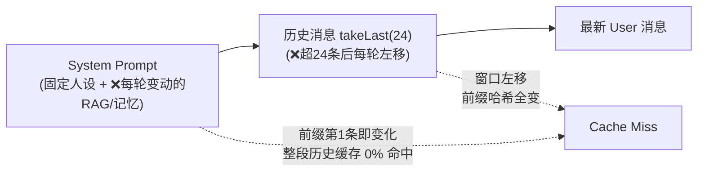
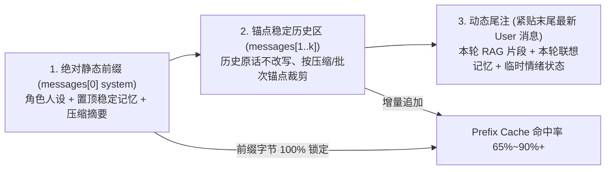

# 栖忆 Android 客户端五项核心体验与架构优化方案

> **文档日期**：2026-11-27  
> **适用范围**：`android/` 纯离线原生 Android 客户端（Kotlin + Jetpack Compose + Room + OkHttp）  
> **覆盖议题**：① 扩大打字区与动态隐藏提示 ② 提升 Prompt Cache 缓存命中率 ③ 音乐播放队列与喜欢/收藏 ④ 系统状态栏媒体控制（暂停/进度条/切歌） ⑤ 回答生成期间自由退出/切换界面与后台保活

---

## 一、 问题总览与根因定位矩阵

| 编号 | 用户反馈问题 | 当前代码根因定位 | 严重度 | 改造范围 |
| :--- | :--- | :--- | :---: | :--- |
| **P1** | 打字区太小，底部提示行应并入打字区（无字显示、打字隐藏） | [ChatScreen.kt](file:///e:/tools/wangshen/ai-companion/android/app/src/main/java/com/qiyi/companion/ui/screens/ChatScreen.kt#L995-L1072)：`BasicTextField` 下方有 `HorizontalDivider` + 固定 `46dp` 提示行常驻占位 | 高 | 前端 Compose UI |
| **P2** | Prompt 缓存命中率很低 | [QiYiRepository.kt](file:///e:/tools/wangshen/ai-companion/android/app/src/main/java/com/qiyi/companion/data/QiYiRepository.kt#L406-L455) 每轮将动态 RAG/记忆拼入首条 `system` 消息且 `takeLast(24)` 滑动破坏前缀；[OpenAiClient.kt](file:///e:/tools/wangshen/ai-companion/android/app/src/main/java/com/qiyi/companion/data/network/OpenAiClient.kt#L60-L173) 流式未传 `stream_options.include_usage` | **极高** | Prompt 组装 + 网络协议 |
| **P3** | 音乐功能待完善（播放队列、喜欢/收藏、模式、曲库） | [Entities.kt](file:///e:/tools/wangshen/ai-companion/android/app/src/main/java/com/qiyi/companion/data/db/Entities.kt#L121-L131) 缺收藏/封面字段；[MusicPlayerEngine.kt](file:///e:/tools/wangshen/ai-companion/android/app/src/main/java/com/qiyi/companion/data/media/MusicPlayerEngine.kt#L130-L232) 无独立播放队列与随机模式；[MusicSheet.kt](file:///e:/tools/wangshen/ai-companion/android/app/src/main/java/com/qiyi/companion/ui/screens/MusicSheet.kt) 无分栏视图 | 高 | Room `v8→v9` + 播放器引擎 + UI |
| **P4** | 播放时系统状态栏/通知栏无控制条（暂停、进度条、下一首） | [AndroidManifest.xml](file:///e:/tools/wangshen/ai-companion/android/app/src/main/AndroidManifest.xml) 缺 `mediaPlayback` 前台服务与权限；无 `MediaSession` 与 `Notification.MediaStyle` | 高 | 前台 Service + 系统 `MediaSession` |
| **P5** | 「回答的时候不能退出界面」是怎么回事 | [QiYiViewModel.kt](file:///e:/tools/wangshen/ai-companion/android/app/src/main/java/com/qiyi/companion/ui/QiYiViewModel.kt#L244-L292) 使用单槽位 `_streaming` 强制拦截切角色/切会话/新建；流式任务挂在 `viewModelScope` 无后台保活，切出 App 易断流 | **极高** | 并发状态架构 + Application 作用域保活 |

---

## 二、 逐项深度检查与优化设计

### 1. 打字区扩容与提示行动态隐藏（P1）

#### 现状问题
在 [ChatScreen.kt](file:///e:/tools/wangshen/ai-companion/android/app/src/main/java/com/qiyi/companion/ui/screens/ChatScreen.kt#L995-L1072) 中，底部输入卡片内部垂直堆叠了：
1. `BasicTextField`（默认单行高度起跳，`maxLines = 4`）
2. `HorizontalDivider` + `8.dp` 间距
3. 固定占位的 `Row`：左侧静态提示文字 `对话保存在本地，发送时调用所选模型`，右侧「发送/停止」按钮。

即使用户正在输入大段内容，下方的分隔线和提示文字依然固定占据近半个输入卡片的高度。

#### 优化方案
- **单一体式大打字区布局**：移除中间 `HorizontalDivider` 与底部提示行，将整个输入卡片内部改为 `Box`/`Row` 融合结构：
  - 文本输入区支持 `minLines = 2`（起步高度更宽敞，约 `68dp`）并自动增高至 `maxLines = 6`；
  - 右下角悬浮对齐圆形/胶囊「发送 / 停止」按钮（`Alignment.BottomEnd`），文本区右侧留出安全边距避免遮挡最后一行字；
- **空态显示提示、有字自动隐藏**：
  - 当 `draft.isEmpty()` 时：在输入区内清晰展示主占位文案（`和望舒聊聊今天的想法...`）+ 紧随其后的柔和副提示（`对话保存在本地，发送时调用所选模型`）；
  - 当 `draft.isNotEmpty()` 时：整组占位与副提示**立即消失**，用户打字内容直接使用全卡片宽度和高度。

---

### 2. Prompt Cache 缓存命中率深度诊断与优化（P2）

#### 为什么当前缓存命中率很低？（4 大实查根因）

主流大模型服务商（OpenAI、DeepSeek、火山方舟 Ark、通义千问、Claude、Gemini）的 **Prefix Prompt Caching** 都遵循同一底层机制：**只有请求体从头开始逐 Token 完全一致的最长公共前缀才能命中缓存**。检查源码后发现 4 处直接导致缓存失效的问题：

1. **根因 1（最致命）：每轮动态检索内容被追加进了首条 `system` 消息**  
   - 位置：[QiYiRepository.kt](file:///e:/tools/wangshen/ai-companion/android/app/src/main/java/com/qiyi/companion/data/QiYiRepository.kt#L409-L455)  
   - 每轮都按当轮提问 `effectiveQuery` 检索不同的 `knowledgeHits`（书阁文档片段）和 `memoryHits`（长期记忆），然后通过 `append(referenceBlock)` 直接拼在首条 `system` 消息末尾。
   - **后果**：每发一条新消息，第 1 条消息（`messages[0]`）字节就会变化 → **后面几十轮对话的 Prefix Cache 全部失效**。

2. **根因 2：固定长度滑动窗口 `takeLast(24)` 破坏长对话前缀**  
   - 位置：[QiYiRepository.kt](file:///e:/tools/wangshen/ai-companion/android/app/src/main/java/com/qiyi/companion/data/QiYiRepository.kt#L406-L412)  
   - 会话消息超过 24 条后，每多发 1 条，`takeLast(24)` 就会把最旧的 1 条踢掉，导致 `messages[1]` 发生变化 → **24 条之后的每一轮命中率归零**。

3. **根因 3：流式请求未发送 `stream_options: {"include_usage": true}`**  
   - 位置：[OpenAiClient.kt](file:///e:/tools/wangshen/ai-companion/android/app/src/main/java/com/qiyi/companion/data/network/OpenAiClient.kt#L60-L67)、[L165-L173](file:///e:/tools/wangshen/ai-companion/android/app/src/main/java/com/qiyi/companion/data/network/OpenAiClient.kt#L165-L173)  
   - OpenAI 及多数兼容网关（含火山方舟/通义/硅基流动等）在 `stream: true` 时默认不回传最后一帧 `usage`，导致客户端拿不到服务商真实的 `cached_tokens` / `prompt_cache_hit_tokens`，只能降级走本地估算（估算值中 `cachedPromptTokens` 恒为 `0`），让统计看板看起来缓存命中率极低。

4. **根因 4：ReAct 工具轮次与最终收敛轮次的请求结构不一致**  
   - 位置：[OpenAiClient.kt](file:///e:/tools/wangshen/ai-companion/android/app/src/main/java/com/qiyi/companion/data/network/OpenAiClient.kt#L279-L398)  
   - 首轮带 `tools` 且 `stream: false`，收敛轮却去掉 `tools` 并改写 `tool` 角色为 `user`。因为 `tools` 定义位于模型缓存前缀的最前端，去掉 `tools` 或改写历史角色都会让同一轮内的多步推理也无法命中缓存。

#### 彻底优化方案（动静分层架构）

1. **严格动静分层组装 Prompt**：
   - **静态前缀（`system`）**：仅包含角色 `name` / `tone` / `systemPrompt`、已置顶（`isPinned = true`）且按 `id` 固定排序的核心长期记忆、以及当前已生效的 `contextSummary`。只要不改人设、不重压缩，前缀在多轮中**逐字节零变化**。
   - **动态参考尾注（附着于最后一条 `user` 消息前或末尾包装）**：本轮按需召回的 `knowledgeHits`、非置顶 `memoryHits`、当前情绪状态注入到**最后一条 `user` 消息的不可信参考块中**（仅发给本轮请求，不写回数据库污染历史消息）。
2. **锚点分批裁剪替代逐条 `takeLast(24)`**：
   - 正常对话优先依赖我们刚做好的「会话压缩」机制推进 `compactedUpToMessageId`；
   - 未压缩超长对话采用**步进台阶裁剪**（例如满 40 条时一次性推进丢弃最旧 12 条，而不是每发 1 条滑 1 条），让连续 12 轮内前缀保持完全稳定。
3. **流式默认附带 `stream_options: {"include_usage": true}`**：
   - 在 `ChatCompletionRequest` 中开启 `stream_options`；若遇到少数老旧中转站返回 HTTP 400 拒绝未知字段，自动降级去掉 `stream_options` 无感重试，并记忆该 Base URL 的兼容性。
4. **工具收敛轮保持前缀一致**：
   - 收敛轮尽量保持同一消息结构，不再随意重写已发过的消息角色，并在无需工具时直接流式响应。

---

### 3. 音乐功能完善（队列、喜欢、播放模式、曲库与缓存）（P3）

#### 现状短板
- `MusicTrackEntity`（[Entities.kt](file:///e:/tools/wangshen/ai-companion/android/app/src/main/java/com/qiyi/companion/data/db/Entities.kt#L121-L131)）仅有基础字段，缺少 **喜欢/收藏 (`isFavorite`)**、**专辑 (`album`)**、**封面 (`coverUrl`)**、**最近播放时间 (`lastPlayedAt`)**。
- `MusicPlayerController`（[MusicPlayerEngine.kt](file:///e:/tools/wangshen/ai-companion/android/app/src/main/java/com/qiyi/companion/data/media/MusicPlayerEngine.kt#L126-L236)）的 `playlist` 直接绑定整张本地表，点播在线歌曲后点击「下一首」会跳回本地曲库，缺少真正的**动态播放队列**和**随机播放**。
- 在线搜歌未同步拉取服务器本地曲库 `/api/library`（如服务器已存的《稻香》《江南》《成都》），且 `MediaPlayer` 直连 HTTPS 流遇到 404 时误报成「音频格式问题」。

#### 优化方案
1. **数据层升级（Room `v8 → v9` 无损迁移）**：
   - `music_tracks` 表新增字段：`isFavorite INTEGER NOT NULL DEFAULT 0`、`album TEXT NOT NULL DEFAULT ''`、`coverUrl TEXT NOT NULL DEFAULT ''`、`lastPlayedAt INTEGER NOT NULL DEFAULT 0`；
   - 新增 `play_queue` 表（或在 `SecurePreferences` / Room 持久化队列顺序），确保重启 App 后上次播放队列与进度不丢失。
2. **播放器引擎重构（`MusicPlayerController`）**：
   - **独立播放队列状态**：`queue: List<MusicTrackEntity>`、`currentIndex: Int`、`playMode: PlayMode`（`SEQUENCE` 列表循环 / `REPEAT_ONE` 单曲循环 / `SHUFFLE` 随机播放）、`isBuffering: Boolean`；
   - **完整队列操作 API**：立即播放并插入队列、添加到「下一首播放」、追加到队列末尾、队列内移除、清空队列、一键收藏/取消收藏（收藏在线歌曲时自动持久化到 `music_tracks`，下次可直接从「我喜欢」播放）；
   - **OkHttp 预检 + 本地音频流缓存**：播放远程曲目前先经 OkHttp 携带 `X-API-Key` 请求并校验状态码：
     - `404 no playable source` → 明确提示「该歌曲暂无可用音源（可能 VIP/版权受限或需换源）」；
     - `401/403` → 明确提示「音乐服务密钥鉴权失败」；
     - 支持拉取服务器 `/api/library` 曲库与 `/api/local_play` 播放，并自动缓存近期音频文件到本地 `cacheDir/music_stream_cache`（LRU 上限 256MB），切歌拖动流畅且省流量。
3. **「丝竹乐坊」UI 升级**（[MusicSheet.kt](file:///e:/tools/wangshen/ai-companion/android/app/src/main/java/com/qiyi/companion/ui/screens/MusicSheet.kt)）：
   - 顶部采用 **液态玻璃分段条** 划分 4 个清晰视图：**`播放队列`**｜**`我喜欢`**｜**`曲库`**｜**`搜歌`**；
   - 正在播放卡片新增：**精确时间显示**（`01:18 / 04:29`）、**❤️ 喜欢按钮**、**三态播放模式切换**（列表循环 / 单曲循环 / 随机）、**缓冲加载指示**；
   - 每首歌曲行提供快捷菜单：**播放 / 下一首 / 加入队列 / 收藏❤️ / 移除**。

---

### 4. 系统状态栏 & 通知栏媒体播放控制（P4）

#### 现状问题
目前完全没有前台服务与系统 `MediaSession`，导致：
- 系统状态栏 / 下拉通知栏 / 锁屏界面看不到任何播放状态；
- 无法在通知栏点击暂停、上一首、下一首或拖动进度条；
- 切到后台或息屏后容易被系统回收导致音乐中断，且接电话/看视频不会自动让出音频焦点。

#### 技术实现方案（纯原生 Android Framework，零额外外部依赖，离线可编译）

1. **权限与服务声明**（[AndroidManifest.xml](file:///e:/tools/wangshen/ai-companion/android/app/src/main/AndroidManifest.xml)）：
   - 声明 `android.permission.FOREGROUND_SERVICE`、`android.permission.FOREGROUND_SERVICE_MEDIA_PLAYBACK`、`android.permission.POST_NOTIFICATIONS`；
   - 注册前台服务 `QiYiMusicPlaybackService`（`android:foregroundServiceType="mediaPlayback"`）；
   - 在首次播放音乐（Android 13+ / API 33+）时友好申请 `POST_NOTIFICATIONS` 权限。
2. **原生 `MediaSession` + `Notification.MediaStyle`**：
   - 使用系统内置 `android.media.session.MediaSession` 与 `Notification.MediaStyle().setMediaSession(session.sessionToken)`：
     - 写入 `MediaMetadata`（歌名、歌手、专辑、总时长 `METADATA_KEY_DURATION`、默认/专辑封面 Bitmap）；
     - 实时同步 `PlaybackState`（`STATE_PLAYING` / `STATE_PAUSED` / `STATE_BUFFERING`、当前位置 `positionMs`、支持的操作 `ACTION_PLAY_PAUSE | ACTION_SKIP_TO_NEXT | ACTION_SKIP_TO_PREVIOUS | ACTION_SEEK_TO`）；
     - Android 11–15 系统控制中心会自动渲染带**可拖动实时进度条 + 暂停/播放 + 上一首/下一首**的标准媒体卡片，并同步支持锁屏控制与蓝牙耳机按键！
3. **音频焦点与耳机拔出保护**：
   - 通过 `AudioManager.requestAudioFocus(...)` 监听音频焦点变化（来电、语音或视频播放时自动暂停，焦点恢复时自动恢复）；
   - 注册 `ACTION_AUDIO_BECOMING_NOISY` 广播，拔出耳机/断开蓝牙时自动暂停，防止公放尴尬。

---

### 5. 「回答的时候不能退出界面」问题澄清与根治方案（P5）

#### 明确含义：当前发生了哪两件事？

经过逐行检查 [QiYiViewModel.kt](file:///e:/tools/wangshen/ai-companion/android/app/src/main/java/com/qiyi/companion/ui/QiYiViewModel.kt#L244-L292) 和 [MainActivity.kt](file:///e:/tools/wangshen/ai-companion/android/app/src/main/java/com/qiyi/companion/MainActivity.kt)，造成「回答时无法退出/切走」的是以下 **两个层面的原因**：

1. **App 内部硬性拦截了切换操作**（[QiYiViewModel.kt](file:///e:/tools/wangshen/ai-companion/android/app/src/main/java/com/qiyi/companion/ui/QiYiViewModel.kt#L244-L292)）：
   - 正在生成回复时，如果你想点左侧「历史」切去别的对话、切换人设开启新对话、或者点「新建」，代码会直接拦截并弹出提示：
     - `正在生成回复，请先停止当前生成再切换对话。`
     - `正在生成回复，请先停止当前生成再切换角色。`
   - **根本原因**：当前 ViewModel 里只维护了**一个全局 `_streaming` 变量和单个 `activeStreamJob`**，没有按 `conversationId` 分槽隔离，所以为了防止 A 会话的流式气泡串到 B 会话里，早期采用了“一刀切禁止切换”的保守做法。

2. **切出 App 到后台 / 锁屏后容易断流中断**：
   - 流式请求协程绑定在 `viewModelScope`（跟随 Activity 生命周期），未挂在 `Application` 级长期作用域，也没有短时前台通知保活；
   - 在手机上切到微信或锁屏十几秒后，Android 省电策略/国产 ROM 会冻结后台网络 Socket，导致 SSE 连接被系统强行切断、生成中的回复报错中断。

#### 彻底优化方案（真正做到「发完就能走，后台继续答」）

1. **多会话独立流式任务池（按 `conversationId` 隔离）**：
   - 将流式状态与协程任务从 `QiYiViewModel` 下沉到 `QiYiApplication` 级单例 `ChatGenerationManager`（独立 `SupervisorJob` 作用域，不随 Activity 销毁而取消）；
   - 维护 `streamingByConversation: StateFlow<Map<String, StreamingState>>` 与 `activeJobs: ConcurrentHashMap<String, Job>`：
     - **彻底移除** `selectPersona`、`selectConversation`、`startNewConversation`、`createGroupConversation` 的强制阻断！
     - 正在回答时，你可以随时切去看「书阁 / 人设 / 设置」、切去其他历史会话聊天、甚至同时在另一个会话发新问题；
     - 仅对**同一个 `conversationId`** 保留单并发互斥锁（防同一会话重叠提交），互不干扰；
     - `ChatScreen` 仅展示 `streamingByConversation[activeConversationId]`，绝不串屏；左侧「历史目录」中正在后台生成的会话旁边显示脉冲绿点「生成中…」，方便随时点回查看。
2. **退后台防断流保活 + 断网容错**：
   - 当存在活跃生成任务且 App 退到后台时，可选启动轻量级短时前台通知（`栖忆正在后台整理回复…`，生成完毕即自动撤销或弹出「回复已完成」轻提示），防止国产 ROM 冻结网络 Socket；
   - 若因极端断网导致流式中断，自动将已收到的部分内容安全落库并标记可续接，不丢半截回复。

---

## 三、 分阶段实施路线（垂直切片，每步独立测试与真机验证）

建议按以下 **4 个清晰阶段** 依次推进（每个阶段完成后跑完专项单元测试 + 模拟器实测验证再进入下一阶段）：

| 阶段 | 交付内容 | 核心改动文件 | 验收标准 |
| :---: | :--- | :--- | :--- |
| **Phase 1** | **P1 打字区扩容 & 动态提示** + **P5 回答期间自由切换界面与后台继续生成** | `ChatScreen.kt`, `ChatGenerationManager.kt` (新增), `QiYiViewModel.kt`, `QiYiApplication.kt`, `HistoryDrawer.kt` | 打字区明显变大且打字即隐藏提示；回答中可自由切换会话/人设/页面且原会话后台正常生成并落库 |
| **Phase 2** | **P2 Prompt Cache 动静分层与真实缓存统计** | `QiYiRepository.kt`, `OpenAiClient.kt`, `KnowledgeEngine.kt`, 新增 `PromptCachePrefixTest.kt` | 连续多轮对话 `messages[0]` 字节完全不变；流式拿到服务商真实 `cached_tokens`；单元测试验证缓存前缀稳定性 |
| **Phase 3** | **P3 音乐播放队列、喜欢/收藏、三态模式、服务器曲库与音频流缓存** | `Entities.kt`, `QiYiDatabase.kt` (`v8→v9`), `Daos.kt`, `MusicPlayerEngine.kt`, `MusicSheet.kt`, `QiYiViewModel.kt` | 支持队列管理、下一首插入、❤️ 喜欢持久化、随机/单曲/列表循环、精确进度时间、404 精准提示 |
| **Phase 4** | **P4 系统状态栏/通知栏媒体播放控制与后台稳定播放** | `QiYiMusicPlaybackService.kt` (新增), `AndroidManifest.xml`, `MusicPlayerEngine.kt`, `MainActivity.kt` | 模拟器通知栏与锁屏出现原生媒体卡片，支持播放/暂停、上一首/下一首、拖动进度条、切后台持续播放 |

---

## 四、 实施前确认项

在正式动手写代码前，可以先确认 2 个小偏好（如果都按默认推荐也没问题，直接回复「按方案开始」即可）：

1. **回答期间切到桌面后台时**：是否希望在系统状态栏显示一条轻量提示（如「栖忆正在回复中…」，答完自动消失）来防止手机系统杀后台断网？（**推荐开启**，国产手机后台保活最稳）
2. **音乐在线搜索默认行为**：是否同时优先检索你服务器上的 `/api/library` 已有本地曲目，再补充 QQ/网易云在线结果？（**推荐开启**，与 PC 端一致且秒播不耗上游配额）
