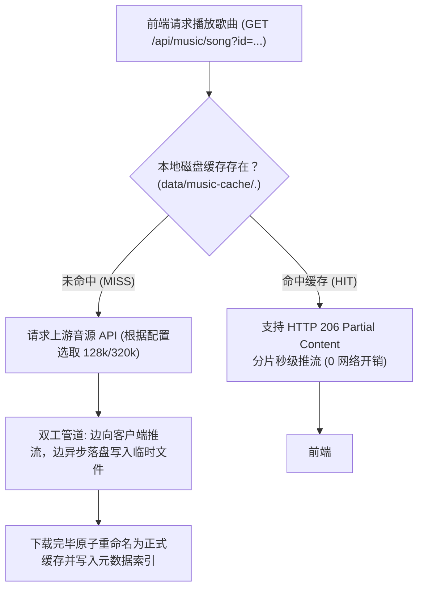
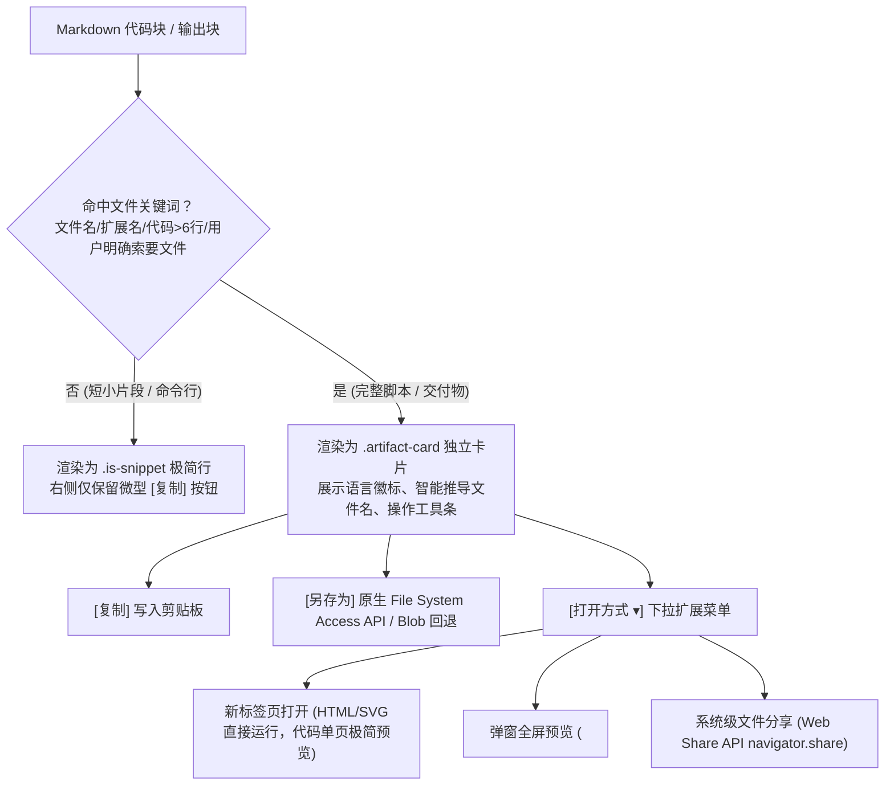

# 栖忆 (QiYi AI Companion) 音乐播放与媒体组件工程落地与避坑指南

> **创建说明**：本文档详细复盘了音乐播放系统在流媒体弱网卡顿、本地磁盘持久化缓存、弹窗交互与双列排版重构、移动端小屏高度塌陷重叠、以及 HTML5 `<dialog>` 与 CSS `display: flex` 优先级冲突导致幽灵层穿透等典型缺陷的根因剖析、修复方案与防御性架构准则。  
> **适用范围**：前端模态交互（`<dialog>`）、音频流媒体传输、本地磁盘缓存系统、Flexbox/CSS Grid 响应式布局与 Playwright 端到端测试。

---

## 目录
1. [背景与架构定位：为什么音乐功能不需要独立页面？](#一背景与架构定位为什么音乐功能不需要独立页面)
2. [问题一：音乐在线播放卡顿与本地缓存架构落地](#二问题一音乐在线播放卡顿与本地缓存架构落地)
3. [问题二：弹窗排版怪异与长垂直滚动条重构（双列控制台）](#三问题二弹窗排版怪异与长垂直滚动条重构双列控制台)
4. [问题三：移动端（320px/390px）点击穿透与元素重叠缺陷](#四问题三移动端320px390px点击穿透与元素重叠缺陷)
5. [问题四：闭合弹窗仍作为幽灵层穿透在页面背后的致命 Bug](#五问题四闭合弹窗仍作为幽灵层穿透在页面背后的致命-bug)
6. [问题五：代码与交付产物分级导出（片段 vs 完整文件、另存为与多模式打开）](#六问题五代码与交付产物分级导出片段-vs-完整文件另存为与多模式打开)
7. [问题六：移动端交互沉浸重构（侧栏沉降、20px 超微按钮防折行）](#七问题六移动端交互沉浸重构侧栏沉降20px-超微按钮防折行)
8. [通用架构与代码避坑清单（Cheatsheet）](#八通用架构与代码避坑清单cheatsheet)

---

## 一、背景与架构定位：为什么音乐功能不需要独立页面？

在用户提出“页面太长、排版奇怪，需不需要新建一个独立页面”时，必须从产品的核心场景与交互模型进行定性分析：

```mermaid
flowchart LR
    subgraph 独立页面模式 (反模式: 割裂对话流)
        A1["正在与 AI 伴侣聊天"] -->|"点击音乐"| B1["路由跳转至 #/music 页面"]
        B1 -->|"失去对话上下文"| C1["搜歌 / 点歌 / 选音量"]
        C1 -->|"必须返回路由"| D1["跳回聊天页面继续输入"]
    end

    subgraph 弹出式双列控制台 (正模式: 伴随式流)
        A2["正在与 AI 伴侣聊天"] -->|"点击音乐图标"| B2["双列控制台原位滑出 (Top Layer)"]
        B2 -->|"原位搜歌 / 点播"| C2["背景音乐静默流转，BGM 不中断"]
        C2 -->|"点击外部遮罩 / 快捷键"| D2["瞬间收起，对话毫无中断感"]
    end
```

### 1. 伴随流（Ambient Context）的核心原则
AI 伴侣的核心体验是交互沉浸感。音乐对于 AI 伴侣而言是**“边聊边听”的背景氛围音（BGM）**，而非音乐播放软件（如 Spotify/网易云独立客户端）。如果为了音乐而开辟单独的 `#/music` 路由：
- 用户为了切歌或调音量必须打断当前的聊天输入；
- 每次路由跳转都带来额外的生命周期切换与渲染开销；
- 削弱了“伴侣在身边为你放歌”的在场感。

### 2. 之前体验糟糕的根本原因
旧界面的槽点并不是“它是弹窗”，而是**“在狭窄的单列中无节制垂直堆叠”**：
- 搜索框、数据源、搜索按钮、音量滑块、循环选择、8 首搜索结果卡片、当前播放信息、待播列表全部串联在 680px 宽的单列内；
- 整体高度超过 900px，必然导致弹窗产生外层滚动条；
- 音量调节硬生生插在搜索按钮和结果之间，造成严重的视觉混乱。

---

## 二、问题一：音乐在线播放卡顿与本地缓存架构落地

### 2.1 缺陷根因
1. **弱网与 SSH 隧道瓶颈**：在远程开发或 SSH 端口转发（如 `127.0.0.1:11001`）环境下，直接从上游在线拉取 320 kbps 高码率音频流，带宽吞吐不足引发频繁的缓冲欠载（Buffer Underrun）。
2. **缺乏本地持久化存储**：即使同一首歌重复点播，系统每次都重新走网络代理下载，无法脱机或离线秒播。
3. **音频标签预加载缺陷**：`<audio>` 元素此前设置为 `preload="none"`，切歌时无法提前握手拉取首包。

### 2.2 解决方案架构



### 2.3 关键落地代码

1. **多档位音质切换（[`lib/music.mjs`](file:///e:/tools/wangshen/ai-companion/lib/music.mjs)）**：
   引入 `musicQuality: "128" | "320"`，在弱网或 SSH 隧道环境下默认采用 `128 kbps`（体积减少 60%，首包提速 3 倍）。
2. **本地磁盘缓存服务（[`lib/media.mjs`](file:///e:/tools/wangshen/ai-companion/lib/media.mjs)）**：
   - 使用 SHA-256 计算歌曲唯一哈希：`const key = createHash('sha256').update(`${source}:${id}`).digest('hex')`；
   - 存储路径：`data/music-cache/${key}.${quality}.audio` 与配套的 `.json` 元数据索引；
   - 遇到断点续传与快进拖动，严格处理 `Range: bytes=start-end` 头并返回 `HTTP 206 Partial Content`；
   - 前端增加“缓存到本地 / 已存本地”按钮，支持显式固化离线音乐。

---

## 三、问题二：弹窗排版怪异与长垂直滚动条重构（双列控制台）

### 3.1 布局架构重构原则

为了兼顾大屏的高效利用与无滚动条体验，将模态弹窗重构为**双列演播室控制台（Studio Deck）**：

| 区域 | 占比 / 尺寸 | 职责与布局特性 |
| :--- | :--- | :--- |
| **顶部标题栏** | `flex-shrink: 0; 16px 22px` | 标题、描述副标题、关闭按钮，采用柔和浅绿底色分界。 |
| **左侧检索栏** | `58% (1.25fr)` | **顶部固定**搜索输入框、来源下拉与搜索按钮；操作胶囊（本地曲库、设置）；**下方自适应独立滚动**展示搜索结果列表（`overflow-y: auto; flex: 1; min-height: 0`）。 |
| **右侧控制栏** | `42% (1fr)` | **顶部**：当前播放大卡片（黑胶唱片图标、歌曲名与歌手实时同步）；<br>**中部**：待播队列（`接下来听` + 待播计数徽章 + 清空按钮，列表独立滚动）；<br>**底部吸附**：音量拖拽滑块与循环模式下拉框。 |
| **弹窗外壳** | 固定宽高定死防撑爆 | `width: min(880px, calc(100vw - 32px)); height: min(620px, calc(100dvh - 56px)); overflow: hidden;` |

### 3.2 现代 Web 规范赋能
- **原生点击外部关闭**：为 `<dialog>` 标记 `closedby="any"`，并在 JS 中监听 `click` 事件匹配点击目标是否为 `dialog` 本身（即 `::backdrop` 伪元素遮罩层），命中即关闭。
- **滚动阻尼防穿透**：配置 `overscroll-behavior: contain`，当用户在弹窗内部结果列表滚动到底部时，阻止页面底层跟随滚动。

---

## 四、问题三：移动端（320px/390px）点击穿透与元素重叠缺陷

### 4.1 缺陷现象
在运行 Playwright 移动端视口测试（`width: 320, height: 844`）时，点击搜索结果列表的“播放”按钮超时失败，Playwright 抛出异常：
```text
locator.click: Target closed
=========================== logs ===========================
waiting for locator('.music-result').filter({ hasText: '安静片刻' }).getByRole('button', { name: '播放', exact: true })
  element is visible, enabled, but <strong id="browser-current-title"> intercepted pointer events!
```

### 4.2 缺陷根因：CSS Grid 与 Flex 容器高度塌陷
在桌面端布局中，左列与结果列表使用了：
```css
.music-col-search { display: flex; flex-direction: column; min-height: 0; }
.music-results { flex: 1; min-height: 0; overflow-y: auto; }
```
而在移动端媒体查询 `@media (max-width: 700px)` 中，布局由双列改成了单列垂直排列：
```css
/* 错误代码示例 */
.music-browser-layout { grid-template-columns: minmax(0, 1fr); overflow: visible; }
.music-results { max-height: 240px; }
```
**为什么会导致元素重叠？**
- 在单列 Grid 中，未指定行高时网格行高度默认为 `auto`；
- `.music-col-search` 是第一行的 Grid Item，其高度由子元素计算；
- 然而，`.music-results` 继承了桌面端的 `flex: 1; min-height: 0;`。当其父容器的高度由内容撑开（`height: auto`）而非确定像素时，Flex 规范中 `flex: 1` 的计算基准 `flex-basis` 为 0，可分配剩余空间为 0！
- 这导致 `.music-results` 的计算高度塌陷为 0（或极小值），第一行高度收缩；
- 第二行的 `.music-col-playlist`（包含 `#browser-current-title`）直接被拉上移到了顶部，直接覆盖在了 `.music-results` 的上方，造成肉眼看似正常但“指针事件被右侧卡片标题截断拦截”的现象！

### 4.3 彻底修复方案
在移动端媒体查询中，明确将双列复杂的弹性比例重置为**标准文档流（Normal Document Flow）**：
```css
@media (max-width: 700px) {
  .music-browser {
    width: calc(100% - 24px);
    height: min(680px, calc(100dvh - 32px));
    max-height: calc(100dvh - 28px);
    overflow: hidden;
  }
  .music-browser-body {
    flex: 1;
    min-height: 0;
    overflow-y: auto; /* 移动端让外层容器统一纵向滚动 */
    display: block;
  }
  .music-browser-layout {
    display: flex;
    flex-direction: column;
    flex: none;
    min-height: auto;
    overflow: visible;
    gap: 16px;
  }
  /* 显式取消内部 flex: 1 和 min-height: 0，避免高度塌陷 */
  .music-col-search, .music-col-playlist, .music-queue {
    display: block;
    flex: none;
    min-height: auto;
  }
  .music-results, #music-queue-list {
    display: flex;
    flex-direction: column;
    flex: none;
    min-height: auto;
    max-height: none;
    overflow: visible;
  }
}
```

---

## 五、问题四：闭合弹窗仍作为幽灵层穿透在页面背后的致命 Bug

### 5.1 缺陷现象
用户切换到任务页面（`#/tasks`）时，发现音乐播放器的整个界面（搜索框、网易云下拉、正在播放卡片、音量滑块）作为底图若隐若现地渲染在所有任务卡片背后。

### 5.2 缺陷根因：CSS 样式表优先级覆盖了 User-Agent 样式
这是非常典型但极易被忽视的前端核心基础机制冲突：

1. **浏览器原生 `<dialog>` 的隐藏原理**：
   浏览器本身不自带任何魔术代码，它依靠 User-Agent 默认样式表来控制 dialog 的显隐：
   ```css
   /* User-Agent 内部样式表规则 (优先级: (0,0,0)) */
   dialog:not([open]) {
     display: none;
   }
   ```
2. **开发者的覆盖失误**：
   为了实现双列 Flex 布局，在样式表中直接对类选择器应用了：
   ```css
   /* 开发者外部样式表规则 (优先级: (0,1,0)) */
   .music-browser {
     display: flex;
     flex-direction: column;
     ...
   }
   ```
3. **层叠机制决定了 Bug 的发生**：
   - 开发者样式表（Author Stylesheet）的优先级 **无条件高于** 浏览器内部样式表（User-Agent Stylesheet）；
   - 无论 `<dialog>` 的 `open` 属性是否存在，`.music-browser` 的 `display: flex` 都会直接胜出，将 `display: none` 覆盖；
   - 此时，即使 JavaScript 执行了 `dialog.close()`，DOM 节点只是失去了 `open` 属性并退出 Top Layer，但因为其计算样式是 `display: flex`，它就会像普通 `<div>` 一样静态渲染在 `<body>` 底部，成为了各个页面底层的“幽灵背景”。

### 5.3 修复方案与规范

**准则：永远不要在 `<dialog>` 的基础类选择器上无条件声明 `display: flex`、`display: grid` 或 `display: block`！**

必须且只能通过 `[open]` 属性选择器来赋予布局属性，并使用 `:not([open])` 施加双重防线：

```css
/* 基础尺寸与视觉装饰（不含 display） */
.music-browser {
  width: min(880px, calc(100vw - 32px));
  height: min(620px, calc(100dvh - 56px));
  max-height: calc(100dvh - 40px);
  overflow: hidden;
  padding: 0;
  border-radius: 20px;
  box-shadow: 0 24px 80px rgba(25, 45, 33, 0.24);
  border: 1px solid var(--line, #d8e0cf);
  background: var(--paper, #f9faf4);
}

/* 核心铁律：未打开时必须 display: none，杜绝幽灵层 */
.music-browser:not([open]) {
  display: none;
}

/* 仅在通过 showModal() 打开后，才激活 Flex 布局 */
.music-browser[open] {
  display: flex;
  flex-direction: column;
}
```

---

## 六、问题五：代码与交付产物分级导出（片段 vs 完整文件、另存为与多模式打开）

### 6.1 缺陷现象与交互痛点
在 AI 助手输出技术回答时，传统实现往往对所有代码块一视同仁：
1. **轻重失衡**：一句简短的命令（如 `npm install`）被强行渲染为一个庞大的产物卡片，带有文件扩展名、重型操作按钮，破坏对话阅读流畅度；
2. **下载途径缺失**：生成完整的程序脚本（如冒泡排序 `bubble_sort.py`）或前端页面（如 `index.html`）时，仅有一个“复制”按钮，用户无法直接保存到本地磁盘，也无法在浏览器中一键预览执行。

### 6.2 分级分类智能判定架构（`isExportableArtifact`）

在 [`public/app.js`](file:///e:/tools/wangshen/ai-companion/public/app.js) 中建立了双轨分类器：



### 6.3 关键技术实现

1. **原生另存为与回退体系**：
   - 优先调用现代化 `window.showSaveFilePicker({ suggestedName, types: [...] })` 调起原生操作系统文件选择器，用户可自由指定保存目录和文件名；
   - 遇到不支持现代 API 的环境（或 HTTP 不安全上下文），无缝降级为 `URL.createObjectURL(new Blob([...]))` + `<a download="...">` 方案触发下载。
2. **多模式打开与渲染沙箱**：
   - **HTML / SVG**：在新标签页或弹窗预览中，将其注入带有 `sandbox="allow-scripts allow-modals"` 的沙箱 `<iframe>`，杜绝 XSS 风险并提供即开即用的动态页面体验；
   - **文本与程序代码**：在新标签页提供独立清爽的等宽代码阅读页，免去在外部编辑器反复打开的繁琐。

---

## 七、问题六：移动端交互沉浸重构（侧栏沉降、20px 超微按钮防折行）

### 7.1 缺陷现象
1. **垂直空间浪费**：在 iPhone 等手机视口（320px ~ 390px）中，侧边栏的角色形象卡片（`.persona-summary`）和记忆列表（`.garden-memory`）占据了顶部大量视口高度，导致用户打开页面第一眼看不到核心对话区，必须往下翻很久；
2. **按钮挤压换行（“复\n制\n代\n码”）**：通用按钮类 `.button.small` 在移动端被全局样式强制赋予了 `min-height: 44px; padding: 10px 13px;`（以符合触屏尺寸），导致在 320px 屏幕上，三个按钮总宽度超过 260px，容器装不下发生折行，按钮内文字被拆成竖排单字。

### 7.2 修复方案与样式隔离

1. **小屏侧边栏信息智能沉降**（[`public/styles.css`](file:///e:/tools/wangshen/ai-companion/public/styles.css)）：
   在移动端 `@media (max-width: 800px)` 下，隐藏角色总结与记忆列表，将垂直高度完全归还给核心对话流与底部输入框：
   ```css
   @media (max-width: 800px) {
     .chat-aside .persona-summary,
     .chat-aside .garden-memory {
       display: none !important;
     }
   }
   ```
   > **关键防错细节**：切忌直接对整个 `.chat-aside` 设置 `display: none`！因为音乐挂载槽 `#garden-music-slot` 位于 `.chat-aside` 内部，若整个隐藏会导致音乐微型挂载坞在移动端销毁，引发测试断言失效。
2. **超微型按钮类隔离与防折行**：
   彻底移除产物按钮上的 `.button` 与 `.button.small` 类名，采用独立的专用类名 `.artifact-btn`，并强制声明防折行：
   ```css
   .artifact-btn {
     min-height: 22px !important;
     height: 22px !important;
     padding: 0 8px !important;
     font-size: 10.5px !important;
     white-space: nowrap !important;
   }
   @media (max-width: 700px) {
     .artifact-btn {
       min-height: 20px !important;
       height: 20px !important;
       padding: 0 6px !important;
       font-size: 9.5px !important;
       white-space: nowrap !important;
     }
   }
   ```

---

## 八、通用架构与代码避坑清单（Cheatsheet）

在后续新增或修改弹窗、媒体播放与响应式组件时，务必对照下述检查清单：

### 1. HTML5 `<dialog>` 组件规范
- [ ] **严禁全局覆盖 `display`**：检查 CSS 中是否直接写了 `dialog-class { display: flex; }`。必须写为 `dialog-class[open] { display: flex; }` 与 `dialog-class:not([open]) { display: none; }`。
- [ ] **点击外部遮罩关闭**：统一为 `<dialog>` 配置 `closedby="any"`，并在 JS 模态监听中补充点透拦截：
  ```javascript
  dialog.addEventListener('click', event => {
    if (event.target === dialog) dialog.close();
  });
  ```
- [ ] **滚动链隔离**：声明 `.dialog:modal { overscroll-behavior: contain; }` 与 `::backdrop { overscroll-behavior: contain; }`。

### 2. Flexbox 嵌套在可滚动容器中的黄金法则
- [ ] **父级必须具备明确约束**：若子元素要使用 `flex: 1; overflow-y: auto;` 形成内部滚动条，其祖先链条中的每个弹性子项都必须显式声明 `min-height: 0;`（Flexbox 规范中 `min-height` 默认为 `auto`，会阻止子元素收缩）。
- [ ] **响应式降级切忌直接继承 `flex: 1`**：从桌面端多列（受限高度）切换到移动端单列（自然滚动）时，必须将子元素的 `flex` 重置为 `none`，`min-height` 重置为 `auto`，以防高度归零发生幽灵重叠。

### 3. Playwright 自动化测试防脆性准则
- [ ] **严防 Strict Mode 冲突**：当页面存在多个语义相似的按钮时（如顶部栏图标与设置页按钮），通过独立的 `aria-label` 与可视文本进行区分（例如顶部栏统一使用 `aria-label="打开音乐播放器"`，页面内操作卡片使用文本 `打开音乐面板`），杜绝 Playwright `strict mode violation` 报错。
- [ ] **指针拦截审查**：遇到 `... intercepted pointer events` 错误时，先别急着加 `force: true`，这 99% 是响应式布局下有看不见的祖先或临近元素高度塌陷产生了负边距或绝对覆盖，必须检查该视口下的包围盒（Bounding Box）。

### 4. 音频流媒体与缓存管理准则
- [ ] **弱网环境默认降级音质**：提供流媒体码率阶梯（128 kbps 作为弱网保底）。
- [ ] **持久化文件分片服务**：服务端代理本地缓存必须正确解析 `Range` 请求头并返回 HTTP 206，以支持拖动进度条（Seek）。
- [ ] **优雅回退与原子落盘**：写入本地缓存时应先写临时文件 `.tmp`，下载并验证完毕后再原子重命名，防止写入中断导致损坏的脏缓存常驻磁盘。

### 5. 代码产物交付与微型按钮避坑准则
- [ ] **分类分级优先**：必须通过 `isExportableArtifact` 识别短片段与完整交付物，避免单行命令被包装成复杂文件卡片造成视觉噪点。
- [ ] **拒绝全局按钮类名污染**：行内微型操作按钮切勿直接复用全局基类（如 `.button`），否则极易被移动端媒体查询（如 44px 触控规范）强行放大拉伸导致换行爆框。
- [ ] **沙箱化预览**：对动态 HTML 产物的预览必须注入带有沙箱限制（`sandbox="allow-scripts allow-modals"`）的 `<iframe>` 中，隔离宿主环境与会话凭证。
