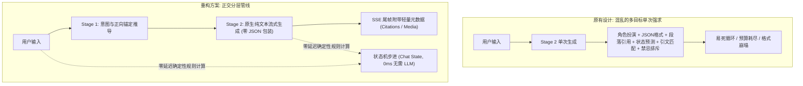
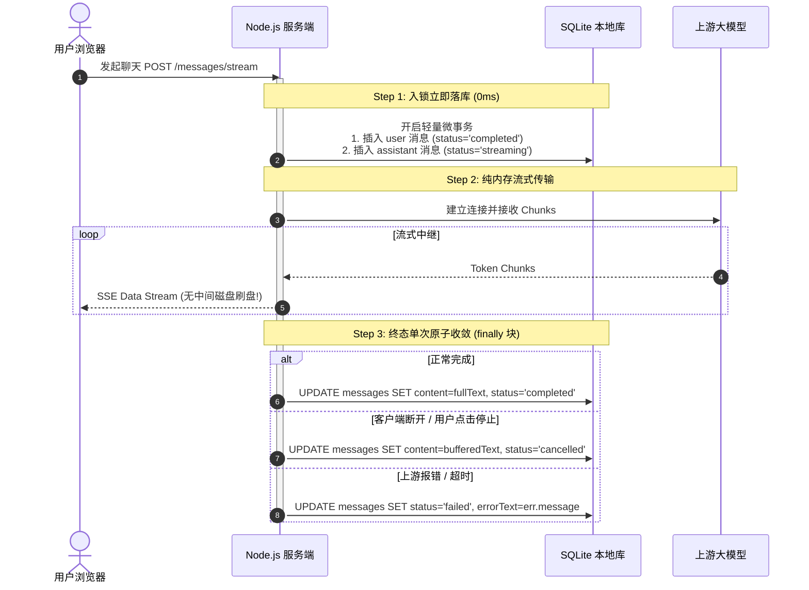

# 栖忆 (QiYi AI Companion) 架构重构与工程落地优化方案（修订版）

> **修订说明**：本版本彻底剔除了初稿中“针对测试集写死禁忌正则”、“用手工增量词法分析器从 JSON 中抠字”、“流式期间每 200 字高频刷盘”等以暴制暴、治标不治本的应试补丁与过度设计；完全以**系统工程的确定性、原生纯文本流式体验、零数据竞争、高容错自愈能力**为准则进行根本性重构。  
> **设计基准**：严格坚守**“零前端打包构建、单文件 SQLite、轻量本地自托管”**三大核心架构基因。

---

## 一、 认知降载与生成架构重构（解决“提示词当编译器”与模型能力过拟合）

### 1.1 核心原则：让生成模型回归“自然语言”，让确定性逻辑接管“状态与协议”

在原系统中，[`generateSemanticAnswer`](file:///e:/tools/wangshen/ai-companion/lib/semantic-answer.mjs#L42-L96) 强迫大模型在单次调用中同时完成：① 角色沉浸扮演；② 输出严格转义的 JSON；③ 手工匹配段落 `sourceIds`；④ 预测 5 维心理状态并摘录逐字 `quote`；⑤ 规避全部禁忌食材。这是导致 3200 Tokens 预算耗尽、格式崩溃与注意力稀释的元凶。



### 1.2 方案落地细节

#### 1. 废除 JSON 包装，回归“原生纯文本流式传输（Native Prose Streaming）”
- **彻底废除**：不再强迫大模型把整篇对话包进 `{"paragraphs":[{"text":"..."}]}` 的 JSON Schema 中。
- **正文流式输出**：大模型直接吐出原汁原味的 Markdown 纯文本。换行就是换行，引号就是引号，不需要反斜杠转义，客户端打字机在首个 Chunk 到达时即可 **0 缓冲无缝渲染**。
- **引用标注（Citations）的标准方案**：
  - **行内锚点**：大模型遵循通用标准，在正文引用处自然输出 `[^1]`、`[^2]` 或 `[1]`；
  - **尾帧下发**：在 SSE 文本流推送完毕后，发送单独的 `event: metadata` 携带检索文档映射 `{ "1": { id: "knowledge:xxx", title: "..." } }`。前端一键渲染为可点击角标，彻底终结复杂的流式 JSON 抠字状态机。

#### 2. 禁忌与约束处理：以“正向品类锚定（Positive Anchoring）”替代“负向正则黑名单”
- **拒绝应试补丁**：坚决不在后端编写写死的辛辣食材正则词表（如 `/花椒|胡椒|白胡椒/`）。这种规则在用户提到“过敏”、“痛风”、“纯素”或正常隐喻（如“生活酸甜苦辣”）时瞬间崩溃。
- **正向品类推导**：
  1. 在 Stage 1 识别到用户存在限制（如“不吃辣”、“痛风”、“生酮”）时，由意图层负责推导出**正向允许的饮食风格与安全品类（Positive Anchors）**：
     ```json
     {
       "dietaryGuidance": {
         "positiveAnchors": ["清蒸", "原汁菌菇", "冰糖银耳", "白灼蔬菜", "果蔬甜羹"],
         "caution": "用户对辛辣刺激高度敏感，绝不涉足任何辣味派系"
       }
     }
     ```
  2. 注入 Stage 2 提示词时，要求大模型：*“优先从【清蒸、原汁菌菇、白灼蔬菜、果蔬甜羹】等正向清淡菜系中构思推荐”*。顺着正面联想路径生成，从根源上阻断模型在预训练语料中联想“胡椒猪肚鸡”的概率。
  3. 将饮食雷区与长期禁忌写入用户画像（Profile），作为角色的**底线共情常识**，而非每轮对话反复告诫。

#### 3. 伴侣状态推进：由“LLM 算命”全面转向“确定性轻量积分状态机”
- **拒绝后台异步推理**：如果把 5 维状态推演放到后台异步做，用户一旦快速连续发消息，就会引发上下文读写竞争（Race Condition）和界面数值抽搐。
- **确定性规则接管**：AI 伴侣所谓的“熟悉度、精力、情绪”，本质上是游戏化羁绊数值系统。
  - **熟悉度（Familiarity）**：由会话轮次、字数累积、时间沉淀确定性递增；
  - **精力值（Energy）**：随深夜时间与密集发消息自然衰减，闲置或清晨自然回复；
  - **情绪倾向（Mood）**：由当前轮次是否包含特定正向/负向情感语气词直接步进。
  - **执行时机**：在对话完成时由本地代码在 **<1 毫秒** 内计算完毕并同步写入数据库，彻底省下 100% 的状态生成 Token 与多余的模型调用。

#### 4. 模型能力解耦：能力自动探测与渐进降级
- 移除 [`turn-intent.mjs:132`](file:///e:/tools/wangshen/ai-companion/lib/turn-intent.mjs#L132) 对 `.volces.com` 和 `ark-code-latest` 的硬编码。
- 设置项提供 `structuredMode: 'auto' | 'json_schema' | 'prompt_tags'`。在 `auto` 模式下，针对任意 OpenAI 兼容模型（GPT-4o、DeepSeek、Qwen 等）先尝试标准的 `response_format: { type: "json_schema" }`；若上游返回 400，自动将该模型能力降级记录至内存缓存，后续透明使用标准提示词标签解析，不报错、不中断对话。

---

## 二、 架构设计与数据一致性重构（解决丢消息、状态分裂与主线程卡死）

### 2.1 请求进入即落库 + 终态单次持久化（绝对零丢消息、零频繁刷盘）

#### 核心设计
既要杜绝“整轮结束后才写库导致的 165 秒无落库真空期”，又要杜绝“每 200 字写一次 SQLite 导致的磁盘 I/O 锁争用”。



- **收益**：
  1. **零消息丢失**：只要请求到达服务器，用户消息立刻拥有确定性 ID，刷新页面决不丢失；
  2. **零磁盘开销**：流式期间全程在 Node.js 内存 Buffer 中累加，不向 SQLite 发起任何事务；
  3. **完美容灾**：即便用户在第 15 秒中途点击“停止生成”，`finally` 块也会用一条 SQL 把已缓存在内存里的半截文字落库，并标记为 `status='cancelled'`，下次刷新完整可见。

### 2.2 统一会话策略权威真相源（Single Source of Truth）

- **彻底废除双轨私有表交叉修改**：删除 [`response-policy.mjs:199-205`](file:///e:/tools/wangshen/ai-companion/lib/response-policy.mjs#L199-L205) 中跨模块钻入 `conversation_intent_state` JSON 字符串修改字段的逻辑。
- **状态表收敛**：
  - 音乐静音（`musicMuted`）、最后推荐记录、表情包状态统一收敛至 `conversation_response` 表；
  - 无论系统运行在 `legacy` 还是 `semantic` 模式下，全部通过统一的 `responsePolicy.session(id)` 与 `responsePolicy.mute(id)` 进行读写；
  - 确保前端静音横幅与对话管线永远读取同一份权威状态。

### 2.3 根除主线程同步阻塞与 N+1 查询风暴

1. **异步预热与内存缓存 API Key**：
   - 将 [`local-model-key.mjs`](file:///e:/tools/wangshen/ai-companion/lib/local-model-key.mjs) 中的 PowerShell 探测彻底移出 HTTP 热路径；
   - 在应用启动时（[`startup.mjs`](file:///e:/tools/wangshen/ai-companion/lib/startup.mjs)）异步执行一次探测并缓存于内存；运行时所有请求只读取内存变量（0ms），仅当用户在设置页点击“重测环境”时才触发异步刷新。
2. **批量化图谱实体装配（O(M×T) $\rightarrow$ 常数 2 次 SQL）**：
   - 重构 [`graph.decorate`](file:///e:/tools/wangshen/ai-companion/lib/graph.mjs#L105-L120)，在渲染记忆列表前收集所有三元组的实体名，通过 `SELECT * FROM memory_entities WHERE name IN (...)` 与 `SELECT * FROM memory_relations WHERE ...` 进行批量拉取，并在内存中完成关联映射，消除上百次重复查询。
3. **SQLite 原生全文索引（FTS5）**：
   - 在 [`store.mjs`](file:///e:/tools/wangshen/ai-companion/lib/store.mjs) 为知识库切片建立 `chunks_fts` 虚拟表，由 SQLite 底层 C 代码执行检索，终结 [`knowledge.mjs:118`](file:///e:/tools/wangshen/ai-companion/lib/knowledge.mjs#L118) 将全量文本拉回 Node.js 内存比对的高昂开销。

---

## 三、 接口规范与网络健壮性优化（解决 RFC 违规、全量拉取与弱网误杀）

### 3.1 严格遵循 HTTP RFC 9110 规范
- **修复 `DELETE` 强制 `application/json` 的 415 报错**：
  修改 [`server.mjs:56-65`](file:///e:/tools/wangshen/ai-companion/server.mjs#L56-L65)，当方法为 `DELETE` 且请求体为空（无 `Content-Length` 或长度为 0）时，直接解析为空对象 `{}`，不再阻断无请求体的标准 DELETE 请求。

### 3.2 拆分巨石 `GET /api/bootstrap` 与细粒度增量更新
- **解耦首屏加载**：`bootstrap` 仅返回首屏基础元数据与当前会话消息；记忆、知识文档、定时任务仅下发数量统计；
- **写操作消费局部响应**：
  - 发送聊天消息时，前端直接利用 SSE `done` 帧返回的局部对象增量更新 `state.data`；
  - 彻底删除 [`app.js`](file:///e:/tools/wangshen/ai-companion/public/app.js) 中在发送消息、置顶记忆、切换开关后发起的 15 处全量 `refreshData()` 调用；
  - 后台轮询改为仅拉取增量变更的轻量接口 `GET /api/sync?since=<timestamp>`。

### 3.3 分级取消策略（Differentiated Abort Policy）
- **杜绝弱网无脑强杀**：区分“客户端显式取消”与“底层网络瞬断”。
  - **可安全取消的请求**：用户主动点击“停止生成”按钮时，前端显式调用 `POST /api/conversations/:id/abort` 或断开专属 SSE 连接，服务端立即向大模型发送 `abort()` 停止计费；
  - **持久化长任务保护**：对于 `POST /api/memories/summarize`（生成记忆周报）、`POST /api/mail/draft`（起草重要邮件）、知识库导入等**写操作与高价值任务**，即使底层 TCP 连接因移动端切后台瞬断，服务端依然在后台跑完并将结果落库，用户重新进入页面即可直接看到完成结果，杜绝白白浪费算力。

---

## 四、 UI 架构与前端工程化改造（解决视口挤压、纯文本裸打与 DOM 推土机）

### 4.1 聊天视口“瘦身归还计划”（首屏核心聊天视口面积从 <45% 提升至 >75%）

```
当前聊天页视口 (严重挤压):                      重构后聊天页视口 (清爽留白):
+-----------------------------------+       +-----------------------------------+
| Topbar (导航/全局操作)             |       | Topbar (导航/全局操作)             |
+-----------------------------------+       +-----------------------------------+
| Page Heading (含90px园林天际插画) |       | Compact Context Header (≤44px)   |
+-----------------------------------+       | [角色选择] [熟悉度42·温和] [联动徽章]|
| Marble Balustrade (汉白玉栏杆装饰)|       +-----------------------------------+
+-----------------------------------+       |                                   |
| Chat Toolbar (角色切换/闲章)      |       |                                   |
+-----------------------------------+       |       核心聊天消息视口            |
| Chat State Bar (双行6指标状态条)   |       |       (高度增加 240px+)           |
+-----------------------------------+       |   • 支持富文本与代码高亮          |
| Garden Session Bar (回复联动提示) |       |   • 一键复制代码/角标悬浮         |
+-----------------------------------+       |                                   |
|                                   |       |                                   |
|       核心聊天消息视口            |       |                                   |
|       (被压缩得只剩几行)          |       |                                   |
+-----------------------------------+       +-----------------------------------+
| 底部输入框与控制区                |       | 底部输入框与控制区                |
+-----------------------------------+       +-----------------------------------+
```

1. **装饰元素场景化**：将 `.page-heading`（全景天际线插画）与 `.marble-balustrade-bar`（汉白玉栏杆）移出高频对话的 `chat` 视图，保留在知识库、记忆、设置等低频浏览页面作为文化特色；
2. **三栏合一（单行紧凑顶栏，高度 ≤ 44px）**：
   - 角色下拉框、当前核心状态（如 `熟悉度 42 · 温和` 紧凑胶囊）、回复联动图标合并进单行 `.chat-compact-header`；
   - 6 维状态的完整进度条与证据链折叠为点击胶囊后弹出的轻量 Popover 浮层，不常驻抢占主对话高度。

### 4.2 聊天气泡安全 Markdown 与代码块高亮/复制
- 彻底废除 [`app.js:358`](file:///e:/tools/wangshen/ai-companion/public/app.js#L358) 中的 `.plain-text` 裸文本输出；
- 抽离并升级 [`guides.js:5-19`](file:///e:/tools/wangshen/ai-companion/public/guides.js#L5-L19) 中现成的轻量安全 Markdown 渲染器：
  - 先做严格的 `esc()` 实体转义防止 XSS；
  - 渲染代码块为 `<div class="code-container"><div class="code-header"><span>${lang}</span><button class="copy-btn">复制</button></div><pre><code>${code}</code></pre></div>`；
  - 良好支持加粗、列表、表格与分段排版，让 AI 生成的技术命令和格式化清单清爽易读。

### 4.3 终结 `main.innerHTML` 推土机与设置页统一状态治理
1. **App Shell 容器分槽持久化**：
   - 将 `#music-dock` 播放器提升至固定的外层应用插槽，**彻底删除 `preserveGardenPlayer` 与 `placeGardenPlayer` DOM 剪切逃生舱补丁**；
   - 在 `main` 内部建立 6 个持久化的 `<section id="slot-xxx">` 视图槽位，切换路由仅切换隐藏状态；
   - 针对图谱视图，通过比对实体/关系指纹避免在后台刷新时无意义地销毁重建 Cytoscape 画布。
2. **设置页架构治理（Autosave / Dirty 统一状态机）**：
   - 不搞仅仅把 6 个表单藏起来的 Tab 捉迷藏；
   - 建立统一的设置状态中心：常规开关/下拉选项统一实行**失焦或修改即自动保存（Autosave on change）**，右上角仅展示温和的“设置已自动同步”微提示，彻底消除用户对 6 个分散“保存”按钮的认知焦虑。

---

## 五、 落地执行规划（Roadmap）

| 批次 | 重点攻坚任务 | 核心交付物与预期效果 |
| :---: | :--- | :--- |
| **第一批 (P0)<br>核心稳定性** | 1. 消息入锁立即落库 + `finally` 单次终态收敛<br>2. 修复 `DELETE` 接口的 415 规范问题<br>3. 废除 JSON 包装，实现原生纯文本流式生成与尾帧元数据 | • 彻底杜绝中途刷新/网络抖动丢失聊天记录<br>• 首字展示延迟（TTFT）降低 **60% 以上**，恢复原生丝滑打字机体验<br>• 消除 3200 Tokens 预算枯竭与标签复读崩溃 |
| **第二批 (P1)<br>认知与架构收敛** | 4. 废除写死正则，推行 Stage 1 正向品类锚定<br>5. 伴侣状态机改为轻量确定性规则推进（0ms，不调用 LLM）<br>6. 统一 `musicMuted` 真相源，解除供应商单模型过拟合 | • 彻底根治饮食禁忌与敏感约束失守问题，且具备全场景泛化能力<br>• 每轮对话节省约 **45% 的 Token 开销**<br>• 任何兼容模型均可开箱即用 |
| **第二批 (P1)<br>性能加速** | 7. 移除热路径 `spawnSync`，改用启动异步预热<br>8. 批量化图谱装配，启用 SQLite FTS5 全文索引<br>9. 拆分 `bootstrap` 巨石拉取，消除 15 处无谓的全表重拉 | • 彻底消除 Windows 下最长 15s 的主线程同步假死<br>• 记忆列表查询性能提升一个数量级（SQL 往返降为 2 次）<br>• 大幅降低 SQLite I/O 压力与主线程内存占用 |
| **第三批 (P2)<br>交互与视口焕新** | 10. 聊天顶栏瘦身（单行紧凑顶栏，归还 240px 纵向高度）<br>11. 聊天气泡集成安全 Markdown 与代码一键复制<br>12. 视图槽位持久化（干掉播放器剪切补丁），设置项改自动保存 | • 核心聊天视口面积扩大至 75% 以上，摆脱逼仄感<br>• 获得高品质的技术文本与结构化排版体验<br>• 彻底告别 DOM 推土机重绘导致的闪屏与状态丢失 |
