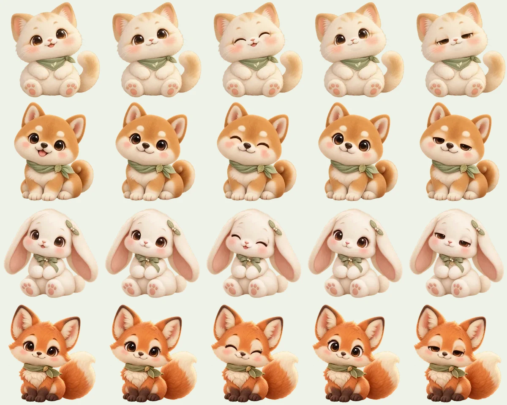
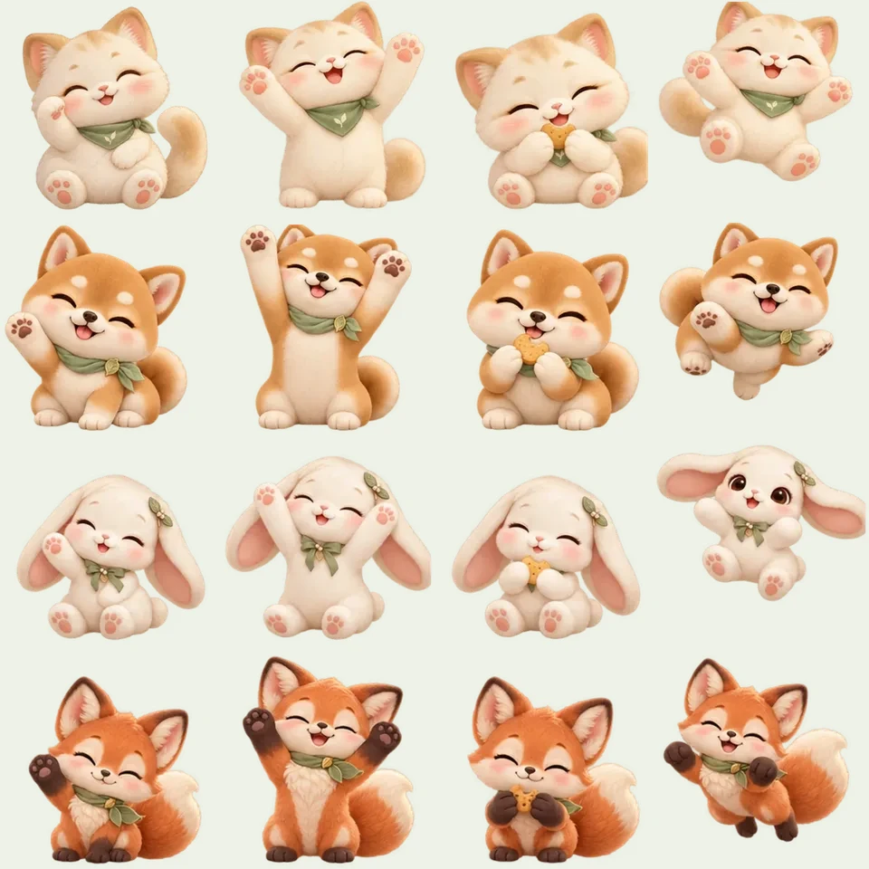

# 原创 Q 版宠物形象

生成日期：2026-10-25。四张形象由本次开发使用内置 imagegen 分别生成，复制到项目中直接使用，保留透明通道；不是外部图库下载或现成角色素材。图片为 1254 × 1254 的 RGBA PNG。

| 文件 | 形象 | 默认名字 |
| --- | --- | --- |
| `public/assets/pets/cream-cat-v1.png` | 奶油猫，鼠尾草绿叶纹三角巾 | 团团 |
| `public/assets/pets/shiba-v1.png` | 蜂蜜色柴犬，绿围巾与小叶扣 | 豆包 |
| `public/assets/pets/lop-rabbit-v1.png` | 奶白垂耳兔，绿蝴蝶结与叶片发饰 | 糯米 |
| `public/assets/pets/little-fox-v1.png` | 肉桂色小狐狸，奶油尾尖与绿围巾 | 栗栗 |

统一设计提示：原创单只 Q 版虚拟宠物，完整身体、超大圆脑袋与短小四肢，柔软手办及绘本质感，圆眼、腮红、温暖自然光；奶油、燕麦、鼠尾草绿和浅桃色，中心方形构图，耳朵、脚和尾巴完整，真实透明背景，不含场景、底座、文字、商标或水印。四种动物使用各自独立的生成调用。

原始生成图保留在生成工具的默认目录，应用只引用仓库内的文件。版本化文件名配合静态资源长期缓存；以后更换形象应使用新的文件名并更新目录映射，避免用不同图片覆盖已缓存的 `v1`。

## 2026-10-26：五种表情与眨眼素材

继续使用内置 imagegen 编辑四张原图，每款独立调用一次，生成 3 列 × 2 行、六种面部变化的参考图。实际生成图可能包含背景，只取角色内部的面部区域；不会把生成图的背景或重新生成的身体用于应用。原来的四张 `v1` 文件保持不变。

维护脚本 `scripts/build-pet-sprites.mjs` 对眼部与鼻子位置进行注册，提取面部补片并柔化边缘，再与同一张缩小后的原图合成。自然表情完全沿用原图，温柔、开心、专注、困倦四种仅替换眼睛与嘴部附近；另外两个透明眼部帧供眨眼覆盖，不替换嘴巴。最终透明通道来自原始形象轮廓及眼部补片遮罩。

| 文件（`public/assets/pets/`） | 大小 | 内容 |
| --- | ---: | --- |
| `cream-cat-expressions-v2.webp` | 140,176 字节 | 奶油猫，七帧 |
| `shiba-expressions-v2.webp` | 133,316 字节 | 柴犬，七帧 |
| `lop-rabbit-expressions-v2.webp` | 124,646 字节 | 垂耳兔，七帧 |
| `little-fox-expressions-v2.webp` | 172,758 字节 | 小狐狸，七帧 |

每张条带为 2688 × 384 RGBA WebP，横向依次排列：自然、温柔陪伴、开心、专注好奇、困倦放松、半闭眼透明补片、闭眼透明补片。运行期只按需加载当前宠物，原图继续作为失败回退。动作使用连续局部形变，保持原有毛发纹理和身体；不是把耳尾裁下来后露出缺口。

完整原始提示与参考图对应关系见 [生成提示记录](pet-animation-prompts.md)。实现与验证见 [宠物动画说明](pet-animation.md)。

维护时可在已有 sharp 的环境运行 `node scripts/build-pet-sprites.mjs <pet-id> <3x2-sheet.png>`；也可用环境变量 `SHARP_MODULE_PATH` 指定 sharp 模块目录。四张条带齐全后，运行 `node scripts/build-pet-sprites.mjs --preview` 重建下方预览图。sharp 只用于开发期素材整理，应用启动和 `npm ci` 不需要额外安装。生成参考图尺寸或形象位置变化时，必须重新校准脚本中的每帧鼻子与眼睛坐标，并检查五种表情与眨眼预览，不能直接按网格裁切后替换整张原画。此脚本只重建明确指定的版本化输出，现有 `v1` 原图不会被覆盖。

下图各行依次为奶油猫、柴犬、垂耳兔、小狐狸；各列依次为自然、温柔、开心、专注、困倦。

## 2026-10-26：完整身体动作（v3）

使用内置 imagegen，以四款 `v1` 原画分别作为形象参考，制作完整身体的招手、伸展、进食、跳跃画面。保留原有毛绒风格、品种、配色、比例与配饰，允许动作改变肢体和身体轮廓。每款最终 24 帧，每行一个动作、六个独立姿势，整理为 `2304 × 1536`、每格 384px 的透明 WebP。

| 文件（`public/assets/pets/`） | 大小 | 内容 |
| --- | ---: | --- |
| `cream-cat-actions-v3.webp` | 665,738 字节 | 奶油猫，24 帧；招手行另做同爪修订 |
| `shiba-actions-v3.webp` | 648,362 字节 | 柴犬，24 帧 |
| `lop-rabbit-actions-v3.webp` | 578,042 字节 | 垂耳兔，24 帧；完整图采用留白修订版 |
| `little-fox-actions-v3.webp` | 681,832 字节 | 小狐狸，24 帧；完整图采用留白修订版 |

四张合计 2,573,974 字节（约 2.45 MiB），每张小于 700 KB。仅在当前宠物允许活动时按需加载，不会一次下载四张。原始 PNG 与表情条带保持现有内容，完整动作图失败时仍有表情和原有轻微动作。

`scripts/build-pet-actions.mjs` 按网格提取生成图，保留实际 alpha；使用同一缩放比例整理全部姿势，校准非腾空帧的脚底并保留跳跃高度。通过透明通道的主体连通区域移除邻格边缘碎片，保留柔软边缘，不进行颜色抠图。奶油猫招手独立重做，避免左右爪交换；垂耳兔和狐狸完整图重新生成并增加留白，保留完整耳尾。

完整实际提示、生成文件和修订记录见 [动作提示](pet-action-prompts.md)，共七次独立内置生成调用。没有下载或复用开源桌宠项目的角色素材。下图各行依次为奶油猫、柴犬、垂耳兔、小狐狸；各列为招手、伸展、进食和跳跃的关键姿势。

## 2026-10-27：静止与动作构图校准

录屏检查发现兔子做动作时整体缩小，原因是静止图和动作图的主体占画布比例不同。新增 `scripts/build-pet-framing.mjs`，从已有 `v1` 原图和 `v3` 动作图计算每行坐姿的统一比例、水平中心和脚底，生成 `public/pet-framing.js`。没有重新生成形象，也没有覆盖原图或长期缓存的动作 WebP。

校准依据每个动作首尾的普通坐姿，而不是把蹲伏或腾空的边界强行放大到一样高；所有姿势在共同的相机范围中播放，留出耳朵、尾巴、抬爪和微动所需空间。画布外扩以原脚底为支点，补偿相机留白，使静止显示大小也保持原样。
