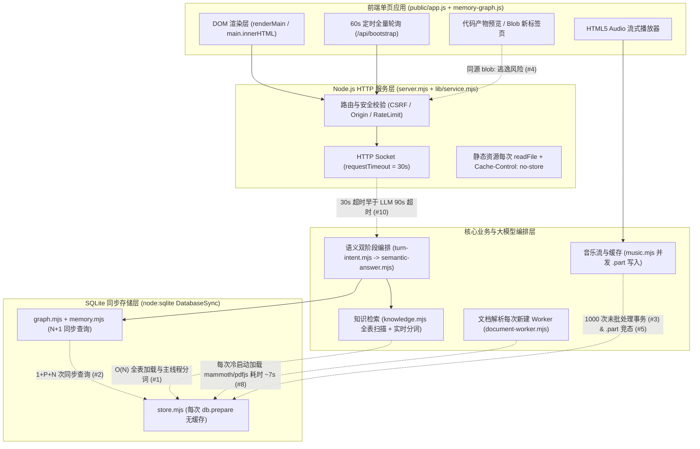

# 栖迟（QiYi AI Companion）全量工程扫描与深度优化报告

- **扫描日期**：2026-11-02
- **扫描基线提交**：`b1bc620`（`main` 分支，已同步推送至 `origin/main`）
- **自动化验证基线**：782 项 Node.js 单元/集成测试 + 26 项 Playwright 端到端浏览器测试全绿通过
- **扫描范围**：后端服务与路由（[`server.mjs`](file:///e:/tools/wangshen/ai-companion/server.mjs)、[`lib/*.mjs`](file:///e:/tools/wangshen/ai-companion/lib/service.mjs) 共 16 个核心模块）、SQLite 存储层、知识库与 Worker 解析器、大模型语义编排层、音乐流媒体与缓存层、前端单页应用（[`public/app.js`](file:///e:/tools/wangshen/ai-companion/public/app.js)、[`public/index.html`](file:///e:/tools/wangshen/ai-companion/public/index.html)、[`public/garden.css`](file:///e:/tools/wangshen/ai-companion/public/garden.css)、[`public/memory-graph.js`](file:///e:/tools/wangshen/ai-companion/public/memory-graph.js)）

---

## 一、 架构全景与数据流诊断图



---

## 二、 十大核心优化点（结论 · 证据 · 逻辑推演 · 方案）

以下 10 项问题均基于源码逐行审计与实测数据得出，按 **“核心结论 → 源码与实测依据 → 逻辑推演链条 → 落地优化方案”** 严格展开。

---

### 优化点 1：【数据库与检索引擎】知识库检索在主线程执行 `chunks` 全表扫描与实时 BM25 分词

- **核心结论**：
  每次对话触发知识库检索时，系统都会从 SQLite **无条件全表拉取所有文档分块（`chunks`）**，并在 Node.js 主线程上对所有分块重新执行 Unicode NFKC 归一化、正则匹配与中文二元切词（Bigram）。随着导入文档数量增长，单次对话的 CPU 阻塞呈线性恶化（$O(\text{TotalChunks} \times \text{ChunkLength})$）。

- **源码与实测依据**：
  1. [`lib/knowledge.mjs`](file:///e:/tools/wangshen/ai-companion/lib/knowledge.mjs#L109-L115) 中的 [`search`](file:///e:/tools/wangshen/ai-companion/lib/knowledge.mjs#L109) 函数每次直接执行无过滤条件的全表 `JOIN` 查询：
     ```js
     search(query, limit = 5) {
       return rankText(
         store.all('SELECT c.id,c.documentId,d.name,c.chunkIndex AS "index",c.content FROM chunks c JOIN documents d ON d.id=c.documentId ORDER BY c.documentId,c.chunkIndex'),
         query, limit, (row) => `${row.name} ${row.content}`
       );
     }
     ```
  2. [`lib/knowledge.mjs`](file:///e:/tools/wangshen/ai-companion/lib/knowledge.mjs#L19-L41) 中的 [`rankText`](file:///e:/tools/wangshen/ai-companion/lib/knowledge.mjs#L19) 对全表每一行调用 [`tokenize(text)`](file:///e:/tools/wangshen/ai-companion/lib/knowledge.mjs#L7-L17)，执行 `.normalize('NFKC')`、正则 `/[a-z0-9_]+|\p{Script=Han}+/gu` 以及中文逐字双字切片。
  3. [`lib/semantic-answer.mjs`](file:///e:/tools/wangshen/ai-companion/lib/semantic-answer.mjs#L21-L39) 中的 [`retrievalPlan`](file:///e:/tools/wangshen/ai-companion/lib/semantic-answer.mjs#L21) 在语义模式下最多会对 `variants` 循环调用 **4 次** `knowledge.search(variant, 6)`。

- **逻辑推演链条**：
  1. **前提**：单篇文档允许导入最大 `300,000` 字符（见 [`lib/knowledge.mjs`](file:///e:/tools/wangshen/ai-companion/lib/knowledge.mjs#L5) `MAX_IMPORT_CHARS = 300000`），按每块 `1,000` 字符切分，单篇最多产生约 `300` 个分块。
  2. **推演**：当用户知识库积累到 50 篇长文档（约 `15,000` 个分块、总文本约 `15 MB`）时，单轮语义对话最多触发 4 次 `knowledge.search`，意味着主线程在单次请求中要从 SQLite 同步拷贝 `60 MB` 字符串，并对 `60,000` 个分块重复执行正则与双字切词。
  3. **后果**：由于使用的是同步 SQLite（`node:sqlite` `DatabaseSync`）与主线程同步分词，Node.js 事件循环会被直接卡死数百毫秒至数秒，期间所有并发 HTTP 请求、SSE 流推送和音乐流传输全部停滞，同时产生大量短生命周期字符串触发频繁 GC。

- **落地优化方案**：
  - **方案 A（内存倒排索引缓存，零外部依赖，推荐）**：在 [`createKnowledge`](file:///e:/tools/wangshen/ai-companion/lib/knowledge.mjs#L79) 内部维护内存级倒排索引 `Map<token, Array<{chunkId, tf}>>` 与文档长度表 `docLengths`。仅在服务启动、[`importDocument`](file:///e:/tools/wangshen/ai-companion/lib/knowledge.mjs#L98) 或 [`deleteDocument`](file:///e:/tools/wangshen/ai-companion/lib/knowledge.mjs#L116) 时增量更新分词结果；检索时仅遍历查询词命中的 Posting List，将复杂度从 $O(N \times L)$ 降至 $O(Q \times \text{MatchedDocs})$。
  - **方案 B（SQLite FTS5 全文检索表）**：利用 Node 内置 SQLite 的 `VIRTUAL TABLE chunks_fts USING fts5(content, tokenize='trigram')` 下推粗召回。

---

### 优化点 2：【数据库与记忆图谱】`graph.decorate()` 存在典型 `N+1` 同步查询与重复 SHA-256 哈希计算

- **核心结论**：
  每次读取记忆列表（`memory.list`）或召回记忆（`memory.recall`）时，[`graph.decorate()`](file:///e:/tools/wangshen/ai-companion/lib/graph.mjs#L88) 都会对每条记忆单独发起一次 `SELECT * FROM memory_graph_state WHERE memoryId=?` 同步 SQLite 查询并计算一次 SHA-256 哈希；且在单轮语义对话中，同一角色的记忆列表和关系表被重复查询了 **2 至 3 次**。

- **源码与实测依据**：
  1. [`lib/graph.mjs`](file:///e:/tools/wangshen/ai-companion/lib/graph.mjs#L51) 与 [`L88-L99`](file:///e:/tools/wangshen/ai-companion/lib/graph.mjs#L88-L99)：
     ```js
     const stateFor = (memoryId) => store.get('SELECT * FROM memory_graph_state WHERE memoryId=?', memoryId);
     // ...
     decorate(rows) {
       // ...
       return rows.map((row) => ({
         ...row,
         triples: byMemory.get(row.id) || [],
         graphExtracted: Boolean(row.id && stateFor(row.id)?.contentHash === fingerprint(row.content))
       }));
     }
     ```
  2. [`lib/memory.mjs`](file:///e:/tools/wangshen/ai-companion/lib/memory.mjs#L40-L56)：
     - [`list(personaId)`](file:///e:/tools/wangshen/ai-companion/lib/memory.mjs#L40) 调用 `graph.decorate(...)`（内部调了一次 `relationsFor(personaId)` + $N$ 次 `stateFor(row.id)`）。
     - [`recall(personaId, query, limit)`](file:///e:/tools/wangshen/ai-companion/lib/memory.mjs#L46) 先调用 `this.list(personaId)`，紧接着在第 55 行调用 `graph.related(personaId, ...)`，而 [`graph.related`](file:///e:/tools/wangshen/ai-companion/lib/graph.mjs#L135) 内部又执行了一遍 `relationsFor(personaId)`。
  3. [`lib/semantic-answer.mjs`](file:///e:/tools/wangshen/ai-companion/lib/semantic-answer.mjs#L16-L24)：
     - 第 16 行：`const constraints = memory.list(personaId).filter(...)` 执行了一整套 `list + decorate`。
     - 第 24 行：`retrievalPlan` 内部调用 `memory.recall(personaId, variant, 8)`，对每个 `variant`（最多 4 个）又重复调用 `memory.list(personaId)`！
  4. 对比证据：在同一个文件 [`lib/graph.mjs`](file:///e:/tools/wangshen/ai-companion/lib/graph.mjs#L173-L175) 的 `view()` 方法中，作者其实已经写出了正确的 `LEFT JOIN` 写法：
     ```sql
     SELECT m.id,m.type,m.content,s.contentHash,s.extractedAt FROM memories m LEFT JOIN memory_graph_state s ON s.memoryId=m.id WHERE m.personaId=?
     ```

- **逻辑推演链条**：
  1. **前提**：假设当前角色拥有 $N = 300$ 条记忆，语义检索生成了 $V = 3$ 个查询变体。
  2. **推演**：单次调用 `memory.list(personaId)` 触发 $1\text{ (memories)} + 1\text{ (relations)} + 300\text{ (stateFor)} = 302$ 次 SQLite 查询与 $300$ 次 SHA-256 运算。在单次语义对话（`semanticAnswer`）中，`memory.list` 被调用了 $1 + 3 = 4$ 次，总计触发 **$1,208$ 次同步 SQLite 查询**和 **$1,200$ 次 SHA-256 哈希计算**！
  3. **后果**：原本 1 条 `LEFT JOIN` SQL 即可在 `< 1ms` 完成的操作，被放大了上千倍，无谓消耗主线程 CPU。

- **落地优化方案**：
  1. 在 [`lib/memory.mjs`](file:///e:/tools/wangshen/ai-companion/lib/memory.mjs#L40) 的 `SELECT` 语句中直接 `LEFT JOIN memory_graph_state s ON s.memoryId=m.id`，彻底消除 `stateFor(row.id)` 的 $N$ 次循环单查。
  2. 在 [`lib/memory.mjs`](file:///e:/tools/wangshen/ai-companion/lib/memory.mjs#L46) 的 `recall()` 与 [`lib/semantic-answer.mjs`](file:///e:/tools/wangshen/ai-companion/lib/semantic-answer.mjs#L16) 中复用已加载的 `memories` 列表，避免对每个检索变体重复查询数据库。

---

### 优化点 3：【数据库与事务批处理】本地音乐搜索存在 1,000 次自动提交事务循环，且 `store.mjs` 未缓存预编译语句

- **核心结论**：
  1. 每次搜索音乐时，[`music.search()`](file:///e:/tools/wangshen/ai-companion/lib/music.mjs#L155) 会遍历最多 1,000 首本地音频文件并逐条调用 `register()` 写入 SQLite，但**未包裹在事务（`store.transaction`）中**，导致触发最多 1,000 次独立的磁盘事务提交。
  2. [`lib/store.mjs`](file:///e:/tools/wangshen/ai-companion/lib/store.mjs#L148-L150) 的 `run` / `get` / `all` 每次调用都重新执行 `db.prepare(sql)`，未做 Statement 缓存。

- **源码与实测依据**：
  1. [`lib/music.mjs`](file:///e:/tools/wangshen/ai-companion/lib/music.mjs#L158)：
     ```js
     local = library.files.slice(0, 1000).map((row) => register(row, 'local', 'local', service)).filter(Boolean);
     ```
  2. [`lib/music.mjs`](file:///e:/tools/wangshen/ai-companion/lib/music.mjs#L127)：[`register()`](file:///e:/tools/wangshen/ai-companion/lib/music.mjs#L114) 内部直接执行：
     ```js
     store.run('INSERT INTO music_catalog VALUES (?,?,?) ON CONFLICT(id) DO UPDATE SET value=excluded.value, updatedAt=excluded.updatedAt', item.id, JSON.stringify(item), Date.now());
     ```
  3. [`lib/store.mjs`](file:///e:/tools/wangshen/ai-companion/lib/store.mjs#L148-L150)：
     ```js
     run: (sql, ...params) => db.prepare(sql).run(...params),
     get: (sql, ...params) => db.prepare(sql).get(...params),
     all: (sql, ...params) => db.prepare(sql).all(...params),
     ```

- **逻辑推演链条**：
  1. **前提**：SQLite 默认处于 Auto-Commit 模式，每条不在 `BEGIN...COMMIT` 内的 `INSERT/UPDATE` 都会单独开启并提交一个事务（伴随 WAL 帧写入与锁同步）。
  2. **推演**：当本地音乐目录有 500~1,000 首歌时，用户每次搜索音乐都会触发最多 1,000 次独立事务写入，耗时可达 `50ms ~ 250ms`；若包裹在单次 `store.transaction(() => ...)` 中，1,000 条写入仅需一次事务提交，耗时低于 `2ms`。
  3. 同时，`db.prepare(sql)` 在高频循环中反复解析相同的 SQL AST，增加不必要的 C++ 绑定开销。

- **落地优化方案**：
  1. 在 [`lib/music.mjs`](file:///e:/tools/wangshen/ai-companion/lib/music.mjs#L158) 与 [`L177`](file:///e:/tools/wangshen/ai-companion/lib/music.mjs#L177) 将批量 `register()` 调用包裹进 `store.transaction(() => ...)`。
  2. 在 [`lib/store.mjs`](file:///e:/tools/wangshen/ai-companion/lib/store.mjs#L148) 引入预编译语句缓存 `const stmtCache = new Map()`（对高频固定 SQL 复用 `StatementSync` 实例）。

---

### 优化点 4：【安全边界与沙箱隔离】代码产物“新标签页打开”使用同源 `blob:` URL，存在同源权限逃逸与内存泄漏

- **核心结论**：
  在弹窗内预览 HTML 产物时，系统正确使用了无 `allow-same-origin` 的 `<iframe sandbox="allow-scripts allow-modals">`；但在点击 **“新标签页打开”**（`open-tab`）时，系统直接通过 `URL.createObjectURL(new Blob([code], { type: 'text/html' }))` 并在新标签页打开。这会导致 AI 生成的 HTML/SVG 脚本在**与主应用完全相同的源（`http://127.0.0.1:4317`）下执行**，绕过后端的同源防护，且创建的 Blob URL 从未释放。

- **源码与实测依据**：
  1. [`public/app.js`](file:///e:/tools/wangshen/ai-companion/public/app.js#L1579-L1590)：
     ```js
     if (ext === 'html') {
       const blob = new Blob([code], { type: 'text/html; charset=utf-8' });
       const url = URL.createObjectURL(blob);
       window.open(url, '_blank');
       return;
     }
     if (ext === 'svg') {
       const blob = new Blob([code], { type: 'image/svg+xml; charset=utf-8' });
       const url = URL.createObjectURL(blob);
       window.open(url, '_blank');
       return;
     }
     ```
  2. 对比 [`public/app.js`](file:///e:/tools/wangshen/ai-companion/public/app.js#L574) 的弹窗预览：
     ```html
     <iframe class="artifact-preview-iframe" sandbox="allow-scripts allow-modals" srcdoc="..."></iframe>
     ```
  3. 后端 [`server.mjs`](file:///e:/tools/wangshen/ai-companion/server.mjs#L171-L185) 的安全防护依赖 `Origin === expectedOrigin` 与 `Sec-Fetch-Site === 'same-origin'`。

- **逻辑推演链条**：
  1. **前提**：根据 W3C File API 规范，`blob:http://127.0.0.1:4317/<uuid>` 继承创建它的文档的 Origin（即 `http://127.0.0.1:4317`），且 SVG 文件内部同样支持嵌入 `<script>` 标签。
  2. **推演**：当用户诱导或模型受 Prompt Injection 影响生成包含恶意 JS 的 HTML/SVG 产物，且用户点击“新标签页打开”时：
     - 新标签页内的脚本拥有 `http://127.0.0.1:4317` 的完整同源权限；
     - 可直接读写主应用的 `localStorage`（如 `qiyi-theme`、缓存配置）；
     - 可直接调用 `fetch('/api/settings')`、`fetch('/api/mail/send')`、`fetch('/api/memories')`，此时浏览器自动附带 `Origin: http://127.0.0.1:4317` 与 `Sec-Fetch-Site: same-origin`，后端 CSRF 校验会将其视为合法主应用请求全部放行！
  3. 此外，`URL.createObjectURL(blob)` 生成的句柄未调用 `URL.revokeObjectURL`，在长会话中重复打开产物会持续占用浏览器内存。

- **落地优化方案**：
  1. 对 `ext === 'html'` 和 `ext === 'svg'` 的“新标签页打开”，不要直接打开原始 HTML/SVG Blob，而是生成一个**外层沙箱壳 HTML Blob**，壳内部仅包含一个全屏 `<iframe sandbox="allow-scripts allow-modals" srcdoc="${escapeAttr(code)}"></iframe>`（不赋予 `allow-same-origin`），使内部脚本运行在 `null` 匿名源（Opaque Origin）下，彻底阻断其访问 `localStorage` 和 `/api/*` 接口。
  2. 调用 `window.open(url, '_blank', 'noopener,noreferrer')`，并在 `setTimeout(() => URL.revokeObjectURL(url), 60000)` 中回收 Blob URL。

---

### 优化点 5：【并发控制与文件 I/O】音乐流边播边存存在 `.part` 临时文件同名并发写竞态，且缓存目录无容量上限

- **核心结论**：
  [`saveStreamToCache()`](file:///e:/tools/wangshen/ai-companion/lib/music.mjs#L77) 对同一首歌固定使用 `${cachePath}.part` 作为临时文件名，且未做并发去重锁。当浏览器 `<audio>` 发起多次探测请求或用户在播放同时点击“缓存到本地”时，多个写入流会同时截断并交错写入同一个 `.part` 文件，在 Windows 下极易引发音频损坏或 `renameSync` 抛出 `EPERM`/`ENOENT`；此外 `data/music-cache` 缺乏磁盘配额淘汰机制。

- **源码与实测依据**：
  1. [`lib/music.mjs`](file:///e:/tools/wangshen/ai-companion/lib/music.mjs#L77-L97)：
     ```js
     async function saveStreamToCache(stream, cachePath, metaPath, meta) {
       const partPath = `${cachePath}.part`;
       try {
         const writer = createWriteStream(partPath);
         await pipeline(Readable.fromWeb(stream), writer);
         renameSync(partPath, cachePath);
         // ...
       } catch {
         try { if (existsSync(partPath)) unlinkSync(partPath); } catch {}
         return false;
       }
     }
     ```
  2. [`lib/music.mjs`](file:///e:/tools/wangshen/ai-companion/lib/music.mjs#L337-L347)：当音频未缓存且请求为全量或 `bytes=0-` 时，[`stream()`](file:///e:/tools/wangshen/ai-companion/lib/music.mjs#L276) 会执行 `upstream.body.tee()` 并异步触发 `saveStreamToCache(cacheBranch, ...)`，同时 [`cacheTrack()`](file:///e:/tools/wangshen/ai-companion/lib/music.mjs#L260) 也会直接调用 `saveStreamToCache()`。

- **逻辑推演链条**：
  1. **前提**：HTML5 `<audio>` 标签在加载流媒体时，经常先发一次 `Range: bytes=0-` 获取头部元数据，紧接着再次发起请求，或者用户在歌曲刚开始播放（后台正在流式写入 `.part`）时手动点击了“缓存到本地”按钮。
  2. **推演**：两次调用同时进入 `saveStreamToCache`，同时对同一个 `${id}.${quality}.audio.part` 调用 `createWriteStream(partPath)`（默认 flags 为 `'w'`，会直接截断或覆盖正在写入的文件描述符）。当先完成的流执行 `renameSync(partPath, cachePath)` 时，Windows NTFS 文件系统会因另一个流仍持有 `partPath` 句柄而抛出 `EPERM: operation not permitted, rename`，进入 `catch` 块执行 `unlinkSync(partPath)`，导致两次缓存全部失败或生成损坏的音频文件。
  3. 同时，每次缓存的音频文件（FLAC/320k MP3 约 10~30 MB）永久保留在 `data/music-cache` 中，长期运行会导致磁盘空间无限膨胀。

- **落地优化方案**：
  1. 引入内存级并发锁 `const inFlightCacheTasks = new Map()`（以 `cachePath` 为键）：若同一 `cachePath` 已有正在进行的写入任务，后续请求直接复用该 Promise 或跳过后台重复写盘。
  2. 将临时文件名改为唯一路径 `${cachePath}.${process.pid}.${Date.now()}.${Math.random().toString(36).slice(2, 8)}.part`，从根本上杜绝文件句柄冲突。
  3. 增加 LRU 容量守卫（如默认上限 `500 MB` 或最多 `100` 首缓存曲目），超出时按 `mtimeMs` 自动清理最旧的未锁定缓存文件。

---

### 优化点 6：【前端架构与状态同步】高频冗余 `/api/bootstrap` 全量拉取与 `main.innerHTML` 破坏性重绘

- **核心结论**：
  前端在绝大多数单条数据变更（如置顶会话、重命名会话、修改单条记忆、切换设置）后，明明已经用接口返回值更新了本地 `state.data`，却又紧接着调用 `refreshData({ silent: true })` 重新请求 `/api/bootstrap` 拉取全库数据；且每次 `renderMain()` 均通过 `main.innerHTML = ...` 销毁重建整个主视图 DOM。

- **源码与实测依据**：
  1. [`lib/service.mjs`](file:///e:/tools/wangshen/ai-companion/lib/service.mjs#L206-L227)：`GET /api/bootstrap` 每次序列化并返回所有角色、全部会话列表、全部文档元数据、当前角色全部记忆与三元组、全部定时任务、最近 100 条任务执行记录、全部表情包、最近 100 封邮件记录。
  2. [`public/app.js`](file:///e:/tools/wangshen/ai-companion/public/app.js#L851)、[`L922`](file:///e:/tools/wangshen/ai-companion/public/app.js#L922)、[`L1018`](file:///e:/tools/wangshen/ai-companion/public/app.js#L1018)、[`L1084`](file:///e:/tools/wangshen/ai-companion/public/app.js#L1084)、[`L1141`](file:///e:/tools/wangshen/ai-companion/public/app.js#L1141)、[`L1394`](file:///e:/tools/wangshen/ai-companion/public/app.js#L1394)：
     例如在修改记忆 [`public/app.js`](file:///e:/tools/wangshen/ai-companion/public/app.js#L1079-L1085) 中：
     ```js
     const updated = await api(`/api/memories/${encodeURIComponent(id)}`, { method: 'PUT', body: ... });
     state.data.memories = state.data.memories.map((item) => (item.id === id ? updated : item));
     state.editingMemoryId = '';
     renderMain();
     await refreshData({ silent: true }); // <-- 已经局部更新并渲染，又立刻全量请求一遍 /api/bootstrap 并二次 renderMain()！
     ```
     同样的冗余模式出现在会话重命名（L922）、会话置顶（L928）、会话删除（L954）、文档上传（L1018）等十余处。
  3. [`public/app.js`](file:///e:/tools/wangshen/ai-companion/public/app.js#L1772)：每 60 秒无条件执行 `refreshData({ silent: true })` 全量拉取 `/api/bootstrap` 并触发 `renderMain()`。

- **逻辑推演链条**：
  1. **前提**：`/api/bootstrap` 是后端最重的聚合接口（触发优化点 2 的 `memory.list` + `graph.decorate` 等全套查询）。
  2. **推演**：每次用户点一下“置顶会话”或“保存记忆”，前端先触发一次 `renderMain()`，几十毫秒后 `refreshData` 返回又触发第二次 `renderMain()`，造成双倍网络请求与双倍 DOM 重建。
  3. 更重要的是，60 秒后台定时器在用户正在阅读长代码、展开“打开方式 ▾”下拉菜单或选中文本复制时触发 `main.innerHTML = ...`，会直接导致下拉菜单突然关闭、文本选区丢失、代码框横向滚动条跳回顶部。

- **落地优化方案**：
  1. **消除冗余 `refreshData`**：对于后端接口已返回完整最新实体（如会话重命名/置顶、记忆单条增删改、设置保存）的操作，信任本地 `state.data` 的增量更新，移除紧随其后的 `await refreshData({ silent: true })`。
  2. **60 秒轮询轻量化与防打扰渲染**：当用户当前处于 `chat` 视图且正在交互（如有打开的菜单 `.artifact-open-dropdown.open`、正在流式生成 `state.sending`、或用户正选中文本 `window.getSelection().toString()`）时，60 秒轮询仅静默更新后台任务状态数据，不强制覆盖 `chat` 视图的 `main.innerHTML`。

---

### 优化点 7：【HTTP 传输与静态资源】全局 `Cache-Control: no-store` 导致每次刷新重复读取并无压缩传输 ~900 KB 静态资源

- **核心结论**：
  [`server.mjs`](file:///e:/tools/wangshen/ai-companion/server.mjs#L168) 对所有响应统一设置了 `Cache-Control: no-store`（仅宠物贴图和音频流除外），且每次请求静态文件都直接执行磁盘 `readFile`、未启用 ETag 协商缓存或 Gzip/Brotli 压缩。

- **源码与实测依据**：
  1. [`server.mjs`](file:///e:/tools/wangshen/ai-companion/server.mjs#L168)：
     ```js
     response.setHeader('Cache-Control', 'no-store');
     ```
  2. [`server.mjs`](file:///e:/tools/wangshen/ai-companion/server.mjs#L238-L246)：
     ```js
     const asset = STATIC_MAP[url.pathname];
     if (asset) {
       const contents = await readFile(join(ROOT, 'public', asset[0]));
       if (url.pathname.startsWith('/assets/pets/')) response.setHeader('Cache-Control', 'public, max-age=86400');
       response.writeHead(200, { 'Content-Type': asset[1] });
       response.end(contents);
       return;
     }
     ```
  3. 静态资产体积实测统计：
     - `public/vendor/cytoscape.esm.min.mjs`：`~400 KB`
     - `public/app.js`：`134.9 KB`
     - `public/garden.css`：`127.6 KB`
     - `public/index.html`：`63.1 KB`
     - `public/entrance.css`：`43.5 KB`
     - `public/memory-graph.js`：`7.3 KB`
     - 仓库中还存在未被 `STATIC_MAP` 引用的历史预览文件 [`public/garden-preview.html`](file:///e:/tools/wangshen/ai-companion/public/garden-preview.html)（`264.6 KB`）以及 `test-reports/` 下 `3.55 MB` 的历史测试快照。

- **逻辑推演链条**：
  1. **前提**：主界面引用的核心 JS/CSS/HTML 静态资源合计约 `780 KB ~ 900 KB`。
  2. **推演**：由于响应头强制 `Cache-Control: no-store` 且无 `ETag` / `Last-Modified`，浏览器每次刷新页面（含移动端切换标签页重新加载或通过 SSH 隧道远程访问）都必须重新从磁盘读取并完整传输这 `~800 KB` 未压缩明文。若开启 ETag（`304 Not Modified`）与 `zlib.gzipSync` 预压缩，首次传输体积可从 `~800 KB` 降至 `~180 KB`，二次刷新传输量趋近于 `0 KB`。

- **落地优化方案**：
  1. 在 [`server.mjs`](file:///e:/tools/wangshen/ai-companion/server.mjs#L238) 为 `STATIC_MAP` 中的文本静态资源（HTML/CSS/JS/SVG）计算基于文件 `mtimeMs` 与字节长度的弱 ETag（如 `W/"size-mtime"`），设置 `Cache-Control: no-cache`（每次协商验证，命中即返回 `304 Not Modified`），并在支持 `Accept-Encoding: gzip` 时返回 Gzip 压缩流。
  2. 清理或归档未使用的 [`public/garden-preview.html`](file:///e:/tools/wangshen/ai-companion/public/garden-preview.html) 及 `test-reports/` 历史冗余产物。

---

### 优化点 8：【工作线程与文档导入】每次导入 PDF/DOCX 均新建销毁 Worker 线程（冷启动耗时 ~7 秒），且存在 8 MiB Base64 重复编码校验

- **核心结论**：
  1. [`parseBinary()`](file:///e:/tools/wangshen/ai-companion/lib/knowledge.mjs#L61) 在每次导入单个 PDF 或 DOCX 文档时都会调用 `new Worker()` 创建全新 V8 线程，并在 [`lib/document-worker.mjs`](file:///e:/tools/wangshen/ai-companion/lib/document-worker.mjs#L55-L59) 内重新动态 `import('mammoth')` 或 `import('pdfjs-dist/legacy/build/pdf.mjs')`，解析完单文件后立即销毁线程，导致单个极小文档导入耗时高达 **6.9 秒**。
  2. [`decodeBinaryPayload()`](file:///e:/tools/wangshen/ai-companion/lib/knowledge.mjs#L84-L93) 在正则校验通过后，又通过 `buffer.toString('base64') !== data` 将最高 8 MiB 的二进制 Buffer 重新编码回 11 MB 的 Base64 字符串做全量比对。

- **源码与实测依据**：
  1. **实测证据**：在本轮运行全量测试套件时，测试项 `Subtest 166: tiny literal DOCX imports and retrieves actual extracted text` 仅解析一个几百字节的最小 DOCX，耗时高达 **`6,958.48 ms`（近 7 秒）**！
  2. [`lib/knowledge.mjs`](file:///e:/tools/wangshen/ai-companion/lib/knowledge.mjs#L61-L77)：
     ```js
     function parseBinary(kind, buffer) {
       return new Promise((resolve, reject) => {
         const worker = new Worker(new URL('./document-worker.mjs', import.meta.url), {
           workerData: { kind, buffer: buffer.buffer.slice(buffer.byteOffset, buffer.byteOffset + buffer.byteLength) }
         });
         // 单次执行完毕立即 terminate()
     ```
  3. [`lib/knowledge.mjs`](file:///e:/tools/wangshen/ai-companion/lib/knowledge.mjs#L86-L91)：
     ```js
     const data = String(payload || '').trim().replace(/\s+/g, '');
     if (!data || data.length % 4 !== 0 || !/^[A-Za-z0-9+/]+={0,2}$/.test(data)) throw badRequest('invalid_document_payload');
     const buffer = Buffer.from(data, 'base64');
     if (!buffer.byteLength || buffer.byteLength > MAX_BINARY_BYTES) throw badRequest('document_binary_limit');
     if (buffer.toString('base64') !== data) throw badRequest('invalid_document_payload');
     ```

- **逻辑推演链条**：
  1. **前提**：`mammoth` 与 `pdfjs-dist` 属于重型依赖，在 Windows 文件系统上，新建 Worker Isolate 并从 `node_modules` 递归加载编译数千个模块需要 3~7 秒。
  2. **推演**：当用户在前端一次拖拽上传 5 个 PDF/DOCX 文件时（[`uploadDocuments`](file:///e:/tools/wangshen/ai-companion/public/app.js#L1003) 串行调用 `/api/documents`），后端会连续创建并销毁 5 个 Worker，仅模块冷启动就要白白耗费 **25~35 秒**。
  3. 此外，第 87 行已经用正则严格保证了 `data` 仅含合法 Base64 字符且长度为 4 的倍数；唯一可能导致 `buffer.toString('base64') !== data` 的情况只有末尾填充位（Padding bits）非零（只需检查最后 4 个字符即可，耗时 `< 0.001ms`），而对 8 MiB Buffer 调用 `buffer.toString('base64')` 会额外分配 11 MB 内存并阻塞主线程。

- **落地优化方案**：
  1. **常驻热池化 Worker（Warm Worker with Idle Timeout）**：将 [`lib/document-worker.mjs`](file:///e:/tools/wangshen/ai-companion/lib/document-worker.mjs) 改造为基于 `parentPort.on('message')` 的可复用 Worker，模块顶层缓存已加载的 `mammoth` 与 `pdfjs-dist`，空闲 60 秒后自动销毁（`unref()` 不阻塞进程退出）。连续上传多篇文档时，第 2~N 篇的解析延迟将从 `~7,000ms` 骤降至 `< 50ms`。
  2. **轻量尾块校验替代全量重编码**：仅对 `data.slice(-4)` 做 `Buffer.from(tail, 'base64').toString('base64') === tail` 校验，免去 8 MiB 全量重编码。

---

### 优化点 9：【服务超时配置倒挂】HTTP `server.requestTimeout = 30000`（30 秒）短于大模型同步接口超时（75~90 秒）

- **核心结论**：
  [`server.mjs`](file:///e:/tools/wangshen/ai-companion/server.mjs#L254) 将 `server.requestTimeout` 设为 `30,000 ms`（30 秒），而后端的模型调用超时 [`lib/model.mjs`](file:///e:/tools/wangshen/ai-companion/lib/model.mjs#L174) 设为 `90,000 ms`（90 秒）、[`lib/turn-intent.mjs`](file:///e:/tools/wangshen/ai-companion/lib/turn-intent.mjs#L154) 设为 `75,000 ms`（75 秒）。对于非 SSE 流式的慢速大模型接口（如角色分析、记忆总结、图谱抽取、邮件起草），当模型响应超过 30 秒时，HTTP 层会提前掐断连接，造成超时配置倒挂。

- **源码与实测依据**：
  1. [`server.mjs`](file:///e:/tools/wangshen/ai-companion/server.mjs#L254-L256)：
     ```js
     server.requestTimeout = 30000;
     server.headersTimeout = 15000;
     server.keepAliveTimeout = 5000;
     ```
  2. [`lib/model.mjs`](file:///e:/tools/wangshen/ai-companion/lib/model.mjs#L174)：
     ```js
     export function createModel(config = {}, { fetchImpl = fetch, timeoutMs = 90000 } = {})
     ```
  3. 非流式大模型接口清单（在模型完整返回前不会调用 `response.writeHead` 发送响应头）：
     - `POST /api/analyze`（[`lib/service.mjs`](file:///e:/tools/wangshen/ai-companion/lib/service.mjs#L267)，支持分析最高 `60,000` 字符的聊天记录）
     - `POST /api/memories/summarize`（[`lib/service.mjs`](file:///e:/tools/wangshen/ai-companion/lib/service.mjs#L368)）
     - `POST /api/graph/extract`（[`lib/service.mjs`](file:///e:/tools/wangshen/ai-companion/lib/service.mjs#L205)，批量抽取最多 20 条记忆的三元组）
     - `POST /api/mail/draft`（[`lib/service.mjs`](file:///e:/tools/wangshen/ai-companion/lib/service.mjs#L94)）
     - `POST /api/tasks/:id/run`（[`lib/service.mjs`](file:///e:/tools/wangshen/ai-companion/lib/service.mjs#L155)）

- **逻辑推演链条**：
  1. **前提**：流式对话接口 `/api/chat/stream` 在一进入路由时就立刻调用了 `response.writeHead(200, ...)` 并每 15 秒发送 `: keepalive\n\n`（见 [`server.mjs`](file:///e:/tools/wangshen/ai-companion/server.mjs#L192-L194)）；但上述 5 个非流式 JSON 接口走的是 [`json(200, await route(...))`](file:///e:/tools/wangshen/ai-companion/server.mjs#L229)，必须等 `await model.complete(...)` 完全结束才会写出 HTTP 响应头。
  2. **推演**：当用户上传数万字聊天记录提取角色设定（`/api/analyze`）或批量构建知识图谱（`/api/graph/extract`）时，大模型推理往往耗时 35~60 秒。此时若 HTTP 服务器层或客户端受到 30 秒超时限制，连接会在模型完成前被重置，而后台模型请求仍在白白消耗 Token。

- **落地优化方案**：
  - 将 [`server.mjs`](file:///e:/tools/wangshen/ai-companion/server.mjs#L254) 的 `server.requestTimeout` 调高至 `120000`（120 秒，大于 `model.timeoutMs = 90000`），同时保留 `server.headersTimeout = 15000` 防御慢速请求头攻击（Slowloris）。

---

### 优化点 10：【大模型编排与首字延迟】语义模式（`semantic`）串行两次完整 LLM 请求，且首阶段阻塞本地检索

- **核心结论**：
  当 `intentMode === 'semantic'` 时，[`semanticAnswer()`](file:///e:/tools/wangshen/ai-companion/lib/semantic-answer.mjs#L13) 必须**完全串行等待**第一次大模型调用 [`analyzeTurn()`](file:///e:/tools/wangshen/ai-companion/lib/turn-intent.mjs#L153)（携带 ~3,300 字符的庞大系统提示词）返回完整 JSON 后，才开始执行本地知识检索与第二次大模型流式生成，导致首字延迟（TTFT）直接翻倍（增加 1.5s ~ 4.0s）。

- **源码与实测依据**：
  1. [`lib/semantic-answer.mjs`](file:///e:/tools/wangshen/ai-companion/lib/semantic-answer.mjs#L18-L60)：
     ```js
     const intent = await analyzeTurn(model, { ... }); // 第 1 次完整非流式 LLM 调用
     const retrieval = retrievalPlan(personaId, content, intent.retrieval, knowledge, memory); // 本地同步检索
     // ...
     for await (const piece of model.stream({ ... })) { ... } // 第 2 次流式 LLM 调用
     ```
  2. [`lib/turn-intent.mjs`](file:///e:/tools/wangshen/ai-companion/lib/turn-intent.mjs#L127-L150)：每次 `analyzeTurn` 都向大模型发送约 3,300 字符的 JSON Schema 规则说明，即使当前用户在设置中关闭了音乐推荐（`musicEnabled === false`）和表情包（`stickersEnabled === false`），依然要求模型评估全部音乐/表情字段。

- **逻辑推演链条**：
  1. **前提**：在 `analyzeTurn` 等待远端大模型响应的 1.5~4 秒时间内，本地 Node.js 进程处于完全空闲等待网络 I/O 的状态。
  2. **推演**：
     - 用户原始输入 `content` 的基础 BM25 检索与记忆召回完全可以在等待 `analyzeTurn` 的同时**并行预取**；若 `intent.retrieval.variants` 未产生新查询词，预取结果可直接命中，省去串行检索开销。
     - 当 `musicEnabled === false && stickersEnabled === false` 时，`turn-intent.mjs` Prompt 中关于音乐 action/query/pick 和表情 category 的冗长规则完全无需发送，可节省约 40% 的首阶段输入 Token 并加快首阶段推理速度。

- **落地优化方案**：
  1. 在 [`lib/semantic-answer.mjs`](file:///e:/tools/wangshen/ai-companion/lib/semantic-answer.mjs#L18) 中，在发起 `analyzeTurn` 的同时预先计算原始 `content` 的基准检索结果；等 `analyzeTurn` 返回后仅对新增的 `variant` 补充检索。
  2. 在 [`lib/turn-intent.mjs`](file:///e:/tools/wangshen/ai-companion/lib/turn-intent.mjs#L127) 中按 `musicEnabled` / `stickersEnabled` 动态裁剪 Prompt 规则段，减少无效 Token 消耗。

---

## 三、 优化优先级路线图与收益评估矩阵

| 优先级 | 编号 | 模块领域 | 核心优化项 | 定位文件与行号 | 改动成本 | 预期工程收益 |
| :--- | :--- | :--- | :--- | :--- | :--- | :--- |
| **P0（高危/必改）** | **#4** | 安全与沙箱 | 新标签页打开 HTML/SVG 改为沙箱 `iframe` 壳 + `revokeObjectURL` | [`public/app.js#L1579-L1590`](file:///e:/tools/wangshen/ai-companion/public/app.js#L1579-L1590) | 低（~25 行） | 彻底阻断 AI 生成脚本通过 `blob:` 同源权限调用 `/api/*` 或读取 `localStorage` |
| **P0（高危/必改）** | **#5** | 并发与文件流 | 音乐缓存 `.part` 唯一临时文件名 + 并发写去重锁 + 容量上限 | [`lib/music.mjs#L77-L97`](file:///e:/tools/wangshen/ai-companion/lib/music.mjs#L77-L97) | 低（~35 行） | 根治边播边存与手动缓存并发时的 Windows `EPERM` 报错、音频损坏与磁盘无限增长 |
| **P0（高危/必改）** | **#9** | 服务超时配置 | 调整 `server.requestTimeout = 120000` 匹配 LLM 90s 超时 | [`server.mjs#L254`](file:///e:/tools/wangshen/ai-companion/server.mjs#L254) | 极低（1 行） | 防止长文本角色分析、图谱抽取等非流式 LLM 接口在 30 秒时被提前断开 |
| **P1（核心性能）** | **#2** | 数据库与图谱 | `LEFT JOIN memory_graph_state` 消除 `N+1` 查询与重复哈希 | [`lib/graph.mjs#L88-L99`](file:///e:/tools/wangshen/ai-companion/lib/graph.mjs#L88-L99), [`lib/memory.mjs#L40-L56`](file:///e:/tools/wangshen/ai-companion/lib/memory.mjs#L40-L56) | 低（~30 行） | 单轮语义对话 SQLite 查询次数从 `1,000+` 次降至 `< 5` 次 |
| **P1（核心性能）** | **#3** | 数据库与事务 | `music.search` 批量注册包裹 `store.transaction` + Statement 缓存 | [`lib/music.mjs#L158`](file:///e:/tools/wangshen/ai-companion/lib/music.mjs#L158), [`lib/store.mjs#L148`](file:///e:/tools/wangshen/ai-companion/lib/store.mjs#L148) | 低（~20 行） | 本地曲库搜索写入耗时从 `50~250ms` 降至 `< 2ms` |
| **P1（核心性能）** | **#1** | 知识库检索 | 为 `chunks` 构建内存倒排索引缓存，增量更新分词 | [`lib/knowledge.mjs#L109-L115`](file:///e:/tools/wangshen/ai-companion/lib/knowledge.mjs#L109-L115) | 中（~60 行） | 消除每次对话全表拉取与重复正则切词，检索延迟降低 90% 以上 |
| **P1（核心性能）** | **#8** | 文档解析线程 | `document-worker` 常驻热复用池（60s 空闲回收）+ Base64 尾块校验 | [`lib/knowledge.mjs#L61-L93`](file:///e:/tools/wangshen/ai-companion/lib/knowledge.mjs#L61-L93), [`lib/document-worker.mjs`](file:///e:/tools/wangshen/ai-companion/lib/document-worker.mjs) | 中（~50 行） | 多文档连续导入时，单文件解析冷启动从 `~6,958ms` 降至 `< 50ms` |
| **P2（体验与传输）** | **#6** | 前端状态同步 | 移除单实体变更后的冗余 `refreshData()` + 轮询防打扰保护 | [`public/app.js#L851-L1772`](file:///e:/tools/wangshen/ai-companion/public/app.js#L851-L1772) | 中（~40 行） | 减少一半以上的 `/api/bootstrap` 请求，防止 60s 轮询打断代码阅读与下拉菜单 |
| **P2（体验与传输）** | **#7** | HTTP 静态资源 | 静态资源 ETag (`304`) 协商缓存 + Gzip 压缩 + 清理冗余预览文件 | [`server.mjs#L238-L246`](file:///e:/tools/wangshen/ai-companion/server.mjs#L238-L246) | 低（~35 行） | 首屏传输体积缩减 ~75%，二次刷新静态资源零字节传输 |
| **P2（体验与传输）** | **#10** | 大模型编排 | 基准知识/记忆预检索与 `turn-intent` 动态 Prompt 裁剪 | [`lib/semantic-answer.mjs#L18`](file:///e:/tools/wangshen/ai-companion/lib/semantic-answer.mjs#L18), [`lib/turn-intent.mjs#L127`](file:///e:/tools/wangshen/ai-companion/lib/turn-intent.mjs#L127) | 中（~40 行） | 减少约 30%~40% 意图分析输入 Token，缩短语义模式首字响应时间 |
