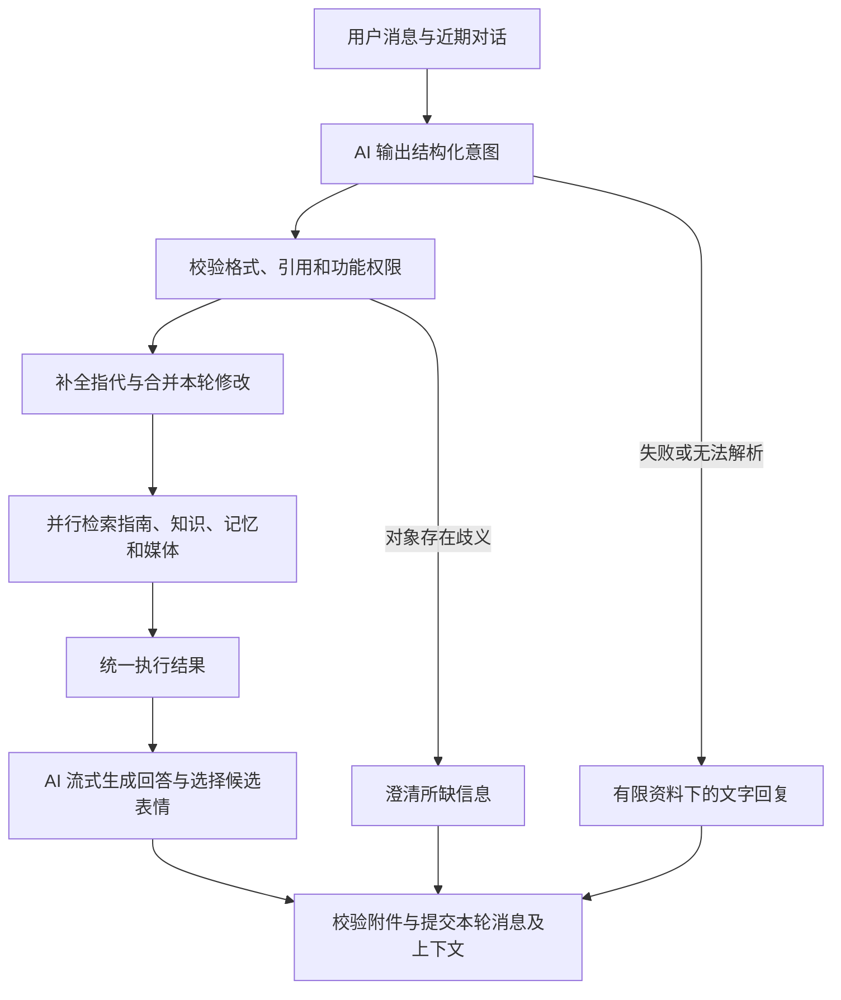

# 聊天语义理解与上下文执行方案

状态：语义路径试用中，默认仍为兼容模式；完整真实模型验收尚未完成。日期：2026-10-30。

## 目标与范围

让音乐、表情、应用帮助、知识问答和记忆召回共享一次上下文理解，支持否定、引用、多个需求、指代和连续修改。模型理解结果应能驱动后续执行，避免被旧关键词门槛再次否决。

本方案覆盖普通聊天入口，不把聊天扩展成任意系统操作入口。现有邮件发送确认、功能开关、密钥本地保存、图片与音频后端代理、点击才播放继续有效。邮件起草和定时任务保留各自入口。

## 现状与已复现问题

当前 `lib/service.mjs` 在模型回答前调用指南检索、知识检索、记忆召回和回应策略；模型回答后再次通过回应策略过滤媒体意图。表情候选也在模型理解本轮需求前准备。

| 表达或场景 | 当前结果 | 需要改变的环节 |
| --- | --- | --- |
| 别发动图 | 被识别为请求表情 | 否定范围与行为理解 |
| 他说“发个表情”，是什么意思 | 引用被识别为请求 | 区分讨论与实际请求 |
| 发了表情后说“再来一张” | 触发重复发送限制，模型意图被删掉 | 指代与明确请求优先级 |
| 发个生气的表情 | 默认状态下不生成远程检索条件 | 情绪到图库元数据的映射 |
| 我没有生病，发个可爱的表情 | 被判为医疗禁用场景 | 否定、事实主体与上下文作用域 |
| 邮箱的密码填哪儿 | 没有加载应用指南 | 帮助主题理解 |
| 新人报到要办哪些手续 | 无法召回“新员工入职流程” | 查询改写与同义召回 |
| 已记住不吃辣，再问适合自己的川菜 | 未召回饮食约束，已有图谱关系也未解决 | 约束注入与语义关联 |
| 点歌后连续两次换歌手 | 第二次丢失歌曲上下文 | 保存结构化的当前音乐对象 |
| 我在写代码，播放《晴天》 | 被当成配置讨论，禁止点歌 | 独立解析同一句中的多个含义 |

## 推荐流程

第一阶段只返回紧凑结构化数据，不要求生成可展示的长篇推理。第二阶段拿到真实检索结果后再回答，避免先承诺有卡片、随后被过滤。

方案默认每轮最多两次模型调用：一次意图分析，一次最终回答。首版普通聊天也走同一路径，以免用新关键词判断“哪些话需要理解”而重现原问题。后续优化应依据实测延迟与准确率。

## 统一意图契约

建议增加 `lib/turn-intent.mjs`，负责输入组织、模型调用、解析和规范化。输入包括本轮消息、限定长度的近期对话、最近媒体对象、手动状态与有效短期状态、设置的布尔状态，以及紧凑的已确认用户约束。不向意图分析器提供 API Key、SSH 配置或完整外部服务地址。

建议版本化输出契约 `TurnIntentV1`：

| 字段 | 内容与约束 |
| --- | --- |
| `version` | 固定为 1 |
| `music` | 动作：无、搜索、推荐、修改、拒绝、澄清；歌名、歌手、版本、风格；引用对象；排除条件 |
| `sticker` | 动作：无、搜索、再来一张、修改、拒绝、澄清；表达含义、场景、情绪、强度；引用对象 |
| `help` | 是否询问本应用使用方法，可包含模型、音乐、表情、邮件、宠物等多个主题 |
| `retrieval` | 补全后的独立问题、有限个查询变体、主题和实体；明确区分用户事实与搜索假设 |
| `contexts` | 对图库禁用上下文的判断，包含是否成立、主体、有效范围与证据；否定和引用不直接当作当前事实 |
| `responseNeeds` | 本轮偏重聊天、倾诉、建议还是任务；不直接覆盖手动设置 |
| `clarification` | 需要澄清的目标与缺失字段；不得因某一动作有歧义就阻止无歧义的其他动作 |

每个会影响媒体执行的动作还须携带：

- `origin`：用户明确请求、上下文延续、主动建议。三者应用不同执行规则。
- `evidence`：用户消息 ID 与连续原文片段；只能引用本轮或允许范围内的用户消息。
- `reference`：需要继承的消息或媒体对象 ID，必须属于当前会话。
- `confidence`：低、中、高，仅用于判断是否澄清；模型自报高置信度不构成操作授权。
- 拒绝范围：当前对象、本轮某类媒体、当前会话的主动推荐。对对象的拒绝不能自动扩展到整类功能。

示例：“别放《晴天》，换成《稻香》”应解析为搜索《稻香》，排除《晴天》；“别放歌了”应解析为本轮不提供歌曲；“本会话别主动推荐歌曲”才改变本会话主动推荐状态。关闭主动推荐仍允许用户之后明确点歌。

字段使用枚举、长度上限和白名单；限制最多一个音乐动作、一个表情动作，但允许两者同时出现。额外目标如多首歌曲暂不假装已执行，解释当前支持范围或澄清优先项。查询变体初始最多三个，避免无限扩展。

验证引用存在只能证明证据来自用户，不能证明模型的语义判断必然正确。语义准确性仍须通过独立测试集评估；歧义时保留未知值，不以空字符串代替已确认事实。

## 程序策略与 AI 的分工

AI 负责理解自然语言、解析否定和引用、补全省略、提出检索词，以及从真实候选中选择适合的内容。

程序负责如下确定性约束：

1. 全局功能开关优先；不因为模型判断用户想要就启用被关闭的功能。
2. 已明确拒绝的目标不执行；存在互相冲突或无法定位的指代时，仅澄清相关动作。
3. 明确请求与主动建议分开：主动建议遵守会话静音与频率限制；“再来一张”这类明确请求可越过主动发送频率，但应避开上一张图片。
4. 只能使用本轮返回的候选 ID、受信任的服务来源与合法参数。继续执行图库禁用上下文、强度和来源校验。
5. 检索只把任务必需的歌名、歌手或表情描述交给远程媒体服务，不传整段对话、个人记忆或密钥。
6. 点击卡片才播放；聊天意图不直接改变播放队列、音量或执行邮件发送。

`lib/response-policy.mjs` 在新路径中改为消费已验证的意图与执行状态。原有 `responseRequests()`、`musicFollowup()`、固定表情场景关键词不能再作为语义路径的入口门槛或最终否决项。旧逻辑仅供显式兼容模式使用。

本轮通过验证的计划与执行结果形成唯一依据。最终回答阶段不再次解释意图、不根据新输出的 `songQuery` 追加搜索，也不因回答末尾的 `qiyi-state` 重新运行媒体决策。状态分析仍可按证据更新后续会话，但不能事后推翻已完成的本轮检索；期间用户修改设置产生的资格失效仍须立即生效。

## 多轮上下文

建议新增按会话隔离的 `conversation_intent_state`，包含版本号、最近音乐请求、最近已找到的音乐对象、最近表情意图与实际图片、待澄清对象、本会话主动推荐偏好。

请求与成功结果分开保存：没有搜到《沦陷》也可以保留用户正在找这首歌，但不能记录为“已找到”或“已播放”。音乐对象保存结构化歌名、歌手、版本及来源消息，避免下轮从卡片标题再次猜测。

例：点《沦陷》→换成贾格唱的→再换成王靖雯唱的。每次仅更新歌手，继承同一个歌名；服务返回的副标题不直接成为下一轮的原始点歌条件。

近期对话与上下文对象共同用于指代。“换个”“不是这个”存在多个可能目标时澄清；用户给出完整新请求时替换对应对象；明确话题切换则解除该对象的默认指代资格。旧对象可保留用于显式引用，但不能无期限充当“它”的唯一解释。

上下文更新与用户消息、助手消息、附件在同一事务中提交。取消、模型失败、响应未完成不推进上下文或记忆访问计数。保留现有会话生成锁，切换会话、删除对象或更改媒体设置后重新检查执行资格。

## 五类能力的具体改造

### 音乐

- 检索条件直接来自结构化歌名、歌手、版本与排除条件，允许连续修改。
- 明确指定歌曲时不再把不易解析的内容自动替换为“轻音乐”。宽泛推荐可以使用风格查询，指定曲目则保留约束。
- 模型提出的别名只作为搜索假设；歌手身份、音源和版本以服务返回数据及可验证映射为准，不因名字部分相似就宣称完全匹配。
- 每轮最多执行一个歌曲检索动作；不追加自动重试循环。搜索失败、无匹配、缺少信息、功能关闭应成为不同的执行结果。
- 标签与工具模式都必须在最终回答前取得歌曲结果，卡片由后端生成，文字根据相同结果描述。

### 表情

- 用含义、场景、情绪、强度及禁用上下文组织远程检索，不再把表达词固定映射到少数几个温柔或庆祝场景。
- `anger` 等情绪按图库现有契约表达。场景值仍由程序校验，`general` 不表示适合所有上下文。
- 同时考虑用户本轮陈述、主体和否定；例如“没有生病”不能仅因出现词语就认定当前在医疗场景。明确否定只更新相同主体和议题，不能抹掉同轮其他真实风险；证据矛盾时保持克制。
- 本地和远程候选都依据同一语义意图匹配。外部图片仍由后端代理，密钥不进入前端。
- 最终回答模型只选择候选 ID；图库候选为不可信资料，不能提供新的动作权限。无合适结果时允许纯文字回应，不硬塞图片。

### 应用指南

- 意图分析识别“询问本应用使用方式”和多个帮助主题，不要求固定的“配置/怎么用”等字样。
- 用补全后的问题和主题检索现有指南。把指南修订号、引用与现有配置布尔状态提供给回答阶段。
- “密码填哪儿”使用项目说明解释输入位置，不要求在聊天中提供秘密。无法确认用户在问哪个产品时澄清，不套用本应用文档。

### 知识库

- 首版采用 AI 补全问题、有限查询改写、现有词法检索的多路合并。文档标题和段落标题也进入索引；标题只作为参考数据。
- 合并命中后按文档与片段去重、限制单文档数量和总上下文预算，保留真实来源和引用编号。不同查询的原始相关分数不直接简单相加，使用按排序位置合并的策略。
- 最终回答只能引用本轮实际提供的来源 ID。来源不足时表述不确定性，不能把查询改写中补出的词语当作资料中的事实。
- “那之后怎么办”应先结合前文恢复为有关入职下一步骤的问题，再检索相关片段；不能只传这几个字。
- 可选向量索引作为后续增强。首版不新增嵌入服务或 Key，查询改写也不等于完整的向量语义检索。长尾召回效果通过测试判断是否需要第二阶段索引投入。

### 记忆

- 在正常召回之外，单独注入预算内的已确认长期约束和固定记忆，例如饮食禁忌。约束不应只有字面匹配后才对回答可见。
- 其他偏好、目标和事实使用补全查询、主题、图谱关系联合召回，不能仅凭出现“用户”之类公共实体引入大量无关记忆。
- 保留角色隔离、归档状态、确认状态和时效性。历史推测不能升级为确认事实；用户本轮明确更正时优先响应更正，但持久记忆更新仍遵循现有流程。
- 常驻约束有明确数量和字符预算，超预算按相关主题和固定优先级筛选，并记录裁剪诊断。此机制不承诺把无限历史全部注入模型。

## 兼容模式、调用与流式体验

建议内部新增 `intentMode: legacy | semantic`，用于分阶段启用和回退。兼容路径保留现有行为，新路径内部不在失败后偷偷重走旧关键词规则。

语义路径提供两个协议适配器，规范化为同一个 `TurnIntentV1`：

| 现有配置 | 第一阶段 | 第二阶段 |
| --- | --- | --- |
| 文本标签模式 | 提示模型只输出 JSON，使用现有解析能力后进行严格校验 | 注入执行结果后流式回答，表情可沿用候选 ID 标签 |
| 原生工具模式 | 用单个 `plan_turn` 工具返回整轮计划，后端统一执行 | 带执行结果继续回答，关闭本轮新的工具调用 |

原生路径应替换现有音乐专属工具循环，不能在旧两次调用外再叠加一次规划。现有工具参数长度上限为 2000 字符；新计划需要独立、明确的体积预算，仅对新工具调整上限，不放宽其他工具验证。设置页面应同步解释新的两阶段流程，保留兼容模式值以便回退。

初始预算：意图输入沿用近期消息的硬上限并控制附件摘要长度；根据当前模型实测，意图分析预算为 3200 tokens、超时为 75 秒；模型的内部推理也可能占用输出预算。最终回答沿用当前超时和取消机制。以上是待实测调整的参数，不是延迟保证。

前端收到用户消息后立即显示状态气泡。阶段顺序为“正在理解…”→按实际动作显示“正在查找歌曲…”或“正在查找资料…”→正文流式增长→附件就绪。仅在确实开始该动作后显示对应状态；普通闲聊不显示检索字样。

内部计划 JSON 不展示为思考内容，也不写进正文。保留现有正文流式和模型提供的思考面板；阶段状态帮助用户了解进度。停止按钮要贯穿分析、检索和回答，取消后不出现迟到的卡片。

## 失败与回退

| 情况 | 预期行为 |
| --- | --- |
| 意图输出格式错误或分析超时 | 不自动重试、不猜测媒体动作；可使用本地基础检索和已确认约束完成文字回复，并简短说明受影响能力本轮未完成 |
| 模型服务认证失败或整体不可用 | 结束本轮并展示现有明确错误，不重复发起同样的认证请求 |
| 歌曲、图片服务暂时不可用 | 不把服务故障解释为“用户意图不明确”；保留真实请求，展示合适的待搜索或失败状态 |
| 单个动作有歧义 | 澄清相关目标，其他无歧义需求可以正常回答 |
| 检索零结果 | 如实说明未找到；不编造音源、文档引用或记忆 |
| 用户中途关闭媒体功能或改变地址 | 取消或丢弃相应结果，正文仍按当前状态完成 |
| 整轮取消或最终模型失败 | 不提交该轮上下文更新、不触碰长期记忆计数、不增加成功推荐次数 |

第一阶段的输出不允许包含完整可执行 URL、凭据或任意系统动作。外部服务只接收经过字段筛选的必要查询；用户材料和检索结果始终作为数据处理。

## 模块与数据改动

| 文件或模块 | 计划职责 |
| --- | --- |
| 新增 `lib/turn-intent.mjs` | 两种协议适配、意图分析、证据和结构校验 |
| 新增 `lib/turn-context.mjs` | 当前媒体对象、指代合并、待澄清对象、事务式上下文更新 |
| 新增 `lib/retrieval-plan.mjs` | 问题改写结果的查询合并、预算、知识与记忆联合召回 |
| `lib/service.mjs` | 编排两阶段流程、统一执行结果、取消和提交 |
| `lib/response-policy.mjs` | 消费语义意图，控制功能开关、拒绝范围、主动推荐频率和附件资格 |
| `lib/sticker-gallery.mjs`、`lib/media.mjs`、`lib/music.mjs` | 结构化检索条件、真实结果与附件生成、现有代理校验 |
| `lib/guides.mjs`、`lib/knowledge.mjs`、`lib/memory.mjs` | 接收完整查询与主题，保留来源、范围和预算 |
| `lib/store.mjs` | 新增版本化会话意图表与兼容设置；迁移可重复执行 |
| `public/app.js`、`public/streaming.js` | 阶段状态、卡片就绪、取消和降级展示 |

日志默认只保存阶段耗时、动作类型、失败类别和结果数量。需要定位时使用本地诊断开关；不默认记录完整提示词、原始推理、密钥和外部鉴权信息。会话意图表只保留所需对象字段，不复制全部聊天。

## 落地顺序

1. **意图契约与媒体闭环。** 建立统一分析、校验和会话上下文；接入音乐与表情；贯通 JSON/原生工具两种路径；在独立测试库验收连续修改、否定和引用。
2. **帮助、知识与记忆。** 接入同一份意图，添加查询改写合并和已确认约束注入；移除这些路径原有的关键词入口门槛。
3. **体验、回归与启用。** 完成流式阶段状态、取消和并发检查；记录真实延迟、调用次数及模型准确率；通过后启用语义模式并保留显式回退选项。

分阶段开发不意味着中途默认启用半套策略。旧路径和新路径应清楚分开，避免同一轮被两套决策反复过滤。

## 验收方案

采用三层验证，区分确定性实现正确与实际模型是否理解正确：

- 单元测试：输入预设的结构化意图，验证拒绝范围、来源校验、上下文更新、合并检索、功能开关与预算。
- 隔离集成测试：使用模型与媒体服务夹具，检验真实服务编排、两次调用上限、失败回退、取消及事务；固定模型输出不能代替语义效果验证。
- 真实模型与页面验证：使用当前配置的模型运行独立对话集，检查实际意图、资料命中和卡片；播放测试检查音频请求、解码状态与时间推进。使用测试会话，不改写既有用户历史。

首批必须覆盖：

| 用例 | 验收标准 |
| --- | --- |
| 点《沦陷》→换贾格→换王靖雯→换回上一版 | 歌名保持，歌手逐次更新；不存在的版本不伪装匹配 |
| 别放《晴天》，换成《稻香》 | 只检索稻香，否定不扩散到全部音乐 |
| 我在写代码，播放《晴天》 | 识别点歌，不因代码主题禁用 |
| 别发动图；解释“发个表情”这句话 | 不执行发表情 |
| 表情后说再来一张、换个含蓄的 | 理解目标，选不同候选并调整表达强度 |
| 发个生气的表情 | 形成符合图库契约的情绪查询，找到则提供，找不到如实返回 |
| 我没有生病；我正在住院；小说里有人生病 | 区分当前事实、否定和引用；分别验证禁用上下文 |
| 邮箱的密码填哪儿；这小家伙能改个名字吗 | 命中相应指南或在对象不明时澄清 |
| 新人报到要办哪些手续→那之后怎么办 | 同义表达与追问都召回入职资料，引用真实片段 |
| 已确认不吃辣→推荐适合我的川菜 | 饮食约束进入最终回答上下文 |
| 同时要音乐和表情；其中一项不明确 | 可同时处理，单项歧义不阻断另一项 |
| 设置关闭、服务故障、计划格式错误、点击停止 | 无越权媒体、无自动循环、无迟到附件或脏上下文 |

真实语义测试至少包含每类的改写、否定、引用、歧义和跨轮样例；留出未参与提示词调整的表达。记录错误执行率、遗漏率、澄清率、资料命中率、首个状态时间、正文首字时间、总耗时与调用次数。首批已知问题必须逐项通过；未达到目标则调整计划与提示词，不补回逐句关键词特判。

## 当前决策

推荐采用“统一意图分析 → 受控检索与执行 → 流式回答”，首版两次模型调用，复用现有模型与本地密钥。优先完成媒体与上下文，再完成资料召回和前端体验。是否引入向量索引留待查询改写方案的真实召回评估，不作为本次改造的前置依赖。

## 试用实现与验收记录

当前实现提供可显式切换的语义路径、两种分析协议、会话媒体与待澄清对象、查询合并、确认约束注入、引用编号校验、阶段状态和停止按钮。音乐、表情、资料、记忆及提交继续使用会话隔离和取消检查；旧路径仍为默认。

2026-10-31 使用当前配置模型和隔离数据验证：早期 1600 和 3200 输出 token 均出现全部用于内部推理、未产生意图 JSON 的情况。对已实测的火山方舟官方地址及 `ark-code-latest`，意图分析关闭深度思考，标签模式使用严格 JSON Schema，原生模式使用严格的工具参数包装完整计划；均严格解析，失败时不执行媒体、不重试分析。语义模式最终回答也关闭该模型的深度思考，降低之前观察到的最终回答超时风险，同时失去深度思考能力；其他服务商不附加这些专有参数。此前简单关闭思考曾误执行引用内容，故增加说话行为约束并保留独立安全样例；结构化输出不保证语义正确。分析超时为 75 秒、输出上限 3200 tokens，其他模型仍可能耗尽预算或超时，用户可停止生成。

真实模型此前针对 40 条样例在标签和原生协议各通过 40/40，四轮点歌、两次换歌手与换回上一版均通过；隔离曲库无音源时保持待搜索状态。扩展到 42 条并重新完整复测后，标签协议通过 41/42（一次把虚构人物的住院标记为用户事实），原生协议通过 40/42（一次表情续接未执行，一次资料查询改写未命中）。失败样例单独复测通过，但不能据此忽略完整运行中的失败。新增同会话音乐与表情的歧义样例以及明确请求伴随歧义的样例，本次两种协议均通过。模型识别表情依靠图库文字元数据，无需视觉输入。

真实模型配合隔离媒体服务的两种协议浏览器测试均成功同时展示歌曲和生气表情，点击前无音频请求，点击后播放时间推进，总耗时约 13 秒；隔离资料的首问和追问均召回文档，已确认饮食约束进入上下文并体现在示例回答中。真实模型三轮表情请求成功换图并降低强度。浏览器还验证了在意图分析和正文输出阶段停止后，不会提交未完成的消息。自动化测试通过 747 项，相关浏览器测试通过 28 项。

验收尚不满足默认启用条件：最新完整真实模型样例仍有上述语义误判和遗漏；引用编号校验只验证编号是否属于本轮来源，不验证来源是否真正支持论点。保留兼容模式，语义模式可在设置中试用。可通过 `scripts/evaluate-semantic.mjs`、`scripts/evaluate-semantic-chat.mjs` 和 `scripts/evaluate-semantic-browser.mjs` 在隔离数据上复测；这些脚本读取当前模型连接配置，只发送构造的测试内容。报告记录测试统计，不记录个人历史或密钥。

### 2026-10-31 继续验收

进一步修复了检索改写遗漏用户原词、媒体续接引用格式、证据为当前原文字符串、原生工具计划尾部带 `</plan>` 以及会话短期状态被模型漏报的问题。短期状态只保留本会话可核实的近期用户证据，最多跨四条后续用户消息；模型有本轮可核实的状态更正时清除，互相冲突时保守保留。模型省略必要证据时只澄清，不执行媒体；原生工具增加分别由模型提供的音乐和表情原文证据字段，仍需与当前消息逐字核对。针对原生规划曾再次耗尽预算的问题，工具参数将计划字符串限制为 2000 字符、每项证据限制为 300 字符，并仅记录输出与推理 token 数量。表情候选依赖图库元数据，回答不得声称看见图片或捏造未描述的画面；模型未选出合适候选时不会自动附图。

独立样例扩展为 53 条，包含配置帮助、持续困境和已结束状态；标签和原生协议分别出现过 53/53 的通过结果。新增原生工具证据字段后，串行完整样例也通过 53/53；多轮表情与出院更正的真实模型复测通过。一次并发重复测试为 19/20，唯一失败为请求在 75 秒超时并正确取消，表明真实服务仍有长尾延迟；将该 20 次重复测试改为单请求并发后通过 20/20；这不能消除已观察到的服务超时或此前的遗漏，完整端到端验收结果仍需单独核对。浏览器真实模型测试确认两种协议均可同时展示音乐和表情、点击前无音频请求；最终回答在部分请求中仍可能耗时数十秒。样例只反映所配置模型、隔离媒体夹具和测试输入，不代表所有服务商和表达均可靠。

### 2026-11-01 继续验收

原生工具改用一个受限的计划字符串与两个独立的简短证据字段，分别验证动作类型、置信度和当前用户的连续原文，避免部分服务将工具参数和内部格式标记混杂；某一媒体的证据无效不会使另一媒体的有效请求失效。实现后的原生协议 53 条独立样例通过 53/53。表情多轮引用允许指向同一条、最多保留四个来源的续接链，替换对象后不继承旧链；不同对象、跨会话和无法核实的引用仍不能执行。

针对最终回答曾超过 90 秒导致超时，仅对已验证的火山方舟官方地址及 `ark-code-latest` 在语义回答阶段关闭深度思考；这会牺牲该回答的深度思考能力，不能保证服务永不超时。修正了合成图库的描述和强度，使“更含蓄”用例有实际强度更低的候选。真实浏览器的标签和原生协议均通过音乐与表情展示、点击前无音频请求、点击后播放的检查。

最终端到端复测仍未全部通过：一次三轮表情复测全部通过，但另一轮“再来一张”检索到了候选却没有附图；此前捕获到模型把有效媒体标记紧贴正文，而现有解析器要求独立行以避免执行引用或示例。知识追问也曾检索到资料却未在回答中标注引用，单独复测虽通过，完整复测再次遗漏。加强提示后这些问题仍会偶发，不能把单次通过当作解决；引用编号校验本身也不能证明来源支持对应论点。因此继续保持兼容模式为默认，后续应改进最终回答的结构化选择与引用可靠性后再完整验收。

### 2026-11-01 结构化输出与原生预算复核

最终回答已分离结构化和标签格式的系统指令；动态 Schema 约束本轮来源、候选选择和状态证据消息编号。状态预测直接使用对象，消除 JSON 字符串包装与对象输出不一致的问题。明确的表情请求规则不再通过正则替换丢失。相对表情强度由模型输出 lower/higher，后端使用实际发出图片的强度核验上下界。

原生规划另设只提交一次工具调用的格式指令，保留受限计划字符串与分别校验的证据字段。捕获到的 3200 tokens 耗尽样例含反复的 JSON 和工具协议标记，推理计数为 0；单对象/多对象实验未通过完整验收，已撤回。分析截断仍按失败处理，不自动重试或执行部分计划。

最新标签独立样例 57/57，原生 55/57；饮食内容人工复核及真实服务错误仍阻止完整验收。默认继续为兼容模式，不将自动初筛或局部重跑通过视为全部通过。详细结果和原始合成响应索引见 [semantic-intent-issues.md](semantic-intent-issues.md)。
