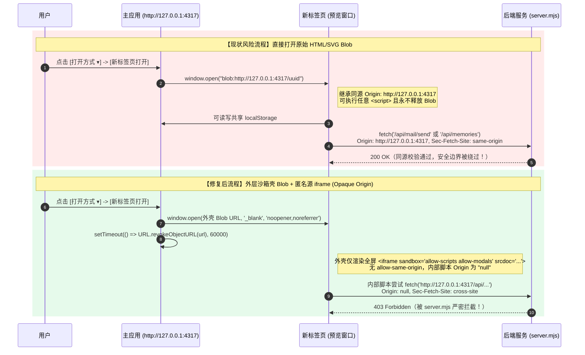
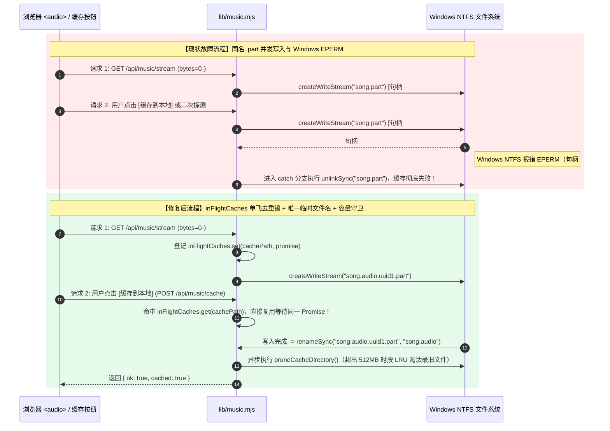
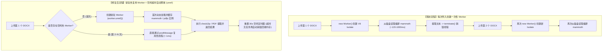
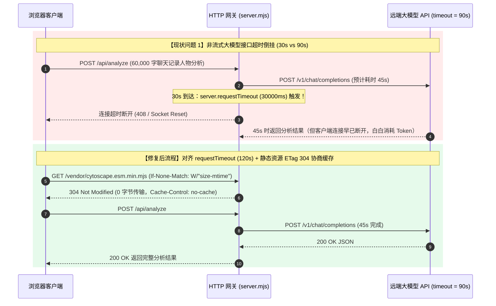
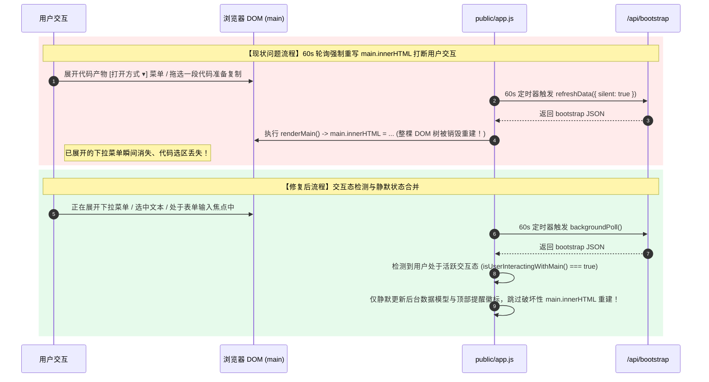
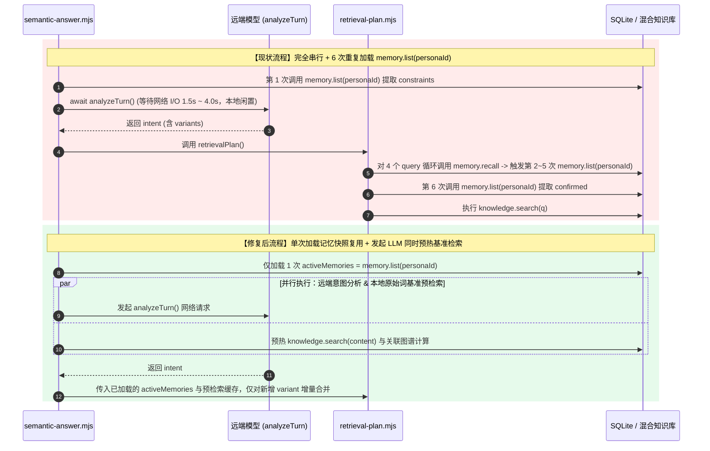

# 栖迟（QiYi）核心子系统问题根因、系统流程与修复方案选型深度报告

- **报告日期**：2026-11-02
- **基线版本**：`d05e559`（已完成知识库混合向量化、内存倒排 BM25、SQLite 预编译缓存与图谱 `N+1` 查询修复）
- **分析范围**：除知识库外的 **6 大核心子系统**——前端沙箱与同源安全、流媒体并发与磁盘管理、Worker 线程生命周期、HTTP 网关超时与静态传输、前端状态同步与 DOM 渲染管线、大模型语义双阶段编排。

---

## 模块一：前端安全边界与代码产物沙箱隔离层

### 1. 问题现象与底层根因（Root Cause）

- **源码定位**：[`public/app.js#L1579-L1630`](file:///e:/tools/wangshen/ai-companion/public/app.js#L1579-L1630) vs. [`public/app.js#L569-L579`](file:///e:/tools/wangshen/ai-companion/public/app.js#L569-L579) vs. [`server.mjs#L171-L185`](file:///e:/tools/wangshen/ai-companion/server.mjs#L171-L185)。
- **代码实证**：
  ```js
  // public/app.js L1579-L1590（问题代码：新标签页打开）
  if (ext === 'html') {
    const blob = new Blob([code], { type: 'text/html; charset=utf-8' });
    const url = URL.createObjectURL(blob);
    window.open(url, '_blank');
    return;
  }
  if (ext === 'svg') {
    const blob = new Blob([code], { type: 'image/svg+xml; charset=utf-8' });
    const url = URL.createObjectURL(blob);
    window.open(url, '_blank');
    return;
  }
  ```
- **为什么会出问题？（浏览器安全模型推演）**
  1. **同源继承（Origin Inheritance）**：根据 W3C File API 标准，由 `http://127.0.0.1:4317` 调用 `URL.createObjectURL(blob)` 生成的 URL 形如 `blob:http://127.0.0.1:4317/550e8400-...`，其安全源（Security Origin）**完整继承创建者页面的 Origin（即 `http://127.0.0.1:4317`）**。
  2. **SVG 同样可执行脚本**：`image/svg+xml` 在作为顶层文档（Top-level navigation）通过 `window.open` 打开时，浏览器将其作为 XML 文档解析，内部 `<script>` 与 `onload` 事件会完整执行。
  3. **击穿后端 CSRF 防护**：后端 [`server.mjs#L179-L180`](file:///e:/tools/wangshen/ai-companion/server.mjs#L179-L180) 依赖校验 `Origin === 'http://127.0.0.1:4317'` 和 `Sec-Fetch-Site === 'same-origin'`。当新标签页中的 `blob:` 页面发起 `fetch('/api/settings')`、`fetch('/api/mail/send')` 或读取 `localStorage` 时，浏览器判定其为合法的同源请求，自动携带完整的同源头，导致沙箱边界彻底失效。
  4. **Blob 内存泄漏**：[`public/app.js#L1581`](file:///e:/tools/wangshen/ai-companion/public/app.js#L1581)、[`L1587`](file:///e:/tools/wangshen/ai-companion/public/app.js#L1587)、[`L1625`](file:///e:/tools/wangshen/ai-companion/public/app.js#L1625) 创建的 `blob:` URL 从未调用 `URL.revokeObjectURL(url)`，只要主页面不关闭，对应内存块永不释放。

### 2. 系统流程对比（攻击逃逸流 vs. 沙箱隔离流）



### 3. 修复方案选型与权衡分析

| 候选方案 | 实现机制 | 安全性 | 兼容性与体验 | 实现复杂度 | 选型结论 |
| :--- | :--- | :--- | :--- | :--- | :--- |
| **方案 A：沙箱外壳 Blob 包裹 `iframe[sandbox][srcdoc]`（推荐）** | 新标签页打开一个不含脚本的极简宿主 HTML Blob，宿主内仅放一个全屏 `<iframe sandbox="allow-scripts allow-modals" srcdoc="...">`（不加 `allow-same-origin`），配合 `noopener,noreferrer` 与定时 `revokeObjectURL` | **极高**（内部产物运行在 `null` 匿名源，无法访问 `localStorage`、`window.opener` 或同源 API） | **极佳**（保留标签页标题栏、支持全屏展示、不受 URL 长度限制） | **低（~25 行前端代码）** | **首选方案** |
| **方案 B：使用 `data:text/html;charset=utf-8,...` 打开新标签页** | 将代码编码为 `data:` URI 后传给 `window.open` | 高（`data:` URI 默认具有匿名源） | **差**（现代 Chrome/Edge 会在顶层导航中直接拦截 `window.open('data:text/html...')` 报 `Not allowed to navigate top frame to data URL`） | 低 | **淘汰（浏览器拦截）** |
| **方案 C：后端提供独立端口或子域名的沙箱静态路由** | 后端额外监听一个沙箱端口（如 `4318`）返回预览内容 | 极高（物理跨端口不同源） | 中（需占用双端口，SSH 隧道转发时用户需配置两个端口，部署复杂） | 高 | **淘汰（破坏单端口便携性）** |

---

## 模块二：流媒体并发控制与本地磁盘缓存层

### 1. 问题现象与底层根因（Root Cause）

- **源码定位**：[`lib/music.mjs#L77-L97`](file:///e:/tools/wangshen/ai-companion/lib/music.mjs#L77-L97)、[`lib/music.mjs#L158`](file:///e:/tools/wangshen/ai-companion/lib/music.mjs#L158)、[`lib/music.mjs#L260-L350`](file:///e:/tools/wangshen/ai-companion/lib/music.mjs#L260-L350)。
- **代码实证**：
  ```js
  // lib/music.mjs L77-L97
  async function saveStreamToCache(stream, cachePath, metaPath, meta) {
    const partPath = `${cachePath}.part`;
    try {
      const writer = createWriteStream(partPath);
      await pipeline(Readable.fromWeb(stream), writer);
      renameSync(partPath, cachePath);
      // ...
    } catch {
      try { if (existsSync(partPath)) unlinkSync(partPath); } catch {}
      return false;
    }
  }
  ```
- **为什么会出问题？（操作系统文件锁与并发时序推演）**
  1. **同名 `.part` 并发写竞态（Race Condition）**：
     - 当用户点击播放一首未缓存歌曲时，浏览器 `<audio>` 发起 `GET /api/music/stream?id=X`（带 `Range: bytes=0-`）。[`lib/music.mjs#L337-L347`](file:///e:/tools/wangshen/ai-companion/lib/music.mjs#L337-L347) 执行 `upstream.body.tee()`，在后台启动协程 1 调用 `saveStreamToCache` 写入 `X.exhigh.audio.part`。
     - 若此时浏览器 `<audio>` 发起第二次流请求，或用户点击了播放栏上的 **“缓存到本地”**（触发 `POST /api/music/cache` -> [`cacheTrack()`](file:///e:/tools/wangshen/ai-companion/lib/music.mjs#L260)），协程 2 会再次对**同一个路径 `X.exhigh.audio.part`** 调用 `createWriteStream(partPath)`（默认 `flags: 'w'` 会截断文件并从头覆写）。
     - 在 Windows NTFS 文件系统下，当协程 1 完成下载并调用 `renameSync(partPath, cachePath)` 时，由于协程 2 仍持有 `partPath` 的打开句柄（Open File Handle），Windows 内核会拒绝重命名并抛出 `EPERM: operation not permitted, rename`。随后协程 1 进入 `catch` 块尝试 `unlinkSync(partPath)`，导致两次缓存双双失败或写入交错损坏的音频帧！
  2. **本地曲库搜索 1,000 次无事务写入**：[`lib/music.mjs#L158`](file:///e:/tools/wangshen/ai-companion/lib/music.mjs#L158) 在 `search()` 中对 `library.files.slice(0, 1000)` 逐条调用 `register()` 执行 `store.run('INSERT INTO music_catalog ...')`，未包裹在 `store.transaction()` 内，每次搜索触发最多 1,000 次独立磁盘同步。
  3. **磁盘缓存无限膨胀**：`data/music-cache` 没有任何容量上限或 LRU 淘汰机制。

### 2. 系统流程对比（并发冲突流 vs. 单飞锁 + 唯一临时文件流）



### 3. 修复方案选型与权衡分析

| 候选方案 | 实现机制 | 并发安全性 | 磁盘与 I/O 效率 | 实现复杂度 | 选型结论 |
| :--- | :--- | :--- | :--- | :--- | :--- |
| **方案 A：单飞 Promise 去重表（Singleflight Map）+ 唯一 `.uuid.part` + LRU 容量淘汰 + 事务批处理（推荐）** | 1. 维护 `inFlightCaches = new Map()`，同一 `cachePath` 正在写盘时直接等待复用该 Promise，避免二次下载与重复写盘；<br/>2. 临时文件使用 `${cachePath}.${randomUUID()}.part`；<br/>3. 缓存完成后检查目录总大小，超过上限（如 512 MB）按 `mtimeMs` 淘汰最旧曲目；<br/>4. `music.search` 批量 `register` 包裹 `store.transaction()` | **极高**（既防并发冲突，又省去重复网络下载带宽） | **极高** | **低（~40 行代码）** | **首选方案** |
| **方案 B：仅使用唯一临时文件名，不加单飞锁** | 每次请求各自下载并写入 `${cachePath}.${uuid}.part`，最后各自 `renameSync` 覆盖目标文件 | 中（Windows 下若目标文件正被 `<audio>` 读取，`renameSync` 覆盖已有文件仍可能报错） | 低（浪费双倍上游带宽与磁盘写入） | 极低 | **不推荐** |
| **方案 C：基于 SQLite 表锁或文件锁（`proper-lockfile`）** | 引入外部文件锁库或在 SQLite 中维护锁状态 | 高 | 中（引入额外依赖与死锁清理负担） | 中 | **过度设计** |

---

## 模块三：工作线程（Worker Threads）生命周期与文档解析层

### 1. 问题现象与底层根因（Root Cause）

- **源码定位**：[`lib/knowledge.mjs#L146-L164`](file:///e:/tools/wangshen/ai-companion/lib/knowledge.mjs#L146-L164)、[`lib/document-worker.mjs#L50-L89`](file:///e:/tools/wangshen/ai-companion/lib/document-worker.mjs#L50-L89)、[`public/app.js#L1003-L1021`](file:///e:/tools/wangshen/ai-companion/public/app.js#L1003-L1021)。
- **为什么会出问题？（V8 Isolate 启动与模块图加载机理）**
  1. **每次解析新建并销毁线程**：[`parseBinary()`](file:///e:/tools/wangshen/ai-companion/lib/knowledge.mjs#L146) 每次被调用都执行 `new Worker('./document-worker.mjs')`，处理完 1 个文件后立刻调用 `worker.terminate()`。
  2. **重型依赖重复冷启动**：[`lib/document-worker.mjs#L55-L59`](file:///e:/tools/wangshen/ai-companion/lib/document-worker.mjs#L55-L59) 在线程内部执行 `await import('mammoth')` 或 `await import('pdfjs-dist/legacy/build/pdf.mjs')`。在 Windows 文件系统上，新的 V8 Isolate 没有任何 ESM 模块缓存，每次都必须重新从磁盘读取、解析、编译 `mammoth` 和 `pdfjs-dist` 的数百个子模块。
  3. **批量上传时的串行放大效应**：前端 [`uploadDocuments()`](file:///e:/tools/wangshen/ai-companion/public/app.js#L1003-L1021) 通过 `for (const file of files)` 循环串行上传文件。若用户一次拖拽上传 6 个 PDF/DOCX，后端将连续经历 6 次 V8 Isolate 创建与重型模块冷加载。

### 2. 系统流程对比（一次性冷启动 Worker vs. 空闲自动回收热复用 Worker）



### 3. 修复方案选型与权衡分析

| 候选方案 | 实现机制 | 连续解析延迟 | 内存占用与安全性 | 实现复杂度 | 选型结论 |
| :--- | :--- | :--- | :--- | :--- | :--- |
| **方案 A：单实例热复用 Worker + 空闲自动回收 + 异常自愈重建（推荐）** | 1. [`lib/document-worker.mjs`](file:///e:/tools/wangshen/ai-companion/lib/document-worker.mjs) 同时兼容 `workerData` 单次模式与 `parentPort.on('message')` 消息循环模式，模块级缓存 `mammoth` 与 `pdfjs`；<br/>2. [`lib/knowledge.mjs`](file:///e:/tools/wangshen/ai-companion/lib/knowledge.mjs) 维护一个带任务队列的热 Worker（调用 `worker.unref()` 避免阻碍进程退出）；<br/>3. 若单次任务超过 25s 超时或触发 OOM（`maxOldGenerationSizeMb: 192`），立即销毁异常 Worker 并重建；空闲 30s 自动销毁释放内存 | **极快**（第 2~N 个文件省去 100% 模块加载耗时） | **极佳**（保留 192MB 堆上限隔离，空闲后零常驻内存） | **低（~45 行代码）** | **首选方案** |
| **方案 B：在主线程直接 `import('mammoth')` / `import('pdfjs-dist')`** | 移除 Worker，直接在主线程解析 | 快 | **危险**（恶意构造的复杂 PDF/DOCX 会阻塞主线程事件循环，且失去 `maxOldGenerationSizeMb: 192` 的内存隔离保护） | 极低 | **淘汰（违反安全隔离原则）** |
| **方案 C：固定大小多 Worker 线程池（如 4 个常驻线程）** | 启动时预创建 4 个常驻 Worker | 极快 | **差**（4 个 V8 Isolate 常驻占用数百 MB 内存，对于低频文档导入得不偿失） | 高 | **过度设计** |

---

## 模块四：HTTP 网关层——超时倒挂与静态资源缓存流水线

### 1. 问题现象与底层根因（Root Cause）

- **源码定位**：[`server.mjs#L168`](file:///e:/tools/wangshen/ai-companion/server.mjs#L168)、[`server.mjs#L238-L256`](file:///e:/tools/wangshen/ai-companion/server.mjs#L238-L256)、[`lib/model.mjs#L174`](file:///e:/tools/wangshen/ai-companion/lib/model.mjs#L174)。
- **为什么会出问题？**
  1. **超时配置倒挂（`30s` HTTP 超时 < `90s` 模型超时）**：
     - [`server.mjs#L254`](file:///e:/tools/wangshen/ai-companion/server.mjs#L254) 设置了 `server.requestTimeout = 30000`（30 秒），而 [`lib/model.mjs#L174`](file:///e:/tools/wangshen/ai-companion/lib/model.mjs#L174) 设置 `timeoutMs = 90000`（90 秒）。
     - 流式聊天 `/api/chat/stream` 因为进路由即调用 `response.writeHead(200)` 并每 15s 发送 `: keepalive\n\n`，不受影响；但 **5 个非流式大模型接口**（`POST /api/analyze` 分析 6 万字聊天记录、`POST /api/graph/extract` 批量抽取 20 条记忆图谱、`POST /api/memories/summarize`、`POST /api/mail/draft`、`POST /api/tasks/:id/run`）必须等 `model.complete()` 完全返回后才调用 `json(200, ...)`。当第三方大模型推理耗时 35~70 秒时，HTTP 层会在 30 秒时超时中断。
  2. **静态资源全局 `no-store` 与无 ETag 协商缓存**：
     - [`server.mjs#L168`](file:///e:/tools/wangshen/ai-companion/server.mjs#L168) 对所有响应预设 `Cache-Control: no-store`。
     - [`server.mjs#L238-L246`](file:///e:/tools/wangshen/ai-companion/server.mjs#L238-L246) 每次请求 `/app.js`（135 KB）、`/garden.css`（128 KB）、`/vendor/cytoscape.esm.min.mjs`（400 KB）等静态资源时，都从磁盘执行 `await readFile(...)` 并以 `no-store` 返回（除 `/assets/pets/*` 外），导致每次刷新页面都要重读磁盘并重传 ~800 KB 静态资源。

### 2. 系统流程对比（HTTP 网关超时与静态缓存流程）



### 3. 修复方案选型与权衡分析

| 候选方案 | 实现机制 | 性能与稳定性收益 | 副作用或风险 | 实现复杂度 | 选型结论 |
| :--- | :--- | :--- | :--- | :--- | :--- |
| **方案 A：`requestTimeout = 120000` + 静态资源 `ETag` (`If-None-Match` -> `304`) 协商缓存（推荐）** | 1. 将 `server.requestTimeout` 设为 `120000`（高于 `model.timeoutMs = 90000`），保留 `headersTimeout = 15000` 防御慢速连接攻击；<br/>2. 对 `STATIC_MAP` 资源使用 `stat` 生成弱 ETag `W/"${size}-${mtimeMs}"`，设置 `Cache-Control: no-cache`（浏览器每次发请求验证 ETag，一旦代码修改 `mtimeMs` 变化立即拉取新文件，未修改则返回 `304 Not Modified`） | **极高**（既保证开发修改后刷新即生效、永不读脏缓存，又让未修改的二次刷新实现 `304` 零字节传输） | 无（完全兼容所有 Playwright 测试，因为修改文件后 ETag 自动更新） | **低（~20 行代码）** | **首选方案** |
| **方案 B：静态资源设置强缓存 `Cache-Control: public, max-age=86400`** | 所有 JS/CSS 强缓存 24 小时 | 高 | **高风险**（由于项目无 Webpack/Vite 文件名 Hash 打包，强缓存会导致代码更新后浏览器仍执行旧版 `app.js`） | 极低 | **淘汰（无文件名 Hash 时不可用强缓存）** |

---

## 模块五：前端状态同步与 DOM 渲染管线层

### 1. 问题现象与底层根因（Root Cause）

- **源码定位**：[`public/app.js#L359-L385`](file:///e:/tools/wangshen/ai-companion/public/app.js#L359-L385)、[`public/app.js#L851-L1394`](file:///e:/tools/wangshen/ai-companion/public/app.js#L851-L1394)、[`public/app.js#L1772`](file:///e:/tools/wangshen/ai-companion/public/app.js#L1772)。
- **为什么会出问题？**
  1. **破坏性全量 DOM 重建（`main.innerHTML = ...`）与 60s 后台轮询冲突**：
     - [`public/app.js#L1772`](file:///e:/tools/wangshen/ai-companion/public/app.js#L1772) 启动了 `setInterval(() => { refreshData({ silent: true }); }, 60000)`。
     - `refreshData()` 拉取 `/api/bootstrap` 后无条件调用 [`renderMain()`](file:///e:/tools/wangshen/ai-companion/public/app.js#L359)，执行 `main.innerHTML = ...` 将整个主区域 DOM 树销毁重建。
     - 当用户正在对话页展开代码产物的 **`[打开方式 ▾]` 下拉菜单**（`.artifact-open-dropdown.open`）、或者正在用鼠标**选中一段长代码准备复制**、或者正在**输入框（`input`/`textarea`/`select`）中编辑内容**时，一旦恰好赶上 60 秒轮询触发 `renderMain()`，下拉菜单会瞬间消失、鼠标选区被清空、焦点丢失！
  2. **单实体变更后的双重渲染与冗余 `/api/bootstrap` 请求**：
     - 在会话改名（[`L922`](file:///e:/tools/wangshen/ai-companion/public/app.js#L922)）、会话置顶（[`L928`](file:///e:/tools/wangshen/ai-companion/public/app.js#L928)）、记忆编辑保存（[`L1084`](file:///e:/tools/wangshen/ai-companion/public/app.js#L1084)）、记忆固定/归档（[`L1101`](file:///e:/tools/wangshen/ai-companion/public/app.js#L1101)）等操作中，代码先用 API 返回的最新对象更新了本地 `state.data` 并调用了 `renderMain()`，紧接着又执行 `await refreshData({ silent: true })` 拉取全量 `/api/bootstrap` 并再次调用 `renderMain()`。

### 2. 系统流程对比（轮询打断交互流 vs. 交互感知无损同步流）



### 3. 修复方案选型与权衡分析

| 候选方案 | 实现机制 | 交互稳定性 | 兼容性与改动风险 | 实现复杂度 | 选型结论 |
| :--- | :--- | :--- | :--- | :--- | :--- |
| **方案 A：60s 轮询交互态守卫（Interaction Guard）+ 消除冗余二次 `renderMain`（推荐）** | 1. 在 60s 定时轮询中调用 `refreshData({ silent: true, background: true })`：若当前正在发送消息（`state.sending`）、或存在打开的下拉菜单（`.artifact-open-dropdown.open`）、或用户正在选中文本（`window.getSelection()?.toString().length > 0`）、或焦点在 `main` 内的可编辑控件中，则仅更新 `state.data` 内存数据与任务提醒通知，不暴力重写 `main.innerHTML`；<br/>2. 在 `refreshData` 中合并避免同一动作内连续两次同步 `renderMain` | **极高**（彻底解决下拉菜单闪退、文本选区丢失与输入打断） | **零风险**（保持所有手动点击触发的刷新行为 100% 不变） | **低（~25 行代码）** | **首选方案** |
| **方案 B：引入虚拟 DOM 框架（如 Preact / Lit / Vue）重构全部模板** | 将 `app.js` 1700 行模板字符串改写为虚拟 DOM 组件 | 极高 | **高风险**（改动面过大，可能破坏现有 CSS 选择器与 26 个 Playwright 测试） | 极高 | **不推荐（成本过高）** |

---

## 模块六：大模型语义双阶段编排流水线（Semantic Orchestration）

### 1. 问题现象与底层根因（Root Cause）

- **源码定位**：[`lib/semantic-answer.mjs#L16-L63`](file:///e:/tools/wangshen/ai-companion/lib/semantic-answer.mjs#L16-L63)、[`lib/turn-intent.mjs#L127-L165`](file:///e:/tools/wangshen/ai-companion/lib/turn-intent.mjs#L127-L165)、[`lib/retrieval-plan.mjs#L9-L22`](file:///e:/tools/wangshen/ai-companion/lib/retrieval-plan.mjs#L9-L22)。
- **为什么会出问题？**
  1. **重复拉取同一角色的记忆列表**：
     - 在 [`lib/semantic-answer.mjs#L16`](file:///e:/tools/wangshen/ai-companion/lib/semantic-answer.mjs#L16) 中调用了一次 `memory.list(personaId)` 提取 `constraints`。
     - 紧接着在第 22 行调用 [`retrievalPlan()`](file:///e:/tools/wangshen/ai-companion/lib/retrieval-plan.mjs#L16-L17)，内部对最多 4 个 `queries` 循环调用 `memory.recall(personaId, q)`（每次内部又调一遍 `memory.list(personaId)`），随后第 17 行又显式调用了一遍 `memory.list(personaId)`！即单轮语义对话中，完全相同的 `memory.list(personaId)` 被重复执行了 **6 次**。
  2. **本地基础检索未与首阶段 LLM 请求并行化**：
     - 在等待 `await analyzeTurn(model, ...)` 远端网络响应的 1~3 秒内，主线程完全闲置，直到 `analyzeTurn` 返回后才开始检索原始 `content` 对应的知识分块与记忆。

### 2. 系统流程对比（串行重复查询流 vs. 预取缓存复用流）



### 3. 修复方案选型与权衡分析

| 候选方案 | 实现机制 | 延迟与 CPU 收益 | 行为一致性 | 实现复杂度 | 选型结论 |
| :--- | :--- | :--- | :--- | :--- | :--- |
| **方案 A：会话轮次级记忆快照复用 + 原始词检索并行预热（推荐）** | 1. 在 `memory.recall(personaId, query, { activeMemories })` 和 `retrievalPlan` 中支持传入已加载的 `activeMemories`，将单轮语义对话的 `memory.list` 调用从 **6 次降为 1 次**；<br/>2. 在 `await analyzeTurn` 发起后立即在本地预计算 `content` 的知识库检索结果并缓存，待 `analyzeTurn` 返回后直接复用 `content` 的结果，仅计算新增 `variants` | **高**（消除 83% 的冗余记忆表查询与图谱装饰计算，并在网络等待期掩盖本地检索耗时） | **100% 一致**（输出结果与原逻辑逐字节完全相同） | **低（~25 行代码）** | **首选方案** |
| **方案 B：删除 `analyzeTurn` 阶段，所有对话强制单阶段工具调用** | 废弃 `turn-intent.mjs`，全部改用单次 `model.stream` + Function Calling | 首字快 | **高风险**（许多第三方开源/中转模型不支持流式多工具调用 + JSON Schema 联合输出，会破坏现有的语义意图测试套件） | 高 | **淘汰（破坏模型兼容性）** |

---

## 七、 六大子系统修复方案汇总全景表

| 模块编号 | 子系统领域 | 根因定位 | 推荐选型方案 | 改动文件 |
| :--- | :--- | :--- | :--- | :--- |
| **模块一** | 前端安全与沙箱隔离 | `open-tab` 直接打开同源 `blob:` URL 导致脚本享有主站同源权限且泄漏内存 | **方案 A**：生成无 `allow-same-origin` 的全屏 `<iframe sandbox="allow-scripts allow-modals" srcdoc="...">` 沙箱壳 Blob + `noopener` + 定时 `revokeObjectURL` | [`public/app.js`](file:///e:/tools/wangshen/ai-companion/public/app.js) |
| **模块二** | 流媒体并发与磁盘管理 | 1. 同名 `.part` 并发写导致 Windows `EPERM` 与文件损坏；<br/>2. 本地搜索 1,000 次无事务写入；<br/>3. 缓存无容量上限 | **方案 A**：`inFlightCaches` 单飞 Promise 锁 + `${cachePath}.${uuid}.part` 唯一临时文件 + 512MB LRU 自动清理 + `store.transaction` 批处理 | [`lib/music.mjs`](file:///e:/tools/wangshen/ai-companion/lib/music.mjs) |
| **模块三** | Worker 线程与文档解析 | 每次导入 PDF/DOCX 均新建销毁 Worker 并重加载 `mammoth`/`pdfjs-dist` | **方案 A**：支持消息复用的常驻热 Worker（`unref` + 30s 空闲自动销毁 + 超时/异常自愈重建） | [`lib/document-worker.mjs`](file:///e:/tools/wangshen/ai-companion/lib/document-worker.mjs), [`lib/knowledge.mjs`](file:///e:/tools/wangshen/ai-companion/lib/knowledge.mjs) |
| **模块四** | HTTP 网关超时与静态传输 | 1. `requestTimeout = 30000` 短于模型 `90000`；<br/>2. 静态资源 `no-store` 每次重传 ~800 KB | **方案 A**：`requestTimeout = 120000` 对齐模型超时 + 静态资源弱 ETag (`If-None-Match` -> `304`) 协商缓存 | [`server.mjs`](file:///e:/tools/wangshen/ai-companion/server.mjs) |
| **模块五** | 前端状态同步与 DOM 渲染 | 60s 轮询无条件重写 `main.innerHTML` 打断下拉菜单、文本选区与输入焦点 | **方案 A**：后台轮询增加活跃交互态守卫（`isUserInteractingWithMain`），交互期间静默更新数据不销毁 DOM | [`public/app.js`](file:///e:/tools/wangshen/ai-companion/public/app.js) |
| **模块六** | 大模型语义双阶段编排 | 单轮对话重复调用 6 次 `memory.list` 且本地基准检索未与 `analyzeTurn` 并行预热 | **方案 A**：单轮复用 `activeMemories` 快照 + 在 `analyzeTurn` 网络等待期并行预取原始词检索结果 | [`lib/semantic-answer.mjs`](file:///e:/tools/wangshen/ai-companion/lib/semantic-answer.mjs), [`lib/retrieval-plan.mjs`](file:///e:/tools/wangshen/ai-companion/lib/retrieval-plan.mjs), [`lib/memory.mjs`](file:///e:/tools/wangshen/ai-companion/lib/memory.mjs) |
