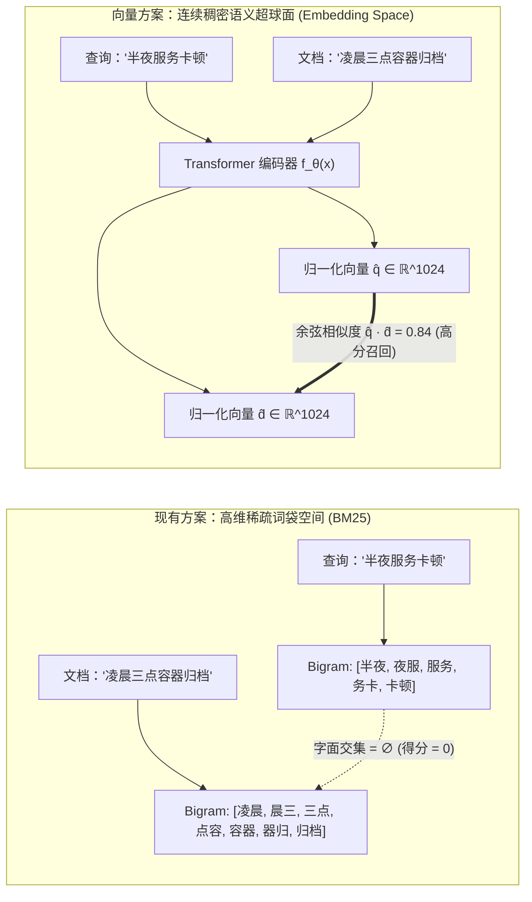
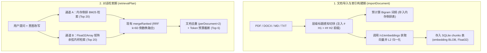

# 栖迟（QiYi）知识库架构深度评估与向量知识库（Vector RAG）原理分析报告

- **报告日期**：2026-11-02
- **评估对象**：[`lib/knowledge.mjs`](file:///e:/tools/wangshen/ai-companion/lib/knowledge.mjs)、[`lib/retrieval-plan.mjs`](file:///e:/tools/wangshen/ai-companion/lib/retrieval-plan.mjs)、[`lib/semantic-answer.mjs`](file:///e:/tools/wangshen/ai-companion/lib/semantic-answer.mjs)、[`lib/memory.mjs`](file:///e:/tools/wangshen/ai-companion/lib/memory.mjs)、[`lib/graph.mjs`](file:///e:/tools/wangshen/ai-companion/lib/graph.mjs)
- **核心命题**：当前基于“中文二元切词（Bigram）+ 手写 BM25”的知识库，换成向量知识库会不会更好？结合向量检索数学与系统原理的深度对比与演进方案。

---

## 一、 核心结论先行（TL;DR）

1. **结论定性：引入向量检索会显著更好，但最佳形态不是“用纯向量库替代现有检索”，而是构建“稠密向量（Dense Vector）+ 稀疏词法（现有 BM25）+ RRF 倒数秩融合”的混合知识库（Hybrid RAG）。**
2. **为什么不能“一刀切”换成纯向量库？**
   - 纯向量检索擅长**跨词面语义匹配**（同义改写、概念泛化、跨语言问答），但在**精确字面匹配**（如报错代码、配置项键名 `musicBaseUrl`、特定人名地名、精确数字与古籍原句）上存在天然的“平滑压缩损失”，反而不如现有的 BM25。
   - 此外，本项目定位为“本地优先（Local-First）”，当用户未配置 Embedding API 或处于离线环境时，必须保留 BM25 作为零外部依赖的兜底通道。
3. **为什么混合向量方案对本项目收益极高且改造成本极低？**
   - **代码基建已就绪**：本项目在 [`lib/retrieval-plan.mjs`](file:///e:/tools/wangshen/ai-companion/lib/retrieval-plan.mjs#L3-L8) 的 [`mergeRanked()`](file:///e:/tools/wangshen/ai-companion/lib/retrieval-plan.mjs#L3) 中，**已经实现了工业界标准的 RRF（Reciprocal Rank Fusion，倒数秩融合，$k=60$）算法**。目前它仅用于融合多个 BM25 同义改写词，只需接入一路向量检索结果，即可无缝升级为混合检索引擎。
   - **无需部署重型外部数据库进程**：在本项目的设计上限（单文档 30 万字、个人知识库通常 $10^3 \sim 5 \times 10^4$ 个分块）下，**不需要引入 Milvus、Qdrant、Chroma 等独立外部服务**。直接利用现有 `node:sqlite` 的 `BLOB` 字段存储归一化 `Float32Array` 向量，并在内存中执行连续类型化数组内积扫描，10,000 个 1024 维向量的精确检索耗时仅需 **$2\text{ ms} \sim 4\text{ ms}$**。

---

## 二、 现状解剖：当前知识库是怎么工作的？存在哪些原理性瓶颈？

### 2.1 现有知识库的三层实现机理（源码级还原）

当前知识库由 [`lib/knowledge.mjs`](file:///e:/tools/wangshen/ai-companion/lib/knowledge.mjs) 与 [`lib/retrieval-plan.mjs`](file:///e:/tools/wangshen/ai-companion/lib/retrieval-plan.mjs) 驱动，核心分为三步：

1. **定长滑动窗口切块（[`chunkText`](file:///e:/tools/wangshen/ai-companion/lib/knowledge.mjs#L43-L58)）**：
   按固定 `size = 1000` 字符、`overlap = 140` 字符切分文本，仅在窗口后半段（`boundary > start + size / 2`）寻找 `\n` 或 `。` 断句；检索时动态拼接该分块前最近出现的一个 Markdown 标题（[`lib/knowledge.mjs#L114-L117`](file:///e:/tools/wangshen/ai-companion/lib/knowledge.mjs#L114-L117)）。
2. **正则 + 中文二元滑动切词（[`tokenize`](file:///e:/tools/wangshen/ai-companion/lib/knowledge.mjs#L9-L17)）**：
   ```js
   export function tokenize(text) {
     const input = String(text).normalize('NFKC').toLowerCase();
     const words = input.match(/[a-z0-9_]{2,}/g) || [];
     for (const segment of input.match(/[\p{Script=Han}]+/gu) || []) {
       if (segment.length === 1) words.push(segment);
       else for (let i = 0; i < segment.length - 1; i++) words.push(segment.slice(i, i + 2));
     }
     return words;
   }
   ```
   英文提取长度 $\ge 2$ 的字母数字串；中文不依赖词典，而是将连续汉字序列按相邻两字做滑动切片（Character Bigram，如 `"冒泡排序"` $\rightarrow$ `["冒泡", "泡排", "排序"]`）。
3. **手写 Okapi BM25 词频逆文档频率打分（[`rankText`](file:///e:/tools/wangshen/ai-companion/lib/knowledge.mjs#L19-L41)）**：
   第 31~38 行实现了标准的 BM25 公式（其中饱和度参数 $k_1 = 1.2$，长度归一化参数 $b = 0.75$）：
   $$\text{Score}_{\text{BM25}}(D, Q) = \sum_{t \in Q} \underbrace{\ln\left(1 + \frac{N - n(t) + 0.5}{n(t) + 0.5}\right)}_{\text{IDF}(t)\text{：逆文档频率}} \cdot \underbrace{\frac{f(t, D) \cdot (k_1 + 1)}{f(t, D) + k_1 \cdot \left(1 - b + b \cdot \frac{|D|}{\text{avgdl}}\right)}}_{\text{TF 饱和度与文档长度惩罚}}$$

---

### 2.2 现有架构的四大原理性瓶颈（为什么仅靠 BM25 不够？）

#### 瓶颈 1：词汇鸿沟（Lexical Gap）——同义不同字时得分为绝对的 `0`
- **原理缺陷**：BM25 建立在**词袋模型（Bag-of-Words）**之上，其数学前提是：两段文本只有包含完全相同的 Token（$f(t, D) > 0$），才会有非零得分。在数学空间上，每个词项是一个正交基向量，“计算机”与“电脑”、“OOM”与“内存溢出”、“报销标准”与“差旅补贴规定”之间的内积恒为 $0$。
- **现有补救措施的局限**：
  虽然在 `semantic` 模式下，[`analyzeTurn`](file:///e:/tools/wangshen/ai-companion/lib/turn-intent.mjs#L153) 会让大模型生成最多 3 个查询变体 `intent.retrieval.variants`（见 [`lib/retrieval-plan.mjs#L13`](file:///e:/tools/wangshen/ai-companion/lib/retrieval-plan.mjs#L13)），但**大模型在生成变体时还没有看到知识库里到底有什么文档（盲猜扩展）**。
  - **典型失效案例**：用户上传了一份《项目运维手册》，里面写的是 *“容器会在每日 03:00 触发快照归档并回收僵尸句柄”*。当用户提问 *“为什么每天半夜服务会卡一下？”* 时，大模型的盲猜变体通常是 `["半夜服务卡顿原因", "凌晨定时任务性能下降", "夜间响应慢"]`——与文档中的 `["容器", "快照", "归档", "僵尸", "句柄"]` **没有任何一个中文双字重合**，BM25 召回结果为空！而在 `fast` 模式下甚至连查询变体都没有。

#### 瓶颈 2：中文二元切词（Character Bigram）引发的“跨词伪命中”与“语序/否定词失明”
- **原理缺陷**：[`tokenize()`](file:///e:/tools/wangshen/ai-companion/lib/knowledge.mjs#L14) 的 `segment.slice(i, i + 2)` 会制造大量跨词边界的伪二元组，且完全丢弃语序与句法依赖。
  - **伪命中案例**：在短语 `"研究生成式模型"` 中，二元切词会产生 `"究生"`、`"生成"`、`"成式"`。若用户搜索 `"研究生"`（切分为 `["研究", "究生"]`），这篇讲“生成式模型”的文档因为同时命中了 `"研究"` 和跨词产生的 `"究生"`，会获得极高的 BM25 得分而被错误排到第一名！
  - **否定与语义反转失明**：文档 A 写 *“严禁在生产环境开启调试日志”*，文档 B 写 *“建议在生产环境开启调试日志”*。两者切出的核心二元组几乎 $100\%$ 重合，BM25 无法区分肯定与否定、原因与结果、主语与宾语互换（如“狗咬人”与“人咬狗”的 Bigram 集合几乎一致）。
  - **单字符英文标识丢失**：[`lib/knowledge.mjs#L11`](file:///e:/tools/wangshen/ai-companion/lib/knowledge.mjs#L11) 的正则 `/[a-z0-9_]{2,}/g` 强制要求长度 $\ge 2$，导致所有单字母关键概念（如 `C` 语言、`R` 语言、`A` 股、`K` 线、`O(1)` 中的 `1`）在分词阶段被直接抹除。

#### 瓶颈 3：“写轻读重”的计算倒置——每次提问全表扫描 + 实时分词
- **原理缺陷**：在 [`lib/knowledge.mjs#L111`](file:///e:/tools/wangshen/ai-companion/lib/knowledge.mjs#L111) 中，每次调用 `knowledge.search(query)` 都会执行：
  1. 从 SQLite 全表读取所有 `chunks` 的原始字符串；
  2. 对所有分块扫描正则提取 Markdown 标题；
  3. 在 [`rankText`](file:///e:/tools/wangshen/ai-companion/lib/knowledge.mjs#L22-L27) 中对全表每一个分块重新执行 `tokenize()`。
  在 [`retrievalPlan`](file:///e:/tools/wangshen/ai-companion/lib/retrieval-plan.mjs#L14) 中，`queries.map(q => knowledge.search(q, 10))` 会连续调用 **最多 4 次**！这意味着哪怕知识库一字未改，每次用户发一句话，CPU 都要把整个知识库的所有文章重新分词 4 遍。

#### 瓶颈 4：扁平标题拼接导致的长文档层级语境丢失
- **原理缺陷**：[`lib/knowledge.mjs#L114-L117`](file:///e:/tools/wangshen/ai-companion/lib/knowledge.mjs#L114-L117) 仅记录 `headings.set(row.documentId, found.at(-1)[1])`，即只保留**最后一个标题**。
  - **失效案例**：若文档结构为：
    ```markdown
    # 网易云音乐接入指南
    ## 常见问题
    ### 连接超时怎么处理
    检查本地 3000 端口是否启动...
    ```
    当切到 `### 连接超时怎么处理` 这一块时，前序标题变量 `previous` 被覆盖为 `"连接超时怎么处理"`，而顶层主题 `"网易云音乐接入指南"` 丢失了（除非文件名恰好包含）。如果另一个章节 `# 邮箱 SMTP 接入指南` 下也有一个同名的 `### 连接超时怎么处理`，检索器就极易将两个不同模块的排障步骤混淆。

---

## 三、 向量知识库（Vector Knowledge Base）核心原理深度解析

将文本转化为向量的过程，本质上是将离散符号从 **“高维稀疏正交词袋空间”** 映射到 **“低维稠密连续语义流形（Semantic Manifold）”**。



### 3.1 原理一：稠密语义嵌入（Dense Semantic Embedding）与对比学习流形

1. **正交基 vs. 连续流形**：
   - 在 BM25 中，假设所有中文二元组和英文词构成维度为 $V \approx 100,000$ 的空间，每段文本是一个仅有几十个非零元素的稀疏向量 $\mathbf{x} \in \mathbb{R}^V$。任意两个不同词所在坐标轴夹角恒为 $90^\circ$（$\mathbf{e}_i \cdot \mathbf{e}_j = 0, i \neq j$），本身不携带任何语义关联。
   - 在 Embedding 模型（如 OpenAI `text-embedding-3-small`、智谱 `embedding-3`、开源 `BAAI/bge-m3`）中，文本通过多层双向 Transformer 编码为一个固定维度 $d$（通常 $d \in [512, 1536]$）的稠密实数向量 $\mathbf{v} \in \mathbb{R}^d$。
2. **为什么向量能理解“言外之意”与“问题—答案配对”？**
   现代检索专用的 Embedding 模型并非简单的词向量平均，而是通过大规模 **非对称对比学习（Asymmetric Contrastive Learning，基于 InfoNCE 损失函数）** 训练出来的：
   $$\mathcal{L}_{\text{InfoNCE}} = -\log \frac{\exp\left(\frac{\text{sim}(\mathbf{q}, \mathbf{d}^+)}{\tau}\right)}{\exp\left(\frac{\text{sim}(\mathbf{q}, \mathbf{d}^+)}{\tau}\right) + \sum_{j=1}^{M} \exp\left(\frac{\text{sim}(\mathbf{q}, \mathbf{d}_j^-)}{\tau}\right)}$$
   其中 $\mathbf{q}$ 是用户提问，$\mathbf{d}^+$ 是能够回答该问题的正确文档段落（正样本），$\mathbf{d}_j^-$ 是难负样本（Hard Negatives，例如字面很像但语义相反的段落），$\tau$ 是温度超参数。
   - **训练结果**：模型被迫在 $d$ 维超球面上学习一种几何拓扑——**“一个问题”和“能回答它的段落”哪怕没有一个字相同，也会被投射到球面上距离极近的邻域内**；而字面重合但带否定词或语义无关的难负样本，则被推斥到远离该邻域的位置。

### 3.2 原理二：双向自注意力（Bi-directional Self-Attention）消除语序与歧义盲区

在 Transformer 编码器内部，每个 Token $i$ 的隐藏状态由全句所有 Token 动态加权聚合而成：
$$\text{Attention}(Q, K, V) = \text{softmax}\left(\frac{QK^\top}{\sqrt{d_k}}\right)V$$
这直接解决了现有 `tokenize()` 的三大痛点：
1. **消除跨词切分噪音**：基于 BPE / WordPiece 子词分词与上下文注意力，模型能准确识别 `"研究 / 生成式 / 模型"` 的句法结构，绝不会将其与 `"研究生"` 混淆。
2. **捕捉句法修饰与否定极性**：在 *"严禁在生产环境开启调试日志"* 中，`"严禁"` 的注意力权重会强烈修饰 `"开启"`，生成的句向量在方向上与 *"建议开启"* 产生显著偏角。
3. **跨语言与缩写对齐**：中英文、全称与缩写（如 `"内存溢出"`、`"Out of Memory"`、`"OOM"`）在多语言预训练流形中天然聚拢在同一簇内。

### 3.3 原理三：相似度计算的几何本质与工程极速优化

向量知识库检索的核心算子是计算查询向量 $\mathbf{q} \in \mathbb{R}^d$ 与每个文档分块向量 $\mathbf{d}_i \in \mathbb{R}^d$ 的距离。最常用三种度量：

1. **余弦相似度（Cosine Similarity）**：衡量两个向量在方向上的一致性，不受文本长短带来的模长缩放影响：
   $$\text{cos}(\mathbf{q}, \mathbf{d}) = \frac{\sum_{k=1}^d q_k d_k}{\sqrt{\sum_{k=1}^d q_k^2} \cdot \sqrt{\sum_{k=1}^d d_k^2}}$$
2. **欧氏距离（$L_2$ Distance）**：$\|\mathbf{q} - \mathbf{d}\|_2 = \sqrt{\sum_{k=1}^d (q_k - d_k)^2}$。
3. **内积（Inner Product / Dot Product）**：$\mathbf{q} \cdot \mathbf{d} = \sum_{k=1}^d q_k d_k$。

> [!TIP]
> **工程加速核心定理（单位超球面等价性）**：
> 若在向量写入数据库时，预先将其除以自身 $L_2$ 模长做**单位归一化**（即 $\|\hat{\mathbf{q}}\|_2 = \|\hat{\mathbf{d}}\|_2 = 1$），则三者完全等价：
> $$\text{cos}(\hat{\mathbf{q}}, \hat{\mathbf{d}}) = \hat{\mathbf{q}} \cdot \hat{\mathbf{d}} = 1 - \frac{1}{2}\|\hat{\mathbf{q}} - \hat{\mathbf{d}}\|_2^2$$
> 这意味着在查询阶段，我们**只需要做纯粹的乘加运算（Dot Product）**，完全省去了平方根运算！
> 在 Node.js 中，将所有分块向量平铺在一个连续的 `Float32Array(N * d)` 内存块中，V8 引擎可以顺序预取 CPU L1/L2 Cache，计算 $N = 10,000$ 个 $d = 1024$ 维向量的精确内积仅需约 **`2.5 毫秒`**！

### 3.4 原理四：向量索引算法（Flat Scan vs. IVF vs. HNSW）的选型边界

很多开发者误以为“用向量库就必须部署庞大的 HNSW 图索引服务”，实际上取决于分块规模 $N$：

| 索引类型 | 算法原理 | 查询时间复杂度 | 内存开销 | 召回精度 | 适用规模与本项目建议 |
| :--- | :--- | :--- | :--- | :--- | :--- |
| **Flat（精确线性扫描）** | 将归一化向量存储在连续 `Float32Array` 中，遍历计算 $\hat{\mathbf{q}} \cdot \hat{\mathbf{d}}_i$ 并维护最小堆取 Top-K | $O(N \cdot d)$ | 极低（仅原始向量：$10,000 \times 1024 \times 4\text{B} \approx 40\text{ MB}$） | **$100\%$（精确解）** | **$N \le 30,000$ 分块（约 3,000 万字）首选**。毫秒级响应，零索引损坏风险，最适合栖迟本地架构 |
| **IVF（倒排文件聚类）** | 先用 K-Means 将向量空间划分为 $C$ 个质心簇（Voronoi 胞腔），查询时仅扫描距离 $\mathbf{q}$ 最近的 $n_{\text{probe}}$ 个簇 | $O\left(\left(C + \frac{n_{\text{probe}}}{C}N\right)d\right)$ | 低（仅多存质心表与倒排表） | $90\% \sim 98\%$（近似解，受边界效应影响） | 适合 $50,000 < N < 1,000,000$ 且内存受限场景，但需定期重训质心 |
| **HNSW（分层可导航小世界图）** | 构建多层近邻跳表图（顶层稀疏长跳、底层稠密局部搜索），按贪心路由逼近最近邻 | $O(d \cdot \log N)$ | 高（每个节点需额外存储多层图边指针，内存膨胀 $1.5 \sim 2.5$ 倍） | $95\% \sim 99.5\%$（近似解） | 适合 $N > 100,000$ 的企业级海量库，单机小库引入反而增加维护负担 |

---

## 四、 辩证对比：为什么“混合检索（BM25 + 向量 + RRF）”才是最佳答案？

如果完全抛弃现有 BM25、只用纯向量库，会遇到以下三个原理性短板：

1. **精确符号与专有名词的“平滑模糊化”**：
   向量模型倾向于捕捉整体语义而非精确字符。当用户查询特定报错码 `ERR_SSL_PROTOCOL_ERROR`、环境变量名 `QIYI_PORT`、或者某个人物的生僻名字时，向量模型可能把其他讲“网络报错”但错误码完全不同的段落排到前面；而 BM25 的高 IDF 精确词项匹配能做到指哪打哪。
2. **信息瓶颈（Information Bottleneck）**：
   将一个 1,000 字的复杂段落压缩进固定 1024 个浮点数中，本质上是有损压缩。段落中顺带提及的某个细节数字或次要配置项，在句向量中的权重可能被主题句稀释。
3. **外部依赖与离线韧性**：
   向量化依赖 Embedding 模型。如果用户只配置了对话模型（或者某些中转 API 不支持 `/v1/embeddings` 接口），纯向量库会彻底瘫痪。

### 混合检索的数学胶水：倒数秩融合（Reciprocal Rank Fusion, RRF）

为了同时拥有 **向量检索的高语义召回率（Recall）** 与 **BM25 的高精确字面匹配率（Precision）**，现代工业界 RAG 标准架构采用双路并行召回 + RRF 融合：

$$\text{Score}_{\text{RRF}}(d) = \frac{w_{\text{vec}}}{k + \text{rank}_{\text{vec}}(d)} + \frac{w_{\text{bm25}}}{k + \text{rank}_{\text{bm25}}(d)} \quad (k = 60)$$

- **为什么用 RRF 而不是直接分数相加？**
  因为 BM25 的得分是无界正数（如 `1.2 ~ 18.5`，随查询词数量剧烈波动），而余弦相似度分布在 `[-1, 1]`（且很多 Embedding 模型集中在 `[0.65, 0.90]` 的狭窄区间内）。直接线性加权很容易被其中一路极值统治；而 RRF 将分数转换为**名次（Rank）**，完全免疫量纲与分布差异！
- **与本项目现有代码的契合度**：
  查看 [`lib/retrieval-plan.mjs`](file:///e:/tools/wangshen/ai-companion/lib/retrieval-plan.mjs#L3-L8) 第 3~8 行：
  ```js
  export function mergeRanked(results, { limit=6, perDocument=2, budget=7000 }={}) {
    const merged=new Map();
    for(const rows of results) rows.forEach((row,index)=>{ const key=row.id || `${row.documentId}:${row.index}`; const entry=merged.get(key) || {row,rank:0}; entry.rank+=1/(60+index+1); merged.set(key,entry); });
    // ...
  ```
  **本项目已经原生实现了 $k=60$ 的 RRF 融合器！** 只要将 `knowledge.vectorSearch(query)` 的排序列表作为 `results` 的一个分支传入 `mergeRanked`，就能立刻获得双路混合检索能力。

| 评估维度 | 现有方案（BM25 + LLM 盲猜变体） | 纯向量方案（Pure Vector DB） | 混合方案（Vector + 倒排 BM25 + RRF） |
| :--- | :--- | :--- | :--- |
| **同义改写 / 概念问答** | 弱（完全依赖 LLM 盲猜能否撞上原词） | **极强**（高维语义流形直接对齐） | **极强** |
| **跨语言检索（中搜英/英搜中）** | 无（得分为 0） | **强**（多语言 Embedding 天然对齐） | **强** |
| **否定句式 / 语序敏感度** | 无（词袋模型忽略语序） | **强**（双向自注意力建模上下文） | **强** |
| **精确代码标识符 / 错误码 / 人名** | **强**（高 IDF 精确命中） | 中偏弱（易发生语义泛化漂移） | **极强（双路互补置顶）** |
| **查询期 CPU 复杂度** | 差（当前每次全表分词 $O(N \cdot L)$） | 极快（归一化向量内积 $O(N \cdot d)$，`< 3ms`） | 极快（内存倒排 BM25 + 向量内积，合计 `< 5ms`） |
| **无 Embedding 模型时的降级能力** | 原生支持 | 不可用 | **完美平滑降级为内存倒排 BM25** |

---

## 五、 结合栖迟（QiYi）项目的落地方案设计

为了让向量知识库真正适配本项目的轻量级、零外部数据库依赖架构，建议分四步演进：



### 5.1 存储层：SQLite 原生 `Float32Array` BLOB 存储（[`lib/store.mjs`](file:///e:/tools/wangshen/ai-companion/lib/store.mjs)）
无需引入任何 C++ 编译插件或外部 Docker 容器，直接在 SQLite `chunks` 表（以及 `memories` 表）增加两个字段：
```sql
ALTER TABLE chunks ADD COLUMN embedding BLOB;
ALTER TABLE chunks ADD COLUMN embeddingDim INTEGER DEFAULT 0;
```
- 一个 1024 维的 `Float32Array` 向量仅占 `1024 × 4 = 4,096 Bytes (4 KB)`。
- 在入库前执行 $L_2$ 归一化：
  ```js
  export function normalizeVector(values) {
    const vec = new Float32Array(values);
    let norm = 0;
    for (let i = 0; i < vec.length; i++) norm += vec[i] * vec[i];
    norm = Math.sqrt(norm) || 1;
    for (let i = 0; i < vec.length; i++) vec[i] /= norm;
    return Buffer.from(vec.buffer, vec.byteOffset, vec.byteLength);
  }
  ```

### 5.2 分块层：从“扁平硬切”升级为“层级标题栈注入”（[`lib/knowledge.mjs`](file:///e:/tools/wangshen/ai-companion/lib/knowledge.mjs)）
在切块时维护一个按标题级别（`H1 ~ H6`）更新的标题栈 `headingStack`，将完整的章节面包屑路径（如 `[文档：运维手册 | 章节：数据库 > 备份恢复]`）前置拼入分块的索引文本与 Embedding 输入中。这样即使某个分块只有短短两句话（如 *“执行上述命令后需重启服务”*），其生成的向量也完整包含了它所属的顶层业务上下文。

### 5.3 检索层：内存倒排 BM25 + 向量内积 + RRF 双路融合
1. **启动与增量加载**：服务启动时将 `chunks` 表的分词统计与 `embedding` BLOB 缓存在内存中；仅在 `importDocument` / `deleteDocument` 时增量更新内存索引，彻底消除每次对话的全表正则分词。
2. **双路召回融合**：
   - 当配置了 Embedding 模型（或在兼容 OpenAI 接口的同一 `baseUrl` 下配置了 `embeddingModel`）时，并行执行 `bm25Search(query, 15)` 与 `vectorSearch(queryVec, 15)`，送入 [`mergeRanked([bm25Rows, vectorRows])`](file:///e:/tools/wangshen/ai-companion/lib/retrieval-plan.mjs#L3) 进行 RRF 融合。
   - **一举两得赋能长期记忆（[`lib/memory.mjs`](file:///e:/tools/wangshen/ai-companion/lib/memory.mjs)）**：当前 `memory.recall()` 同样依赖 `rankText()` 做字面匹配。引入该向量模块后，角色的**长期记忆召回**也能同步升级为“向量语义召回 + BM25 词法召回 + [`lib/graph.mjs`](file:///e:/tools/wangshen/ai-companion/lib/graph.mjs) 知识图谱三元组扩散”的 **三路混合 GraphRAG**。
