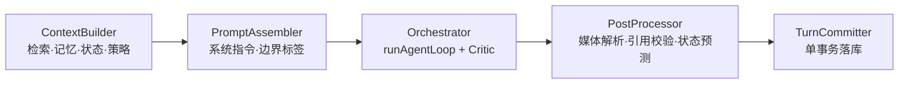
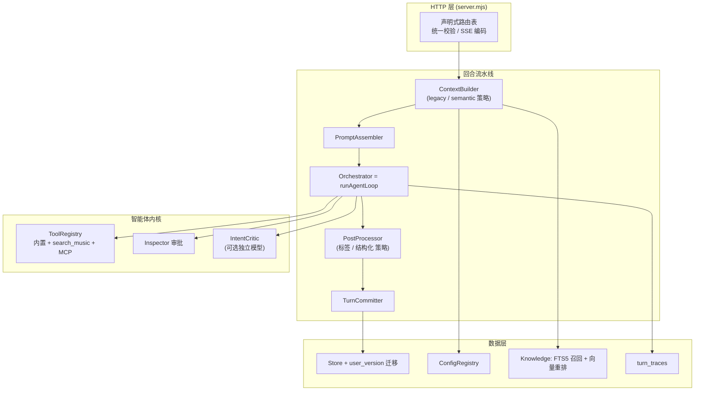

# 栖忆 · 架构设计分析及优化（2026-11-04）

> 范围：`server.mjs` + `lib/`（40 个模块）+ `public/`（零构建前端）+ 存储 / 检索 / 编排链路。
> 基线：提交 `323368a`（主会话接通 ReAct 与 Actor-Critic 之后）。所有结论附文件位置，便于逐条核对。
> 本文为分析文档，未修改代码。

---

## 一、总体结论

栖忆的**底层取舍是对的**：Node 22 原生能力 + SQLite WAL + 零构建 ESM，带来了单命令启动、零供应链风险和秒级测试（812 项单测约 30 秒）。安全基线（Host/Origin 白名单、凭据隔离、审批 Ticket、不可信数据边界标签）也明显强于同类个人项目。

主要问题不在“选型”，而在**演进过程中积累的结构性债务**，可归为三类：

| 类别 | 一句话描述 | 风险 |
| --- | --- | --- |
| **编排层分叉** | 推理循环存在两套实现，安全与熔断逻辑只在其中一套生效 | 🔴 高（含上一提交引入的回归） |
| **服务层膨胀** | `service.mjs` 的 `answer()` 一个函数承担检索、提示词、工具、媒体、状态五种职责 | 🟠 中（每次新功能都在加深耦合） |
| **规模化路径** | 检索全量扫描、bootstrap 全量下发、前端整页字符串渲染 | 🟡 中低（当前数据量下不明显，随使用增长线性恶化） |

> [!IMPORTANT]
> 第二节的 P0 问题中有 4 项是**上一轮（ReAct + Critic 接入）由我引入的**。测试全部通过，但测试没有覆盖这些路径。建议在做任何其他优化之前先修复。

---

## 二、P0：编排层问题（需立即修复）

### 2.1 推理循环两套实现，主会话绕过了指令审批与熔断

当前存在两个 ReAct 循环：

| 能力 | [`agent-loop.mjs`](file:///e:/tools/wangshen/ai-companion/lib/agent-loop.mjs) `runAgentLoop` | [`service.mjs`](file:///e:/tools/wangshen/ai-companion/lib/service.mjs#L156-L252) `answer()` 内联循环 |
| --- | --- | --- |
| 使用方 | `POST /api/agent/run` | **主聊天 + 定时任务**（实际流量的绝大部分） |
| 指令审批 `inspector.assess` / Ticket | ✅ | ❌ 直接 `toolRegistry.execute`（[L239](file:///e:/tools/wangshen/ai-companion/lib/service.mjs#L239)） |
| 5 次重复调用熔断 | ✅ | ❌ |
| 5 次失败阻断 | ✅ | ❌ |
| `criticMaxRetries` 上限 | ✅ | ❌（见 2.2） |
| `search_music` 特殊处理 | ❌ | ✅ |

**后果**：[`mcp-manager.mjs` L150](file:///e:/tools/wangshen/ai-companion/lib/mcp-manager.mjs#L150) 会把 MCP 服务器的工具注册进同一个 `toolRegistry`。一旦用户接入带写操作的 MCP 服务（写文件、执行命令），主聊天里模型可以**不经审批直接执行**——这直接违反 GEMINI.md 第五节红线 4“敏感指令强审批”。当前内置三个工具均为只读，所以尚未造成实际危害，但这是一个潜伏的安全缺口。

**建议**：删除 `service.mjs` 中的内联循环，统一走 `runAgentLoop`。把 `search_music` 做成 `toolRegistry` 中的一个普通工具（其“禁止二次检索、必须点击播放”的约束通过工具结果的 `system` 后缀注入，`runAgentLoop` 提供 `onToolResult` 钩子即可）。

### 2.2 主会话 Critic 重试次数不受 `criticMaxRetries` 约束

[`service.mjs` L176](file:///e:/tools/wangshen/ai-companion/lib/service.mjs#L176)：`if (!auditResult.passed && loopSteps < maxSteps)`。重试上限实际是 `agentMaxSteps`（默认 20），而设置页上暴露给用户的“最大反思轮数 0～2”在主会话中**无效**。

最坏情况下一轮对话会产生 约 20 次回答 + 20 次审核 = 40 次模型调用。设计文档承诺的成本上限是

$$
N_{\text{calls}} \le N_{\text{tool}} + (R_{\max} + 1) \times 2,\quad R_{\max} \le 2
$$

修复方式同 2.1（统一后自然消失）；若短期保留内联循环，至少引入独立的 `criticRetries` 计数器。

### 2.3 语义模式与兼容模式能力不一致

上一轮为了让 `semantic-intent.test.mjs` 通过，回滚了 [`semantic-answer.mjs`](file:///e:/tools/wangshen/ai-companion/lib/semantic-answer.mjs) 的改动。现状：

- **兼容模式（legacy，默认）**：有工具循环 + Critic。
- **语义模式（semantic）**：仍是单轮生成，没有工具、没有 Critic。

用户切换到语义模式会感到“又只会思考一轮”，与设计文档不符。根因是两条回答路径各自拼装提示词和调用模型（见第三节 3.2）。

### 2.4 用正则启发式控制工具可见性

[`service.mjs` L87](file:///e:/tools/wangshen/ai-companion/lib/service.mjs#L87)：`isMusicIntent = ... /放歌|播放|点歌|想听|来首/i.test(content)`。这是为了让 tags 模式下的音乐测试通过而加的补丁，存在两个问题：

1. 与 `response-policy.mjs` 中已有的音乐意图判断重复，且规则更粗（“我想听你说说”会误判，从而关闭本轮所有工具）。
2. 工具是否可用本应由**配置和意图规划**决定，而不是关键词。

**建议**：以 `behaviorPlan` 为唯一判断源；tags 模式与工具调用的冲突改为“tags 模式下 `search_music` 不进入工具列表，其他工具照常提供”。

### 2.5 Critic 的结构性缺陷

| 问题 | 说明 | 建议 |
| --- | --- | --- |
| 同模型自审 | [`intent-critic.mjs` L83](file:///e:/tools/wangshen/ai-companion/lib/intent-critic.mjs#L83) 使用与回答相同的 `model`，存在自我偏好偏差，且时延翻倍 | 支持独立配置 `criticModel`（可用更小更快的模型）；未配置时退回主模型 |
| 被驳回的答案会先流给用户 | 流式模式下候选答案边生成边推送，审核不通过后被替换，用户看到“文字闪回” | 需要审核的回合改为**缓冲输出**：前端显示 `reviewing` 状态，审核通过后一次性推送；不需要审核的寒暄保持流式 |
| 定时任务也会触发 | `answer()` 同时被 [`scheduler`](file:///e:/tools/wangshen/ai-companion/lib/service.mjs#L278) 使用，后台任务会无人值守地跑多轮工具与审核 | 编排参数按调用来源区分：后台任务默认 `maxSteps` 较小、Critic 关闭 |

---

## 三、P1：结构性优化

### 3.1 拆分 `answer()`：从“上帝函数”到回合流水线

[`service.mjs`](file:///e:/tools/wangshen/ai-companion/lib/service.mjs) 共 567 行，其中 `answer()`（L74 起）约 200 行，同时负责：知识/指南/记忆检索 → 状态与回应策略 → 提示词拼装 → 工具循环 → Critic → 媒体解析 → 结果组装。`sendMessage` 再负责附件包装、历史裁剪、事务提交。

建议拆为四个**纯职责阶段**，每个阶段输入输出都是普通对象，便于单测与替换：



- `ContextBuilder` 与 `PostProcessor` 内部按 **legacy / semantic 两种策略**实现，`Orchestrator` 和 `TurnCommitter` 两种模式共用。
- `sendMessage` 只做：加锁 → 跑流水线 → 释放锁。
- 预计 `service.mjs` 可降到 250 行以内，新增文件约 4 个。

### 3.2 合并两条回答路径

`semanticAnswer` 与 legacy `answer` 是两套平行实现：各自检索、各自拼提示词、各自调模型、各自解析输出。这导致每个横切能力（工具、Critic、附件、诊断）都要实现两遍，并且 2.3 这类不一致必然反复出现。

3.1 的流水线完成后，两种模式的差异收敛为“`ContextBuilder` 是否先跑一次意图分析”和“`PostProcessor` 用结构化还是标签协议解析”，其余全部共用。

### 3.3 路由：从 if 链到声明式路由表

[`server.mjs` L73](file:///e:/tools/wangshen/ai-companion/server.mjs#L73) 的 `route()` 是约 38 条 `if (method === ... && pathname === ...)` 串联。问题是：路由不可枚举（无法自动生成接口清单或做统一鉴权）、带参数路径靠手写正则、顺序敏感。

建议保持零依赖，用一个数组即可：

```js
const routes = [
  ['GET',  '/api/bootstrap',              (api) => api.bootstrap()],
  ['POST', '/api/conversations/:id/messages', (api, { params, input, stream }) => api.sendMessage(params.id, input, stream)],
  // ...
];
```

附带收益：可以在一个地方统一校验 `Content-Type`、请求体大小，并导出 `GET /api/_routes` 用于自检与文档生成。

### 3.4 数据库迁移：引入 `user_version`

[`store.mjs`](file:///e:/tools/wangshen/ai-companion/lib/store.mjs) 目前用 `PRAGMA table_info(...)` + 条件 `ALTER TABLE` 做隐式迁移（已有 5 处）。随着字段增加，启动时每次都要逐表探测，且无法表达“删列 / 改类型 / 数据回填”。

建议：

```js
const MIGRATIONS = [
  /* 1 */ db => db.exec("ALTER TABLE messages ADD COLUMN attachments TEXT NOT NULL DEFAULT '[]'"),
  /* 2 */ db => db.exec('ALTER TABLE memories ADD COLUMN confirmedAt TEXT'),
  // ...
];
const current = db.prepare('PRAGMA user_version').get().user_version;
for (let v = current; v < MIGRATIONS.length; v++) store.transaction(() => { MIGRATIONS[v](db); db.exec(`PRAGMA user_version = ${v + 1}`); });
```

旧库首次升级时，用现有的探测逻辑推断起始版本即可平滑过渡。

### 3.5 配置存储碎片化

当前配置分散在：`settings`（KV）、`media_settings`、`mail_settings`、`response_settings`、`configuration_guides`、`pet_state` 等多张单行 JSON 表，各自实现读写和校验。`store.settings()` 只覆盖其中一部分，`DEFAULTS` 也只描述 `settings` 表。

建议引入统一的 `ConfigRegistry`：每个配置域声明 `{ table, defaults, validate }`，读写、默认值合并、修订号并发控制统一处理。不需要合表，重点是**统一访问入口**。

---

## 四、P2：规模化与性能

### 4.1 知识检索：全量内存扫描 + 非语义向量

- [`knowledge.mjs` L408](file:///e:/tools/wangshen/ai-companion/lib/knowledge.mjs#L408)：每次检索对 `cachedItems` 全量计算余弦相似度，复杂度 `O(N·d)`。
- [`vector.mjs`](file:///e:/tools/wangshen/ai-companion/lib/vector.mjs) 的 `qiyi-hybrid-vec-v1` 是 256 维的本地特征哈希投影，本质仍是词面特征，**不具备真正的语义召回能力**（同义改写如“报到”与“入职”依赖手工词表）。

建议分两步，均不引入新依赖：

1. **词面召回交给 SQLite FTS5**（`node:sqlite` 内置），用 `bm25()` 排序 + `LIMIT`，替代 JS 侧全量 BM25/扫描；向量只对 FTS5 前 50 条做重排。
2. **可选真实嵌入**：若用户配置的模型服务提供 `/embeddings` 接口，导入文档时计算并存入 `chunk_vectors`；未配置时退回本地哈希向量。保持“本地优先、云端可选”。

### 4.2 `bootstrap` 全量下发

`GET /api/bootstrap` 一次返回全部会话、全部文档、全部记忆、全部任务和最近 100 条运行记录。前端每次刷新都重新拉取。数据增长后首屏体积与解析时间线性增加。

建议：会话与记忆改为分页接口（前端已有分页 UI）；`bootstrap` 只返回设置与计数；对其余资源加 `ETag` / `If-None-Match`，未变化时返回 304。

### 4.3 前端：单文件与整页字符串渲染

| 文件 | 行数 | 体积 |
| --- | --- | --- |
| [`public/app.js`](file:///e:/tools/wangshen/ai-companion/public/app.js) | 2226 | 163 KB |
| [`public/garden.css`](file:///e:/tools/wangshen/ai-companion/public/garden.css) | 3397 | 141 KB |
| `public/entrance.css` | 1433 | 44 KB |

`app.js` 通过模板字符串 + `innerHTML` 整块重绘视图，单行模板常超过 2000 字符（如设置页 L1435–L1438），可读性与可维护性都较差，且整块重绘会丢失焦点与滚动位置（目前靠各处手工恢复）。

在**不引入构建工具**的前提下：

1. 按视图拆分 ESM 模块：`views/chat.js`、`views/settings.js`、`views/knowledge.js` 等，`app.js` 只保留状态与路由（目标 < 600 行）。
2. 长模板拆成小函数，每个函数返回一个区块。
3. 聊天消息列表改为**增量追加**而不是整块 `innerHTML`，消除流式输出时的重排。
4. `garden.css` 按组件拆文件，利用 `@layer` 管理与 `styles.css` 的覆盖顺序，替代目前依赖加载顺序的隐式覆盖。

### 4.4 模型客户端：缺少有界重试

[`model.mjs`](file:///e:/tools/wangshen/ai-companion/lib/model.mjs) 对 429 / 5xx 只做错误文案映射。ReAct + Critic 之后单轮调用次数增加，任何一次瞬时失败都会导致整轮作废。

建议：**仅在收到首字节之前**对 429 / 502 / 503 / 网络错误做最多 2 次指数退避重试（尊重 `Retry-After`）；首字节之后不重试，避免重复计费与重复输出。重试必须遵守 `AbortSignal`。

---

## 五、P3：可观测性与工程卫生

### 5.1 缺少回合级追踪

目前无法回答“这轮对话调了几次模型、用了哪些工具、Critic 打了几分、耗时在哪”。`semanticDiagnostics` 只覆盖语义模式的部分阶段。

建议新增 `turn_traces` 表（不含任何凭据与正文全文）：`conversationId, messageId, mode, modelCalls, toolCalls[], criticScores[], tokens, durationMs, outcome`。设置页提供“最近 50 轮诊断”只读视图。这也是评估 Critic 是否真正提升质量的唯一依据。

### 5.2 SSE 事件协议需要成文

GEMINI.md 规定了事件名枚举，但 `status.phase` 的取值（`analyzing`、`finalizing`、`reviewing`、`reflecting` 等）和各事件的字段结构没有集中定义，前后端各自硬编码。建议在 `public/` 下新增前后端共用的 `sse-protocol.js`（与 `response-scenes.js` 同样的共享方式），导出事件名与 phase 常量。

### 5.3 文档沉积

`docs/` 下已有 22 份文档，其中至少 7 份是不同日期的“审查 / 优化 / 架构分析”报告（`project-review-2026-10-31`、`critical-review-2026-11-01`、`optimization-solutions-2026-11-01`、`verified-architecture-solutions-2026-11-01`、`project-scan-and-optimization-report-2026-11-02`、`system-architecture-and-remediation-analysis-2026-11-02` 及本文），结论相互重叠且部分已过时。

建议：新建 `docs/architecture/` 保留一份**持续更新**的现状架构文档 + 一份 ADR 列表；历史审查报告移入 `docs/archive/`。

---

## 六、目标架构总览



核心原则：**一个推理循环、一个安全闸口、一条回合流水线**；两种意图模式只在流水线两端以策略形式存在。

---

## 七、实施路线

| 阶段 | 内容 | 涉及文件 | 预估 | 验收标准 |
| --- | --- | --- | --- | --- |
| **P0-a** | 主会话统一走 `runAgentLoop`；`search_music` 工具化；移除 `isMusicIntent` | `service.mjs`、`agent-loop.mjs`、`tool-registry.mjs` | 1 天 | 新增测试：MCP 非只读工具在主聊天中触发 `approval_requested`；Critic 重试次数 ≤ `criticMaxRetries` |
| **P0-b** | 语义模式接入同一循环；需审核回合缓冲输出；定时任务独立编排参数 | `semantic-answer.mjs`、`public/app.js`、`scheduler.mjs` | 1 天 | 语义模式计算类提问触发 `thought_step`；被驳回答案不出现在 SSE `content` 中 |
| **P1** | 回合流水线拆分；声明式路由；`user_version` 迁移 | `service.mjs` 拆出 4 个模块、`server.mjs`、`store.mjs` | 3～4 天 | `service.mjs` < 250 行；812 项测试保持全绿；旧库可无损升级 |
| **P2** | FTS5 召回；bootstrap 瘦身 + ETag；模型首字节前重试 | `knowledge.mjs`、`server.mjs`、`model.mjs` | 2～3 天 | 1 万分块检索 < 50 ms；未变化资源返回 304 |
| **P3** | 前端按视图拆模块；`turn_traces`；SSE 协议常量；文档归档 | `public/`、`store.mjs`、`docs/` | 3～5 天 | `app.js` < 600 行；五档视口 Playwright 全绿 |

> [!TIP]
> P0-a 与 P0-b 建议作为一个提交完成：二者都依赖“统一推理循环”这一改动，分开做会产生中间不一致状态。

---

## 八、不建议做的事

为避免过度设计，以下方向**不建议**投入：

- **引入 Express / Fastify / ORM**：现有路由与 SQL 规模完全可控，引入框架会破坏零依赖定位，收益仅是语法糖。
- **引入 React / Vue 或打包工具**：前端问题是模块划分，不是框架缺失；按视图拆 ESM 即可解决。
- **外置向量数据库（Chroma / Milvus 等）**：单用户本地数据量下 FTS5 + 小规模向量重排已足够，外置服务违背单命令启动原则。
- **多进程 / 消息队列**：单用户场景下内存互斥锁 `chatLocks` 是正确选择；分布式锁只会增加故障面。
