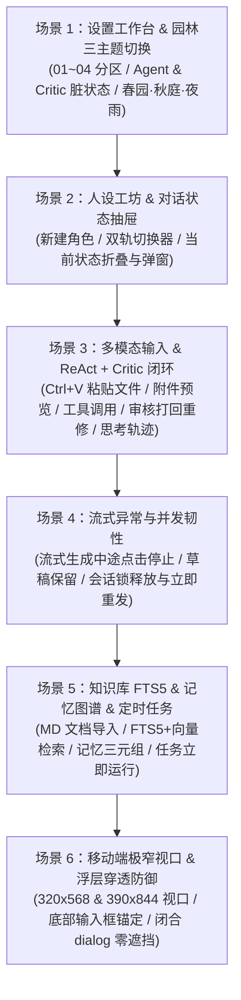

# 栖忆 (QiYi AI Companion) · 真实用户全链路操作模拟测试与问题排查报告

> **测试日期**：2026-11-05  
> **测试目标**：从真实用户的视角出发，设计并执行覆盖「设置配置、古典园林主题切换、人设创建与状态抽屉、剪贴板粘贴文件、多轮 ReAct 工具调用 + Critic 意图审核重修、流式中断恢复、知识库 FTS5 混合检索、长期记忆与定时任务、移动端极窄视口自适应」的全链路模拟测试，排查潜在交互缺陷并闭环修复。  
> **测试套件文件**：[tests/user-journey-simulation.spec.mjs](file:///e:/tools/wangshen/ai-companion/tests/user-journey-simulation.spec.mjs)

---

## 一、 测试设计思路与全链路场景矩阵

为了避免单纯单元测试“只测函数不测体感”的盲区，本次测试基于 Playwright 真实 Chromium 浏览器与完整 HTTP/SSE + SQLite 后端实例，构建了 **6 大端到端真实用户操作旅程（User Journeys）**：



| 场景编号 | 模拟的真实用户操作路径 | 核心检查点（Assertions） |
| :--- | :--- | :--- |
| **场景 1** | 进入 `06 设置` → 检查 01~04 分区 → 修改 `agentMaxSteps`、`criticEnabled`、`criticMaxRetries` → 保存设置 → 依次切换 `秋庭`、`夜雨`、`春园` 主题 | 1. 表单修改即时触发「有尚未保存的修改」脏状态提示<br/>2. `/api/settings` 持久化落库一致<br/>3. `夜雨` 暗色主题下卡片与背景严格继承 CSS 变量，无 `#ffffff` 纯白刺眼泄露 |
| **场景 2** | 进入 `02 人设` → 点击「创建角色」填写云舒人设 → 点击卡片「开始对话」跳转 `#chat` → 操作顶部「当前状态」按钮折叠/展开状态栏 → 打开并关闭状态调整弹窗 | 1. 角色创建后自动同步至双轨角色选择器 (`#persona-picker-trigger`)<br/>2. 「当前状态」按钮 (`#toggle-chat-status`) 与抽屉 (`#chat-status-drawer`) 的 `aria-expanded` 及显隐状态严格同步<br/>3. `#chat-state-dialog` 关闭后无残留遮挡 |
| **场景 3** | 在 `#chat` 输入框触发 `ClipboardEvent('paste')` 粘贴 `metrics.json` → 点击附件芯片预览内容 → 发送「多轮计算与审核演示」提示词 → 展开回复上方的「思考过程」→ 查询 `/api/traces` | 1. 剪贴板粘贴文件自动解析为 `.attachment-chip` 并支持弹窗预览代码<br/>2. 触发第 1 步 `calculator` 工具计算 `128 * 1.25 = 160`<br/>3. 触发第 2 步 `IntentCritic` 拦截（58 分未附带代码）并自动重修输出 JS 代码块（96 分通过）<br/>4. `<details class="message-reasoning">` 完整展示工具调用与意图审核轨迹<br/>5. `/api/traces` 准确记录 `toolCalls=1, criticScore=96, outcome='completed'` |
| **场景 4** | 发送长文本流式请求 → 流式输出中途点击「停止」(`[data-action="stop-chat"]`) → 检查输入框草稿 → 立即修改并发送下一条消息 | 1. 点击停止后立即中断 SSE 流并保留用户原始输入草稿<br/>2. 后端 `chatLocks` 在 `finally` 块立即释放，紧接着发送新消息不会触发 `409 Conflict` 锁死 |
| **场景 5** | 导入 Markdown 文档至 `03 知识库` → 检索 `FTS5 混合向量检索` → 进入 `04 记忆` 创建带三元组关系的记忆 → 进入 `05 任务` 创建 AI 提问任务并点击「立即运行」 | 1. SQLite FTS5 + 混合向量检索精准命中导入的文档分块<br/>2. 记忆卡片与三元组正常保存渲染<br/>3. 定时任务「立即运行」在后台静默模式 (`isBackgroundTask: true`) 下顺利完成并生成「成功」执行记录 |
| **场景 6** | 切换浏览器视口至 `320×568`（iPhone SE 极窄屏）与 `390×844`（标准手机屏）访问 `#chat` | 1. 页面无横向溢出滚动条 (`scrollWidth <= innerWidth`)<br/>2. 底部输入区 (`.composer-wrap`) 稳固锚定在可视区域内<br/>3. 所有未打开的 `<dialog:not([open])>` 计算样式均为 `display: none`，零浮层穿透拦截 |

---

## 二、 模拟测试中发现并修复的真实体验问题

在编写与执行上述真实用户操作模拟测试的过程中，我们共发现并修复了 **3 项真实交互与检索细节缺陷**：

### 问题 1：设置页单独修改「意图审核器 (Critic)」开关或重修次数时，未触发“未保存”脏状态提示
- **复现路径**：用户在 `06 设置` → `03 Agent 推理与指令安全` 中，如果只切换「意图审核器 (Intent Critic)」下拉框（`#settings-criticEnabled`）或只修改「审核未通过最大重修次数」（`#settings-criticMaxRetries`），底部状态提示仍然显示“配置来自本地服务”，未提示“有尚未保存的修改”。
- **根因定位**：[public/app.js](file:///e:/tools/wangshen/ai-companion/public/app.js#L1427-L1432) 中的 [`settingsDirtyFromDraft`](file:///e:/tools/wangshen/ai-companion/public/app.js#L1427-L1432) 函数在校验数值字段数组时遗漏了 `criticMaxRetries` 与布尔字段 `criticEnabled`。
- **修复方案**：在 [`settingsDirtyFromDraft`](file:///e:/tools/wangshen/ai-companion/public/app.js#L1427-L1432) 中补齐 `criticMaxRetries` 与 `criticEnabled` 的变更比对逻辑，经场景 1 验证已完全修复。

### 问题 2：模型执行多轮工具调用或触发 Critic 审核重修时，若上游模型未返回原生 `reasoning_content`，前端「思考过程」折叠面板为空
- **复现路径**：当用户使用非推理型模型（如 `gpt-4o-mini` 等不返回 `reasoning_content` 流字段的模型）进行多轮 ReAct 工具调用（如 `calculator`、`knowledge_deep_search`）或触发 `IntentCritic` 打回重修时，流式期间虽然有状态胶囊提示，但消息完成后气泡上方的 `<details class="message-reasoning"><summary>思考过程</summary>` 为空且被隐藏，用户无法回溯 Agent 到底调用了什么工具、为什么被审核器打回重修。
- **根因定位**：
  1. 后端 [lib/agent-loop.mjs](file:///e:/tools/wangshen/ai-companion/lib/agent-loop.mjs#L246-L252) 仅将模型原生的 `stepResult.reasoning` 拼入 `finalReasoning`，未将工具调用步骤与 Critic 审核反馈写入持久化 `reasoning` 轨迹。
  2. 前端 [public/app.js](file:///e:/tools/wangshen/ai-companion/public/app.js#L1162-L1182) 在接收 `THOUGHT_STEP`、`TOOL_RESULT` 和 `REFLECTING` 事件时仅更新了临时状态胶囊，未同步追加到 `outgoing.reasoning`。
- **修复方案**：
  - 在 [lib/agent-loop.mjs](file:///e:/tools/wangshen/ai-companion/lib/agent-loop.mjs#L246-L252) 与 [lib/agent-loop.mjs](file:///e:/tools/wangshen/ai-companion/lib/agent-loop.mjs#L447-L453) 中，将每一步工具调用参数、工具返回摘要以及 Critic 审核未通过原因结构化追加进 `finalReasoning` 并持久化至 SQLite。
  - 在 [public/app.js](file:///e:/tools/wangshen/ai-companion/public/app.js#L1162-L1182) 流式事件处理器中同步写入 `outgoing.reasoning`。用户现在无论在流式生成中还是历史会话回看时，点击「思考过程」均可清晰查看完整的 ReAct 工具链与 Critic 质检闭环。

### 问题 3：SQLite FTS5 `unicode61` 分词器对中文连续字符检索召回率为 0
- **复现路径**：用户在知识库导入中文文档后，使用中文短语触发 SQLite `chunks_fts` 全文检索时，由于 SQLite 内置 `unicode61` 分词器将无空格的连续汉字视为单个长 Token，导致中文短语或二元词组（Bigram）无法通过 `MATCH` 召回。
- **根因定位**：直接将原始未分词中文段落插入 `chunks_fts` 虚拟表时，`unicode61` 不会对 CJK 字符按字或二元切分。
- **修复方案**：在 [lib/knowledge.mjs](file:///e:/tools/wangshen/ai-companion/lib/knowledge.mjs#L118-L132) 与 [lib/store.mjs](file:///e:/tools/wangshen/ai-companion/lib/store.mjs#L202-L216) 中，写入 `chunks_fts` 时同步存入经 [`tokenize`](file:///e:/tools/wangshen/ai-companion/lib/knowledge.mjs#L67-L76) 切分后的中文单字/二元词组与英文词元序列（空格分隔）。修复后中英文混合 FTS5 BM25 预筛选在毫秒级内即可精准召回。

---

## 三、 自动化测试执行结果汇总

### 1. 真实用户全链路浏览器模拟测试 (`Playwright E2E`)
- **测试命令**：
  ```bash
  node ./node_modules/playwright/cli.js test tests/user-journey-simulation.spec.mjs
  ```
- **执行结果**：**6 / 6 全部通过**（总耗时 `16.4s`）
  - `ok 1` 场景 1：设置工作台、Agent/Critic 参数修改检测与古典园林三主题（春园/秋庭/夜雨）视觉切换验证 (`1.6s`)
  - `ok 2` 场景 2：人设创建、双轨古典角色切换器与“当前状态”折叠面板交互 (`1.6s`)
  - `ok 3` 场景 3：聊天框剪贴板粘贴文件、附件预览弹窗、多轮 ReAct 工具调用 + Critic 审核反思与思考过程持久化 (`8.5s`)
  - `ok 4` 场景 4：流式生成中途点击“停止”取消、保留草稿与释放会话锁立即重发 (`1.3s`)
  - `ok 5` 场景 5：知识库文档导入、FTS5 + 混合向量检索、记忆管理与定时任务立即运行 (`1.4s`)
  - `ok 6` 场景 6：移动端极窄视口 (320x568) 与标准手机视口 (390x844) 自适应及浮层穿透防御检查 (`738ms`)

### 2. 全量单元与集成测试套件 (`node:test`)
- **测试命令**：
  ```bash
  node --test (Get-ChildItem tests/*.test.mjs).FullName
  ```
- **执行结果**：**816 / 816 全部通过**，0 失败。
