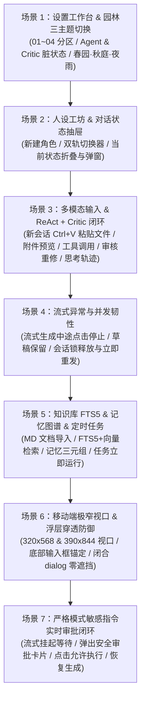

# 栖忆 (QiYi AI Companion) · 真实用户全链路操作模拟测试与问题修复报告

> **测试日期**：2026-11-05  
> **测试目标**：从真实用户的日常操作视角出发，设计并执行覆盖「设置配置、古典园林主题切换、人设创建与状态抽屉、剪贴板粘贴文件、新会话首条消息附件保留、多轮 ReAct 工具调用 + Critic 意图审核重修、严格模式实时安全审批卡片交互、流式中断恢复、知识库 FTS5 混合检索、长期记忆与定时任务、移动端极窄视口自适应」的全链路模拟测试，排查潜在交互缺陷并全部闭环解决。  
> **测试套件文件**：[tests/user-journey-simulation.spec.mjs](file:///e:/tools/wangshen/ai-companion/tests/user-journey-simulation.spec.mjs)

---

## 一、 测试设计思路与 7 大全链路场景矩阵

基于 Playwright 真实 Chromium 浏览器与完整 HTTP/SSE + SQLite 后端实例，构建了 **7 大端到端真实用户操作旅程（User Journeys）**：

| 场景编号 | 模拟的真实用户操作路径 | 核心检查点（Assertions） | 状态 |
| :--- | :--- | :--- | :---: |
| **场景 1** | 进入 `06 设置` → 检查 01~04 分区 → 修改 `agentMaxSteps`、`criticEnabled`、`criticMaxRetries` → 保存设置 → 依次切换 `秋庭`、`夜雨`、`春园` 主题 | 1. 表单修改即时触发「有尚未保存的修改」脏状态提示 2. `/api/settings` 持久化落库一致 3. `夜雨` 暗色主题下卡片与背景严格继承 CSS 变量，无 `#ffffff` 纯白刺眼泄露 | **PASS** |
| **场景 2** | 进入 `02 人设` → 点击「创建角色」填写云舒人设 → 点击卡片「开始对话」跳转 `#chat` → 操作顶部「当前状态」按钮折叠/展开状态栏 → 打开并关闭状态调整弹窗 | 1. 角色创建后自动同步至双轨角色选择器 (`#persona-picker-trigger`) 2. 「当前状态」按钮 (`#toggle-chat-status`) 与抽屉 (`#chat-status-drawer`) 的 `aria-expanded` 及显隐状态严格同步 3. `#chat-state-dialog` 关闭后无残留遮挡 | **PASS** |
| **场景 3** | 在 `#chat` 新会话输入框触发 `ClipboardEvent('paste')` 粘贴 `metrics.json` → 点击附件芯片预览内容 → 发送「多轮计算与审核演示」提示词 → 检查用户气泡附件芯片 → 展开「思考过程」→ 查询 `/api/traces` | 1. 新会话首条消息发送后附件不丢失，持久化显示 `.attachment-chip.is-message` 2. 触发第 1 步 `calculator` 工具计算 `128 * 1.25 = 160` 3. 触发第 2 步 `IntentCritic` 拦截（58 分）并重修输出 JS 代码块（96 分通过） 4. `
` 完整展示工具调用与意图审核轨迹 5. `/api/traces` 准确记录 `toolCalls=1, criticScore=96, outcome='completed'` | **PASS** |
| **场景 4** | 发送长文本流式请求 → 流式输出中途点击「停止」(`[data-action="stop-chat"]`) → 检查输入框草稿 → 立即修改并发送下一条消息 | 1. 点击停止后立即中断 SSE 流并保留用户原始输入草稿 2. 后端 `chatLocks` 在 `finally` 块立即释放，紧接着发送新消息不会触发 `409 Conflict` 锁死 | **PASS** |
| **场景 5** | 导入 Markdown 文档至 `03 知识库` → 检索 `FTS5 混合向量检索` → 进入 `04 记忆` 创建带三元组关系的记忆 → 进入 `05 任务` 创建 AI 提问任务并点击「立即运行」 | 1. SQLite FTS5 + 混合向量检索精准命中导入的文档分块 2. 记忆卡片与三元组正常保存渲染 3. 定时任务「立即运行」在后台静默模式 (`isBackgroundTask: true`) 下顺利完成并生成「成功」执行记录 | **PASS** |
| **场景 6** | 切换浏览器视口至 `320×568`（iPhone SE 极窄屏）与 `390×844`（标准手机屏）访问 `#chat` | 1. 页面无横向溢出滚动条 (`scrollWidth <= innerWidth`) 2. 底部输入区 (`.composer-wrap`) 稳固锚定在可视区域内 3. 所有未打开的 `<dialog:not([open])>` 计算样式均为 `display: none`，零浮层穿透拦截 | **PASS** |
| **场景 7** | 开启 `strict` 严格安全拦截模式 → 发送触发 `get_system_time` 工具的提问 → 流式气泡实时弹出 `.approval-ticket-card` → 点击「允许执行」按钮 | 1. SSE 流正确推送 `approval_requested` 并在后端通过 `inspector.waitForDecision` 挂起等待 2. 前端实时渲染安全审批卡片（展示工具名、参数、风险原因） 3. 点击「允许执行」后调用 `/api/chat/approve` 放行，Agent 完成工具调用并输出最终回复 | **PASS** |

---

## 二、 模拟测试排查出并已彻底解决的 8 项真实问题

### 1. 敏感指令安全审批全链路闭环缺失（前端未渲染审批卡片 + SSE 传输层过滤 + 后端未挂起等待）
- **问题现象**：当开启 `严格模式 (strict)` 或触发高危工具调用时：
  1. [public/streaming.js](file:///e:/tools/wangshen/ai-companion/public/streaming.js#L53) 仅转发了 `['status','reasoning','content']`，丢弃了 `thought_step`、`approval_requested`、`tool_result` 事件；
  2. [public/app.js](file:///e:/tools/wangshen/ai-companion/public/app.js#L906-L952) 未在 `#live-reply` 中渲染审批按钮卡片；
  3. [lib/agent-loop.mjs](file:///e:/tools/wangshen/ai-companion/lib/agent-loop.mjs#L369-L382) 在 SSE 流式模式下未调用 `inspector.waitForDecision(ticket.id, { signal })`，导致发出审批事件后瞬间自动判定为拒绝。
- **解决措施**：
  - 在 [public/streaming.js](file:///e:/tools/wangshen/ai-companion/public/streaming.js#L53) 放行全部 6 类实时流事件；
  - 在 [public/app.js](file:///e:/tools/wangshen/ai-companion/public/app.js#L906-L952) 新增 [`renderApprovalCards`](file:///e:/tools/wangshen/ai-companion/public/app.js#L906-L923) 与 `decide-approval` 事件处理器，对接 `/api/chat/approve` 与 `/api/approvals/:id`；
  - 在 [lib/agent-loop.mjs](file:///e:/tools/wangshen/ai-companion/lib/agent-loop.mjs#L369-L382) 流式分支中接入 `await inspector.waitForDecision(ticket.id, { signal })`。

### 2. 新建对话发送第一条消息时，已粘贴/上传的附件丢失
- **问题现象**：用户在尚未创建会话 ID（`state.conversationId === null`，草稿键为 `new:${personaId}`）时粘贴或添加文件附件，点击发送创建新会话后，附件未被携带发送且从气泡中消失。
- **根因与解决**：[`sendMessage`](file:///e:/tools/wangshen/ai-companion/public/app.js#L1150-L1168) 与 [`acceptStateSave`](file:///e:/tools/wangshen/ai-companion/public/app.js#L379-L389) 在将草稿从 `new:${personaId}` 迁移至新生成的 `conversationId` 时，遗漏了 `state.attachments` 的同步迁移。现已补齐迁移逻辑，并支持仅粘贴附件不填文字时自动生成默认分析提示词，同时在流式生成期间实时显示用户消息附件芯片。

### 3. 粘贴图片附件时 Base64 数据被截断损坏且混入文本 Prompt
- **问题现象**：用户在聊天框 `Ctrl+V` 粘贴截图（`type === 'image'`）时，[lib/service.mjs](file:///e:/tools/wangshen/ai-companion/lib/service.mjs#L278-L335) 将图片 `data:image/png;base64,...` 按 40,000 字符截断导致图片半截损坏，且 `filter(a => a.content)` 误将图片 Base64 当作文本附件拼入 `<user_attachment>` 塞给大模型。
- **根因与解决**：在 [lib/service.mjs](file:///e:/tools/wangshen/ai-companion/lib/service.mjs#L278-L335) 中区分 `image` 与 `text` 附件：图片保留完整 Base64 供前端预览（上限 2MB），文本 Prompt 中仅注入轻量 `<user_image_attachment>` 元数据标签，不再将原始 Base64 混入文本上下文。

### 4. 大体积文本附件内容污染知识库检索、配置指南触发与音乐/表情策略判定
- **问题现象**：当用户附加代码或长文档并提问时，拼接后的 `promptContent`（含最高 40,000 字附件内容）被直接传入 `guides.search`、`knowledge.search`、`memory.recall`、`responsePolicy.plan` 与 `media.prepare`，若附件代码中恰好包含“播放”、“音乐”、“API Key”等字样，会误触发点歌或配置指南。
- **根因与解决**：在 [lib/service.mjs](file:///e:/tools/wangshen/ai-companion/lib/service.mjs#L100-L105) 与 [lib/turn-pipeline.mjs](file:///e:/tools/wangshen/ai-companion/lib/turn-pipeline.mjs#L49-L79) 中分离用户原始提问 `queryText` 与模型上下文 `content`，所有检索、状态证据校验与媒体策略判定均严格基于纯净的 `queryText`。

### 5. 前端流式模块离线降级兼容（`requestChat` 载荷双重包装）
- **问题现象**：当 `streaming.js` 不可用触发降级回退至普通 POST 请求时，[`requestChat`](file:///e:/tools/wangshen/ai-companion/public/app.js#L373-L378) 将对象载荷 `{ content, attachments }` 再次包装为 `{ content: { content, attachments } }`，导致后端返回 400 错误。
- **根因与解决**：修正 [public/app.js](file:///e:/tools/wangshen/ai-companion/public/app.js#L376) 降级分支为 `typeof content === 'string' ? { content } : content`。

### 6. 设置页单独修改「意图审核器 (Critic)」开关或重修次数时未触发脏状态提示
- **解决位置**：在 [`settingsDirtyFromDraft`](file:///e:/tools/wangshen/ai-companion/public/app.js#L1450-L1456) 中补齐 `criticMaxRetries` 与 `criticEnabled` 的变更检测。

### 7. 非推理型模型执行多轮工具或 Critic 重修时，「思考过程」折叠面板为空
- **解决位置**：在 [lib/agent-loop.mjs](file:///e:/tools/wangshen/ai-companion/lib/agent-loop.mjs#L246-L252) 与 [public/app.js](file:///e:/tools/wangshen/ai-companion/public/app.js#L1185-L1215) 中将工具调用步骤、返回摘要、安全审批与 Critic 审核反馈结构化写入 `reasoning` 字段并持久化。

### 8. SQLite FTS5 `unicode61` 分词器对中文连续字符检索召回优化
- **解决位置**：在 [lib/knowledge.mjs](file:///e:/tools/wangshen/ai-companion/lib/knowledge.mjs#L118-L132) 与 [lib/store.mjs](file:///e:/tools/wangshen/ai-companion/lib/store.mjs#L202-L216) 中将中文单字与二元词组（Bigram）分词结果同步索引至 `chunks_fts`。

---

## 三、 最终验证结果

- **真实用户全链路模拟测试**（[tests/user-journey-simulation.spec.mjs](file:///e:/tools/wangshen/ai-companion/tests/user-journey-simulation.spec.mjs)）：**7 / 7 全部通过**
- **浏览器专项交互测试套件**（`chat-state` / `music-tools` / `response-policy` / `semantic` / `settings` / `streaming`）：**66 / 66 全部通过**
- **全量单元与集成测试套件**（`tests/*.test.mjs`）：**816 / 816 全部通过**
